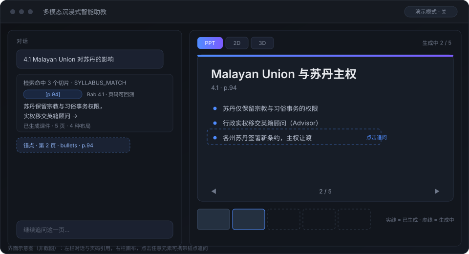
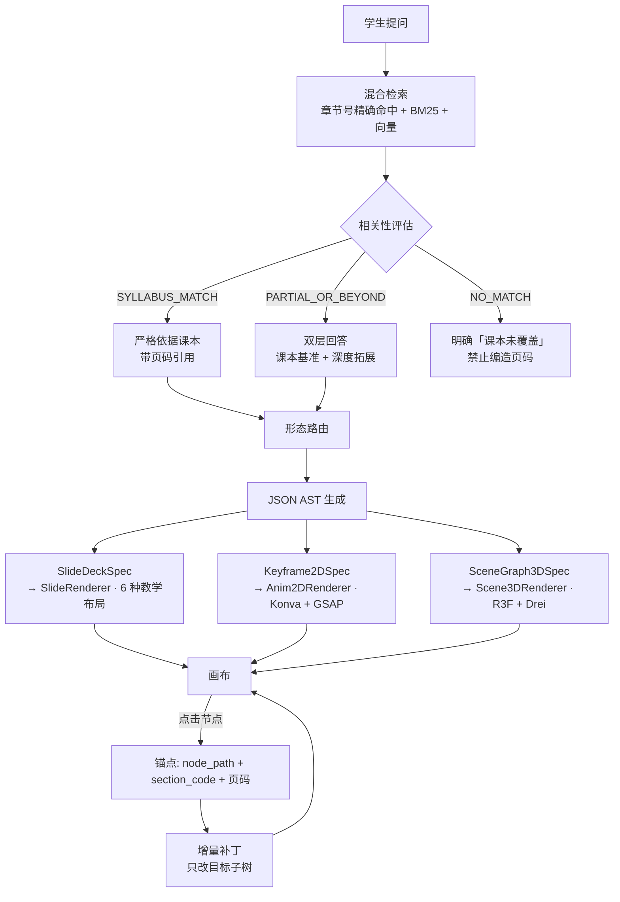

# 多模态沉浸式智能助教

> 上传一本教材 PDF，用对话让它把知识点画出来 —— **PPT / 2D 推演动画 / 3D 空间场景**，然后点画布上任意一页、一个元素、一个部件继续追问，系统只改那一处。

<p align="center">
  
</p>

<p align="center">
  <sub>界面示意图（非截图）。左：对话与 <code>[p.94]</code> 页码引用 · 右：画布与缩略图条 · 点元素自动生成锚点</sub>
</p>

| | |
|---|---|
| **状态** | P0 全部交付，真实 DeepSeek 链路已实测 |
| **测试** | 后端 356 · 前端 153 · 端到端冒烟 31 |
| **整轮耗时** | 66.3s → **18.13s**（P50，n=15） |
| **技术栈** | Python 3.13 · FastAPI · React 19 · TypeScript · three.js |
| **跑起来** | 双击 `1. 启动网页端(Windows).bat`，无需 API Key |

---

## 它解决什么问题

传统 AI 助教是「聊天框 + 一段文字」。这个项目的判断是：**纯文字讲不清结构和过程**。

历史课本里的疆域变迁、物理里的受力分解、生物里的代谢流程 —— 文字描述再多，也不如一张会动的图。但通用 AI 生成的图和代码十次有八次是错的：穿模、材质丢失、语法崩溃。

所以这里做了两件事：

1. **把回答形态扩展成三种**：PPT（离散有序的知识点）、2D 动画（随时间演变的过程）、3D 场景（需要空间想象的结构），由系统按问题性质自动判断该用哪种。
2. **产物是「活的」**：生成完不是一张静态图，而是可交互的 AST —— 点某一页追问，只改那一页，其余页面字节级不变。

---

## 三个和普通 AI 聊天不一样的地方

| | 普通 AI 对话 | 这个项目 |
|---|---|---|
| **依据** | 自由发挥，页码靠编 | **严格锚定教材**：每条事实带页码引用，检索不到就明说「课本未覆盖」，**禁止编造页码** |
| **形态** | 只有文字 | **形态由系统判断**：离散知识点→PPT，随时间演变→2D 动画，需要空间想象→3D |
| **修改** | 重答一遍 | **增量补丁**：点画布节点追问，只改目标子树，其余节点字节级不变 |

---

## 核心设计：LLM 只填 JSON，不写渲染代码

这是整个系统稳定性的根基 —— **禁止 LLM 直接生成 HTML / Three.js 源码**。



四种工程设计模式（详见 [`docs/00-源文档/ARCHITECTURE.md`](docs/00-源文档/ARCHITECTURE.md)）：

1. **受控 DSL 驱动渲染**（策略模式）— LLM 填 JSON，前端策略分发渲染，零编译等待、100% 不崩
2. **双轨知识路由 + 自纠错检索**（CRAG）— 课本内严格依据 vs 超纲拓展，边界清晰
3. **画布增量补丁**（JSON-Patch）— 追问只改目标子树
4. **节点锚点双向绑定** — 点画布元素自动携带 `node_path` + `section_code` + 页码回填输入框

---

## 功能

**教材与检索**
- PDF 上传与解析：逐页文本抽取 + 章节号正则识别，生成 3 级目录树（113 页 ≈ 0.4 秒）
- 混合检索：章节号精确命中 + BM25 + 向量，三态评估决定回答策略
- 页码可回溯：`source_ref` 页码落在检索命中区间内，越界即被钳制剥离

**产物生成**
- 三种形态：PPT（6 种教学布局）· 2D 关键帧动画 · 3D 场景（父子树 + 机位巡游）
- 契约驱动：Pydantic 强校验 + 失败重试 + 降级到演示生成器
- 正文与产物**并行生成**，SSE 事件顺序不变

**画布交互**
- 双栏工作区（可拖拽分栏）· 缩略图条 · 版本历史
- 点任意元素生成锚点 → 追问 → 只改那一处
- 版本 append-only，历史版本可查看、不可改写

**工程能力**
- **演示模式**：没有 API Key 也能完整跑通全链路（内置确定性生成器，界面显示黄标）
- 一键启动脚本（Windows `.bat` / macOS-Linux `.sh`）
- PWA 可安装为桌面应用
- 21 个 REST 端点 + 8 类 SSE 事件，契约前后端镜像

---

## 快速开始

### 一键启动（推荐）

| 平台 | 操作 |
|---|---|
| **Windows** | 双击根目录的 **`1. 启动网页端(Windows).bat`** |
| **macOS / Linux** | `chmod +x "2. 启动网页端(Mac-Linux).sh" && ./"2. 启动网页端(Mac-Linux).sh"` |

脚本会自动：检查 Python/Node → 首次运行建虚拟环境装依赖 → 创建 `.env` → 生成样本教材 → 在**两个独立窗口**启动前后端 → 打开浏览器。

- 后端窗口标题：`智能助教 · 后端 :8000`；前端窗口标题：`智能助教 · 前端 :5173`
- **关闭这两个窗口即停止服务**
- 首次运行需下载依赖（约 3~5 分钟），之后几秒启动

> **不配 API Key 也能用**：留空即进入演示模式，用内置确定性生成器，全链路可跑通，只是产物内容是模板填充的。

### 手动启动

```bash
# 后端
cd backend
python -m venv .venv
.venv\Scripts\activate          # Windows；macOS/Linux: source .venv/bin/activate
pip install -r requirements.txt
cp .env.example .env            # 填 LLM_API_KEY 即进入真实模式
uvicorn app.main:app --reload --port 8000

# 前端（另开一个终端）
cd frontend
npm install
npm run dev                     # http://localhost:5173
```

健康检查：`http://127.0.0.1:8000/api/health` 应返回 `{"code":"OK", ...}`，`/docs` 有完整 OpenAPI。

> **端口注意**：vite 默认绑 `::1`，请用 `localhost` 而非 `127.0.0.1` 访问前端。

### 生成样本教材

```bash
cd backend && python scripts/make_sample_pdf.py
# 生成 data/sample_textbook.pdf（113 页，5 章 / 15 节 / 45 小节，3 级层级）
```

---

## 配置

全部变量见 [`backend/.env.example`](backend/.env.example)，常用项：

| 变量 | 默认值 | 说明 |
|---|---|---|
| `LLM_BASE_URL` | `https://api.openai.com/v1` | OpenAI 兼容端点（DeepSeek / 通义 / 本地 vLLM 均可） |
| `LLM_API_KEY` | 空 | **留空 = 演示模式**，全链路仍可跑通 |
| `LLM_MODEL_ROUTER` | `gpt-4o-mini` | 轻量档：正文流式、路由、评估 |
| `LLM_MODEL_ARTIFACT` | `deepseek-flash` | 产物（结构化 AST）生成档位。**留空 = 跟随 `LLM_MODEL_GENERATOR`** |
| `LLM_MODEL_ARTIFACT_BY_TYPE` | 空 | 分形态覆盖，如 `anim_2d=deepseek-v4-pro`；键拼错启动即报错 |
| `ARTIFACT_PARALLEL_ENABLED` | `true` | 关闭后回到串行（正文流完再生成产物） |
| `ARTIFACT_FORK_MODE` | `after_first_token` | 产物请求 fork 时刻；`immediate` 需 A/B 通过才可启用 |
| `GRADER_CONTENT_HIT_MIN_RATIO` | `0.45` | 实词命中率门槛，低于它判「课本未覆盖」。**换教材必须重标** |
| `DATABASE_URL` | `sqlite+aiosqlite:///./data/app.db` | 换成 `postgresql+asyncpg://...` 即切 PG + pgvector |

**为什么分两个模型档位**：正文要的是低延迟（TTFT 是验收指标），产物要的是结构准确性。实测把产物生成从重档换到轻量档，契约一次通过率不变、耗时 55.5s → 10.1s。

---

## 测试与验收

```bash
# 后端 356 个用例（约 35 秒）
cd backend && ./.venv/Scripts/python.exe -m pytest tests -q

# 前端 153 个用例
cd frontend && npm test

# 前端类型检查 + 构建
cd frontend && npm run typecheck && npm run build

# 端到端冒烟 31 项（需先起后端在 8123）
cd backend && ./.venv/Scripts/python.exe -m uvicorn app.main:app --port 8123
python scripts/e2e_smoke.py

# 真实 LLM 链路验证（消耗 token）
cd backend && ./.venv/Scripts/python.exe ../scripts/real_llm_check.py
```

> **跑冒烟前请确认处于演示模式**（`LLM_API_KEY` 置空），否则会打真实链路消耗配额。
> 已知：冒烟有约 4% 概率偶发失败，根因是一个**改动前就存在**的竞态（建工作区返回 200 后事务尚未提交），重跑即过，详见 [`docs/00-源文档/IMPL-NOTES.md`](docs/00-源文档/IMPL-NOTES.md) E12。

---

## 实测数据

真实 DeepSeek 链路，样本教材 113 页 / 65 切片，5 页 PPT 回合：

| 指标 | 数值 | 说明 |
|---|---|---|
| 首 token（TTFT） | **4.14s**（P50，n=15） | 验收门禁 ≤ 5.08s |
| 完整产物就绪 | **18.13s**（P50，n=15） | 优化前 66.3s（n=3），降 73%；目标 18s，**超 0.7%** |
| 完整产物 P90 | **24.54s** | 长尾来自产物输出量，非网络 |
| 演示模式 TTFT | 7ms | 内置确定性生成器 |
| 113 页 PDF 解析 | 0.41s | 预算 60s |
| 增量补丁影响面 | 仅目标子树 | 其余节点字节级不变 |
| 契约一次通过率 | 23/24 回合 | 1 次重试后通过，0 次降级 |

耗时优化的完整数据、被否掉的三个方案、以及「为什么差 0.7% 不追」，见 [`docs/increments/fork-mode-ab.md`](docs/increments/fork-mode-ab.md)。

---

## 目录结构

```
.
├── backend/                    # FastAPI · 7 张表 · 3 种 AST 契约 · 21 个端点
│   ├── app/
│   │   ├── schemas/artifacts.py    # ★ 三种 JSON AST 契约（核心）
│   │   ├── schemas/chat.py         # 8 类 SSE 事件契约
│   │   ├── services/agent_engine.py# CRAG 主流程 + 提示词契约
│   │   ├── services/retriever.py   # 混合检索 + 三态评估
│   │   ├── services/patch_engine.py# 增量补丁
│   │   └── api/                    # workspaces / chat_stream / artifacts
│   └── tests/                      # 356 个用例
├── frontend/                   # React 19 · Vite 7 · TS
│   └── src/
│       ├── components/canvas/      # 三种渲染器 + 6 种 PPT 布局
│       ├── hooks/useChatStream.ts  # SSE 流 + 事件归约
│       └── lib/                    # jsonPointer / fingerprint / theme
├── docs/
│   ├── index.html              # ★ 文档站入口（23 篇 HTML）
│   ├── 00-源文档/              # 项目级基线文档（SPEC/PRD/ARCHITECTURE/IMPL-NOTES/QA 报告 + 2 张 mermaid）
│   ├── 01-快速开始/ … 06-项目档案/  # 按读者重组的 HTML 文档
│   ├── increments/             # 单次迭代的过程记录（只增不改）
│   └── assets/                 # 共享样式与配图
├── scripts/                    # 启动、冒烟、真实链路验证、性能剖析
├── HANDOVER.md                 # ★ 接手开发先读这个
├── NEXT-ACTION.md              # 当前待办与交接（给下一位 AI）
└── README.md
```

---

## 文档地图

**入口：[`docs/index.html`](docs/index.html)** —— 浏览器直接打开，无需启动服务。

| 我是谁 | 读什么 |
|---|---|
| **第一次看到这个项目** | 本 README → [`01-快速开始`](docs/01-快速开始/1.%20这个项目是什么.html) |
| **想跑起来用** | [`02-用户手册`](docs/02-用户手册/1.%20上传你的第一本教材.html)（4 篇，无需技术背景） |
| **要改代码** | [`HANDOVER.md`](HANDOVER.md) → [`04-开发指南`](docs/04-开发指南/1.%20一次提问的完整旅程.html) |
| **要理解设计** | [`03-架构设计`](docs/03-架构设计/1.%20系统总览.html) + [`docs/00-源文档/ARCHITECTURE.md`](docs/00-源文档/ARCHITECTURE.md) |
| **要部署运维** | [`05-运维部署`](docs/05-运维部署/1.%20部署方案.html) |
| **AI 接手开发** | `HANDOVER.md` → [`docs/00-源文档/IMPL-NOTES.md`](docs/00-源文档/IMPL-NOTES.md) → `docs/increments/` |

**`docs/00-源文档/IMPL-NOTES.md` 是最该先读的一份** —— 它记的是「为什么这么写」，比「写了什么」更能防止你把已经修好的 bug 改回去。里面每条都是踩过的坑，带实测数据。

---

## 已知限制

| 项 | 说明 |
|---|---|
| **逐页页码对应未达成** | 页码不再编造到检索区间外（实测 30/30 在区间内），但同一份课件所有页倾向共用第一条事实的页码。加提示词规则实测无效（91.4% → 93.3%）已回退。真修需要让 slide 与 fact 建立结构对应 |
| **完整产物 18.13s，未达 18s 目标** | 超 0.7%，落在红线 20s 内。P90 24.54s。唯一杠杆是压产物输出长尾，两条候选都改变产品行为，见 `fork-mode-ab.md` 第八节 |
| **TTFT P90 9.77s** | P50 4.14s 达标，但 15 次里 3 次超 8s（上游抖动为主）。与性能改造无关，建议单独立项 |
| **建工作区竞态（改动前就有）** | 返回 200 后紧跟的请求偶发 404，实测 13/300 ≈ 4.3%。根因是事务 commit 在响应之后 —— 不只是测试抖动，崩溃时会真丢数据 |
| **页数不由 schema 校验** | `slides` 是 `min_length=1`，页数约束只在提示词里。任何输出不完整都会产出「通过校验的残页课件」，系统不报警 |
| **PostgreSQL 模式未实测** | 全部测试跑在 SQLite，`PgVectorStore` 无自动化覆盖 |
| **扫描版 PDF 不支持** | 只支持带文本层的 PDF，OCR 属 P1 |
| **无登录体系** | 单用户设计，公网部署前必须加认证，否则任何人都能用你的 API Key 烧钱 |
| **6 种 PPT 布局 / 2D / 3D 渲染无自动化回归** | 目前只有人工验证，补 Playwright 可变成可回归的 |
| **从未部署过** | 无目标环境，TTFT 的绝对达标只能记「未验证」 |

---

## 路线图

**P1（按性价比排序）**
- 压产物长尾：约束讲解字数（预计省 2.9~3.5s，需产品确认「讲解变短可接受」）
- 逐页页码对应：让 slide 与 fact 建立结构对应
- 修建工作区竞态 + 补页数后校验
- PPT 导出 PDF / 图片
- 扫描版 PDF 的 OCR

**P2**
- 跨文档对比（两本教材同主题对照）· 学习进度追踪 · 错题本
- 语音输入 · 多人协作 · 教师端班级看板 · 移动端适配

---

## 开发约定

**改动代码前必读 [`docs/00-源文档/IMPL-NOTES.md`](docs/00-源文档/IMPL-NOTES.md)**。几条最容易踩的：

| 约定 | 不遵守的后果 |
|---|---|
| `update_node` 的 payload 是**局部字段**，必须字段级 merge | 整体替换会丢掉 `node_id`/`layout`/`title`，渲染器当场崩 |
| 契约演进**只能加字段**，不能改语义 | 旧数据全部失效且无法批量迁移 |
| 「课本是否覆盖」看**实词命中率**，不看分数 | 分数没有排序语义，调阈值会同时误判和漏判 |
| `insert`/`delete` 的 `changed_paths` 声明到**父列表层** | 声明到元素层会让「非锚定不变」断言永远失效 |
| `focus_camera` **不写入 spec** | 视角进 spec 会让同一内容产生不同指纹，版本比对失效 |

**提交前跑这两条，都应为 0 failed**（从仓库根目录执行，两条可一起粘）：

```bash
(cd backend && .venv/Scripts/python.exe -m pytest tests -q --basetemp=/tmp/pt_$(date +%s))
(cd frontend && npm test)
```

> 当前基线：后端 **404 passed**（另有 1 条计时敏感用例默认不跑，见下）、前端 **158 passed**。
> **数字会随迭代增长，判断标准是 `0 failed`，不是「条数对不对」**；不是绿的先修基线。
>
> 两条容易踩的：
> - **必须带 `--basetemp`**，否则会因清理 `garbage-*` 目录被拦而得到 `EXIT=1` 但 `0 FAILED` 的假红。
> - 有 1 条 `test_parallel_is_actually_parallel` 标了 `slow`（墙钟断言在机器有并发负载时会红），
>   默认不跑；改了 fork 时机 / join 顺序 / `_parallel_budget` 时用 `pytest -m slow` 单独跑它。

**版本锁定是硬约束**：`@react-three/fiber` 必须 v9（v8 与 React 19 不兼容，装了整块 3D 画布白屏）、`react-konva` 必须 19、`tailwindcss` 必须 v3.4、`katex` 必须 0.16 线（0.19 会出现两份 katex 导致公式字体错位）。

---

## 许可

未指定。若要开源请先补 `LICENSE`，并注意 `backend/.env` 含 API Key（已在 `.gitignore` 中忽略）。
