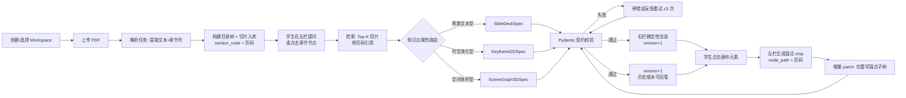
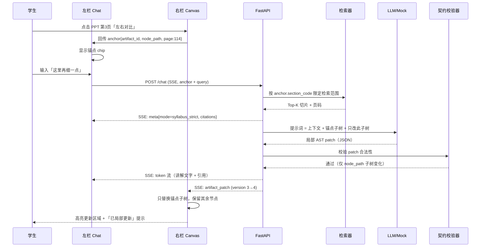
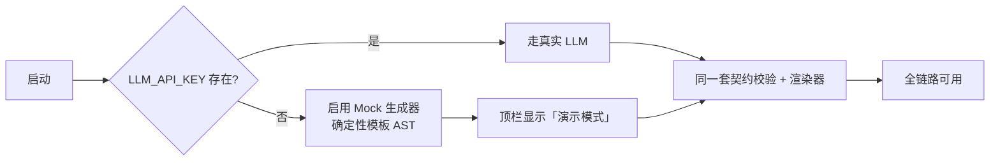

# 多模态沉浸式智能助教 — MVP 产品需求文档（PRD）

| 项 | 内容 |
|---|---|
| 产品名 | 多模态沉浸式智能助教 / 自适应生成式学习工作区（Edu-Spatial Workspace） |
| 文档版本 | v1.0（MVP） |
| 作者 | 许清楚（产品经理） |
| 目标交付 | 单机可跑通的全链路 Demo（无外部服务依赖） |
| 文档状态 | 待架构评审 |

---

## 1. 产品目标与定位

### 1.1 一句话定位

> **不是聊天机器人，而是「对话驱动的富媒体生成式工作区」**：学生上传自己的教材，在左侧对话里提问，右侧画布实时长出一份可点击、可局部重生成的 PPT / 2D 推演动画 / 3D 空间场景。

### 1.2 产品目标（3 个正交目标）

| 编号 | 目标 | 衡量方式 |
|---|---|---|
| G1 | **私有教材可读**：把用户自己的 PDF 变成可检索、可引用的知识结构 | 目录树层级正确率、切片 section_code 命中率 |
| G2 | **讲解形态自适应**：按知识点属性自动选择 PPT / 2D / 3D，而非一律文字回答 | 产物类型路由准确率、三种渲染器均可跑通 |
| G3 | **产物可迭代**：产物是"活的"，点哪改哪，增量 patch 而非整篇重来 | patch 后 AST 差异仅限被点节点子树、版本号自增可回看 |

### 1.3 与"聊天机器人"的差异（产品红线）

| 维度 | 普通聊天机器人 | 本产品 |
|---|---|---|
| 输出形态 | Markdown 文字流 | 结构化 DSL AST → 确定性渲染器 |
| 内容归属 | 模型自由发挥 | 强制标注「课本依据（含页码）」或「超纲拓展」 |
| 迭代方式 | 重新提问、整段重答 | 点画布元素 → 带锚点追问 → 局部 patch |
| 可复用性 | 对话记录易丢失 | Artifact 有版本号，可回看、可对比 |

---

## 2. 目标用户与核心场景

### 2.1 用户画像

**画像 A：备考学生（主要用户）**
- 16–18 岁，马来西亚 SPM / KSSM 体系，Form 4–5。
- 手上有官方课本 PDF（如 Sejarah Form 4 Chapter 4），但课本是静态图文，抽象概念（Malayan Union 的疆域与行政变更）看文字看不懂。
- 痛点：① 不知道考试范围到哪，怕答偏；② 抽象的历史进程/空间结构无法在脑中构建；③ 补习成本高，无法随时追问。
- 关键诉求：**"这页课本到底在讲什么，考试要答什么"**。

**画像 B：补习老师（次要用户 / 内容供给侧）**
- 25–40 岁，带 5–20 人小班，自己做 PPT 备课耗时 2–4 小时/章节。
- 痛点：① 备课重复劳动；② 学生问"为什么"时缺少直观演示素材；③ 需要按章节快速出讲解材料。
- 关键诉求：**"给我一份能直接讲的、基于课本的课件骨架"**。

### 2.2 核心使用场景（用户故事）

| 编号 | 用户故事 |
|---|---|
| US-01 | 作为**备考学生**，我希望上传我的 Sejarah 课本 PDF 后自动看到章节目录树，以便我直接点「4.1 Malayan Union」开始学，而不用自己翻页找。 |
| US-02 | 作为**备考学生**，我希望问到"Malayan Union 对马来苏丹的影响"时，系统给出一个 2D 疆域演变动画并标注课本页码，以便我分清哪些是课本原话、哪些是拓展，考试不答偏。 |
| US-03 | 作为**备考学生**，我希望在 PPT 第 3 页看到"联邦结构"时直接点击那一页问"这里再细一点"，系统只重做这一页，以便我不丢掉已经看懂的部分。 |
| US-04 | 作为**补习老师**，我希望输入"给我 4.2 的讲解课件"，系统自动产出 6 页 PPT + 一个空间结构 3D 场景，以便我 10 分钟内完成备课。 |
| US-05 | 作为**首次体验者**，我希望在没有任何 API Key 的情况下也能完整跑一遍上传→生成→追问，以便我先判断产品值不值得用。 |

---

## 3. 需求池

### 3.1 P0（本次必须交付）

| 编号 | 需求 | 验收标准（可测试） |
|---|---|---|
| **P0-01** | **工作区创建与切换**：可新建 workspace、命名、切换、删除；每个 workspace 隔离自己的教材与 Artifact | ① 创建 2 个 workspace 并各上传不同 PDF，切换后目录树与历史 Artifact 互不串台；② 刷新页面后当前 workspace 与最近会话仍恢复（持久化到 DB）；③ 删除 workspace 后其切片与 Artifact 不可再被检索到 |
| **P0-02** | **PDF 上传与解析任务**：支持上传 PDF，返回解析任务状态（pending→parsing→ready/failed）与进度百分比 | ① 上传 ≥100 页 PDF，**60 秒内**状态变为 ready；② 上传非 PDF / 加密 PDF / 0 页文件，返回明确错误码与中文提示，不崩溃；③ 解析期间前端有进度反馈且可取消 |
| **P0-03** | **章节号解析与目录树**：从 PDF 文本中识别章节层级（Chapter N / N.M / N.M.K）并构建可折叠目录树 | ① 对一份 ≥100 页 KSSM 教材，目录树**至少识别出 3 个层级**（如 Chapter 4 → 4.1 → 4.1.2）；② 目录树节点数 ≥ 真实章节数的 90%；③ 点击任一节点可定位到对应页码范围 |
| **P0-04** | **文本切片与入库**：按章节切分为 chunk 并写入向量/关键词索引，每个 chunk 带 `section_code` 与 `page_start/page_end` | ① 切片 `section_code` 命中率 **100%**（不允许出现空 section_code 的 chunk）；② 每个 chunk 的 `page_start/page_end` 可回溯到原 PDF 真实页码；③ 给定查询"Malayan Union 苏丹"，Top-5 检索结果全部来自同一 chapter 且页码正确 |
| **P0-05** | **SSE 流式对话 + 双模式回答**：回答流式输出，且必须区分 `syllabus_strict`（严格课本依据）与 `hybrid_extended`（含超纲拓展） | ① 首字节（TTFT）≤ **3 秒**，流式过程不阻塞 UI；② `syllabus_strict` 回答中**每条事实性陈述**都带 `[p.页码]` 引用，缺失引用即为不通过；③ `hybrid_extended` 回答必须用视觉上可区分的方式标出拓展部分，并在开头声明"含超纲内容"；④ 当检索无命中时，必须降级为"课本未覆盖"提示，禁止编造页码 |
| **P0-06** | **Artifact 类型路由**：根据知识点属性自动判定生成 PPT / 2D / 3D 之一，并允许用户显式指定覆盖 | ① 用 10 条预置测试问句（覆盖三类）验证，路由准确率 ≥ **80%**；② 用户显式说"用 3D"时 100% 遵循用户指定；③ 每次路由在 UI 上展示"为什么选这个形态"的一句话理由 |
| **P0-07** | **PPT Artifact**：LLM 输出 `SlideDeckSpec` JSON，前端用 6 种布局的确定性渲染器渲染 | ① 6 种布局（标题页 / 要点列表 / 左右对比 / 时间轴 / 流程图 / 随堂测验）各至少被渲染成功一次；② 单次生成 ≥5 页，`SlideDeckSpec` 通过 Pydantic 校验且不含任何 HTML/JS 字符串；③ 渲染器对缺字段/超长文本做优雅降级（截断 + 提示），不白屏 |
| **P0-08** | **2D 推演动画 Artifact**：LLM 输出 `Keyframe2DSpec`（关键帧 + 元素 + 补间），前端 React-Konva + GSAP 播放 | ① 动画可播放/暂停/拖拽时间轴/逐帧步进；② 至少支持 3 类语义：疆域变化、路径/航线、受力/流程；③ 每个关键帧可标注课本页码，hover 显示引用；④ 连续拖动时间轴 60 次无内存泄漏或掉帧到 <30fps |
| **P0-09** | **3D 空间场景 Artifact**：LLM 输出 `SceneGraph3DSpec`（节点树 + 变换 + 材质 + 标注点），前端 R3F + Drei 渲染 | ① 场景可轨道旋转/缩放/复位；② 至少 3 个可点击标注点（Annotation），点击后高亮并显示课本引用；③ 首帧加载 ≤ **5 秒**（中等复杂度场景 ≤ 200 节点）；④ 低性能设备可一键降级为静态截图/简化渲染 |
| **P0-10** | **节点锚点追问 + 增量 patch**：点击画布任意元素（PPT 某页 / 2D 某元素 / 3D 某部件）→ 左侧输入框自动带上引用锚点 → 提交后只 patch 该节点子树 | ① 点击后输入框出现可见的锚点 chip（含节点名 + 页码）；② patch 后 AST 差异**仅限被锚定节点的子树**，其余节点字节级不变；③ patch 响应时间 ≤ 同规模全量生成的 50%；④ 取消锚点后可退回全局提问模式 |
| **P0-11** | **Artifact 版本管理**：每次生成/patch 产生 version+1，可回看历史版本 | ① 连续 patch 3 次后 version 依次为 1→2→3→4；② 可在版本列表中切换到任一历史版本并只读预览；③ 历史版本不可被覆盖或删除（除非删除整个 Artifact） |
| **P0-12** | **Mock 降级模式**：未配置 LLM API Key 时，自动切换到内置确定性生成器，全链路可跑通 | ① 清空 `LLM_API_KEY` 后启动，P0-01~P0-11 全部主链路仍可完成；② mock 产物**确定性**：同一输入两次生成，AST 完全一致（便于回归测试）；③ UI 顶部有明确"演示模式（未接入模型）"标识，不可静默伪装成真实生成 |

**P0 合计：12 条。**

### 3.2 P1（本次不做，仅入池）

| 编号 | 需求 | 备注 |
|---|---|---|
| P1-01 | PPT 导出 PDF / 图片 | 依赖渲染器稳定后再做 |
| P1-02 | 多文件跨文档对比（两本教材同主题对照） | 需先有多 workspace 索引能力 |
| P1-03 | 学习进度追踪（章节已学/未学、掌握度） | 需定义掌握度模型 |
| P1-04 | 错题本（随堂测验结果沉淀与重练） | 依赖 P0-07 测验布局 |

### 3.3 P2（远期）

| 编号 | 需求 |
|---|---|
| P2-01 | 语音输入提问（多模态入口） |
| P2-02 | 多人协作（同 workspace 共同编辑画布） |
| P2-03 | 教师端班级看板（学生进度与常见错题聚合） |
| P2-04 | 移动端 / 平板适配 |

---

## 4. 技术约束（已锁定，不可更改）

| 层 | 约束 |
|---|---|
| **契约** | **严格 DSL 契约驱动**。LLM 只允许输出 JSON AST（`SlideDeckSpec` / `Keyframe2DSpec` / `SceneGraph3DSpec`），前端用确定性渲染器渲染。**严禁** LLM 直接生成 HTML / CSS / Three.js 源码；任何非 JSON 输出视为失败并重试。 |
| **前端** | React 19 + TypeScript + Vite + TailwindCSS + Zustand + Allotment（可拖拽分栏） |
| **渲染** | PPT：自定义 JSON 渲染器，固定 **6 种布局**；2D：React-Konva + GSAP；3D：React Three Fiber + Drei |
| **后端** | Python 3.12+ / FastAPI / Pydantic v2 / SQLAlchemy（异步）/ SSE 流式 |
| **数据库** | 默认 **SQLite 开箱即跑**（无外部依赖）；可通过 `DATABASE_URL` 切换到 PostgreSQL + pgvector |
| **LLM** | OpenAI 兼容 API；未配置 Key 时**必须**降级到内置确定性 mock 生成器，保证 demo 可跑通 |

### 4.1 Artifact 路由规则（供 P0-06 实现参考）

| 知识点属性 | 产物 | 判据 |
|---|---|---|
| 概念梳理、时间轴、对比、因果链、随堂测验 | **PPT** | 离散有序信息，文本密度高，需逐条阅读 |
| 疆域变化、航线路径、物理受力、流程机制 | **2D 动画** | 含空间/时间连续演化，有方向与运动 |
| 空间结构、文物形制、地形、解剖模型 | **3D 场景** | 需要深度、体积、方位关系才能理解 |

---

## 5. UI 设计稿

### 5.1 主布局（双栏，Allotment 可拖拽）

```
┌──────────────────────────────────────────────────────────────────────────────┐
│ [Edu-Spatial]  Workspace: ▾ Sejarah F4 ▾   + 新建   │ ⚠ 演示模式(未接入模型)  │
├───────────────────────────┬──────────────────────────────────────────────────┤
│  左栏 Chat (≈380px)        │  右栏 Canvas (flex)                              │
│                           │                                                  │
│ ┌───────────────────────┐ │ ┌──────────────────────────────────────────────┐ │
│ │ 教材面板 (可折叠)      │ │ │ 工具栏: [PPT][2D][3D] │ v3 ▾  │ ⤢  │ ⋯     │ │
│ │ ▾ Chapter 4           │ │ ├──────────────────────────────────────────────┤ │
│ │   ▾ 4.1 Malayan Union │ │ │                                              │ │
│ │     • 4.1.1 起因       │ │ │                                              │ │
│ │     • 4.1.2 影响       │ │ │            ★ Artifact 渲染区 ★              │ │
│ │   ▸ 4.2 ...           │ │ │                                              │ │
│ │ [+ 上传 PDF]  解析中78%│ │ │        (PPT / 2D / 3D 三态之一)              │ │
│ └───────────────────────┘ │ │                                              │ │
│                           │ │                                              │ │
│ ┌───────────────────────┐ │ │                                              │ │
│ │ 消息流 (SSE 流式)      │ │ │                                              │ │
│ │ ┌───────────────────┐ │ │ │                                              │ │
│ │ │ 🧑 4.1 讲了什么？  │ │ │ │                                              │ │
│ │ └───────────────────┘ │ │ │                                              │ │
│ │ ┌───────────────────┐ │ │ └──────────────────────────────────────────────┘ │
│ │ │ 🤖 【课本依据】     │ │ ├──────────────────────────────────────────────┤ │
│ │ │ Malayan Union 于  │ │ │ 底部状态条: 页码 p.112-118 │ 引用 3 处 │ 耗时  │ │
│ │ │ 1946 年成立 [p.112]│ │ └──────────────────────────────────────────────┘ │
│ │ │ ─── 超纲拓展 ───   │ │                                                  │
│ │ │ （灰色/描边区分）   │ │                                                  │
│ │ └───────────────────┘ │ │                                                  │
│ │                       │ │                                                  │
│ ├───────────────────────┤ │                                                  │
│ │ [📎 锚点: p3·对比表 ×] │ │  ← 点击画布元素后出现锚点 chip                │
│ │ ┌───────────────────┬─┐ │                                                  │
│ │ │ 追问或说"学 4.1"… │➤│ │                                                  │
│ │ └───────────────────┴─┘ │                                                  │
│ └───────────────────────┘ │                                                  │
└───────────────────────────┴──────────────────────────────────────────────────┘
```

### 5.2 画布三态差异

**状态 A — PPT（默认态，有翻页导航）**

```
┌──────────────────────────────────────────┐
│ [PPT][2D][3D]      v3 ▾        ⤢      ⋯  │
├──────────────────────────────────────────┤
│                                          │
│   ┌────────────────────────────────┐     │
│   │  4.1 Malayan Union             │     │  ← 第1页 标题页
│   │  ──────────────────────────    │     │
│   │  Sejarah Form 4 · p.112        │     │
│   └────────────────────────────────┘     │
│                                          │
│   ◀  1 / 8  ▶        [缩略图条 ▪▪▪▪▪▪▪▪] │  ← 底部缩略图导航
└──────────────────────────────────────────┘
```
- 元素级点击：点击某一页 → 该页高亮描边 → 左栏出现锚点 chip `p3 · 左右对比`。
- 6 种布局共用一套 grid；超长文本自动降级为 12px + 省略号。

**状态 B — 2D 推演动画（时间轴主导）**

```
┌──────────────────────────────────────────┐
│ [PPT][2D][3D]      v2 ▾        ⤢      ⋯  │
├──────────────────────────────────────────┤
│  ┌────────────────────────────────────┐  │
│  │  [Konva 舞台]                       │  │
│  │   ● 1945 ──▶ ● 1946 ──▶ ● 1948      │  │  ← 元素可点击(带热区)
│  │   柔佛      马来亚联邦    联合邦      │  │
│  │        ⟵ 疆域填充动画 ⟶             │  │
│  └────────────────────────────────────┘  │
├──────────────────────────────────────────┤
│ ▶ ⏸ ⏮ ⏭   ├────●──────────────┤  1.8s/4s │  ← 播放控制 + 时间轴拖拽
│ 关键帧: [1][2][3][4]      标注: p.114    │  ← 关键帧点选 + 当前帧页码
└──────────────────────────────────────────┘
```

**状态 C — 3D 空间场景（视口主导，标注浮层）**

```
┌──────────────────────────────────────────┐
│ [PPT][2D][3D]      v1 ▾    ⟲复位  ⤢   ⋯  │
├──────────────────────────────────────────┤
│  ┌────────────────────────────────────┐  │
│  │        ╭─────╮  ① 建筑主体          │  │  ← 标注点可点击
│  │       ╱       ╲                     │  │
│  │      │  R3F    │  ② 地形基座        │  │
│  │       ╲       ╱                     │  │
│  │        ╰─────╯   ③ 附属结构         │  │
│  │   [拖拽旋转 · 滚轮缩放 · 右键平移]  │  │
│  └────────────────────────────────────┘  │
├──────────────────────────────────────────┤
│ 选中: ① 建筑主体 │ 课本依据 p.121 │ [简化渲染] │
└──────────────────────────────────────────┘
```

### 5.3 通用状态规范

| 状态 | 表现 |
|---|---|
| 空画布 | 居中提示"上传教材后，问我任何一章节"，附 3 个示例问句快捷按钮 |
| 生成中 | 骨架屏 + 阶段文案（解析知识点 → 生成 AST → 校验 → 渲染），可中断 |
| 校验失败 | 卡片提示"生成结果未通过契约校验，已自动重试（2/3）"，不白屏 |
| 无课本依据 | 明确提示"该问题课本未覆盖"，并区分给出拓展内容 |
| 演示模式 | 顶栏常驻黄色标识，禁止静默伪装 |

---

## 6. 关键交互流程

### 6.1 主链路：上传 → 学习 → 生成 → 追问 → patch



### 6.2 时序图：一次带锚点的追问



### 6.3 降级链路（无 LLM Key）



---

## 7. 非目标（本次明确不做）

| 不做 | 原因 |
|---|---|
| 竞品分析、市场规模测算 | 本 PRD 不做市场研究，聚焦可交付范围 |
| 数据库表结构 / API 详细定义 | 属架构师职责，本文件只约束行为与验收 |
| 任何 LLM 直接生成 HTML / Three.js 源码 | 违反 DSL 契约红线 |
| 用户账号体系、登录、付费 | MVP 单机演示，workspace 即隔离单位 |
| 扫描版 PDF 的 OCR | MVP 仅支持文本层 PDF；扫描件走 P1 |
| 多语言界面（i18n） | 仅中文界面 + 英文教材内容 |
| 移动端 / 平板适配 | P2 |
| 语音输入、多人协作、班级看板 | P2 |
| PPT 导出 PDF、跨文档对比、进度追踪、错题本 | P1 |
| 真实考试评分 / 学习效果量化 | 无数据支撑，不承诺 |
| 离线大模型本地推理 | 超出 MVP 工程成本 |

---

## 8. 待确认问题

| 编号 | 问题 | 建议默认值 |
|---|---|---|
| Q1 | **教材格式边界**：MVP 是否只保证"带文本层的 PDF"？扫描版/图片型 PDF 是否直接拒绝？ | 默认**只支持文本层 PDF**，扫描件返回明确错误提示，OCR 延后到 P1 |
| Q2 | **"超纲拓展"的默认策略**：默认全部走 `syllabus_strict`（更安全，考试不答偏），还是默认 `hybrid_extended`（更丰富）？ | 默认 **`syllabus_strict`**，用户可一键切换"加拓展" |
| Q3 | **patch 粒度上限**：当用户锚定的是顶层节点（如整份 PPT）时，是否允许退化为全量重生成？ | 允许，但需在 UI 明示"将重生成整个 Artifact"，并仍走 version+1 |
| Q4 | **Artifact 持久化范围**：版本历史是否永久保留，还是只保留最近 N 个版本？ | 默认**保留最近 20 个版本**，超出后归档最早版本（仍可查看不可 patch） |
| Q5 | **Demo 数据集**：是否固定内置一份 KSSM Sejarah Form 4 教材作为演示样本（含版权风险）？ | 默认**内置一份自制的公有领域/改写版样本**，避免版权问题；真实教材由用户自行上传 |

---

## 附录：需求编号总览

| 优先级 | 编号范围 | 条数 |
|---|---|---|
| P0 | P0-01 ~ P0-12 | **12** |
| P1 | P1-01 ~ P1-04 | 4 |
| P2 | P2-01 ~ P2-04 | 4 |
