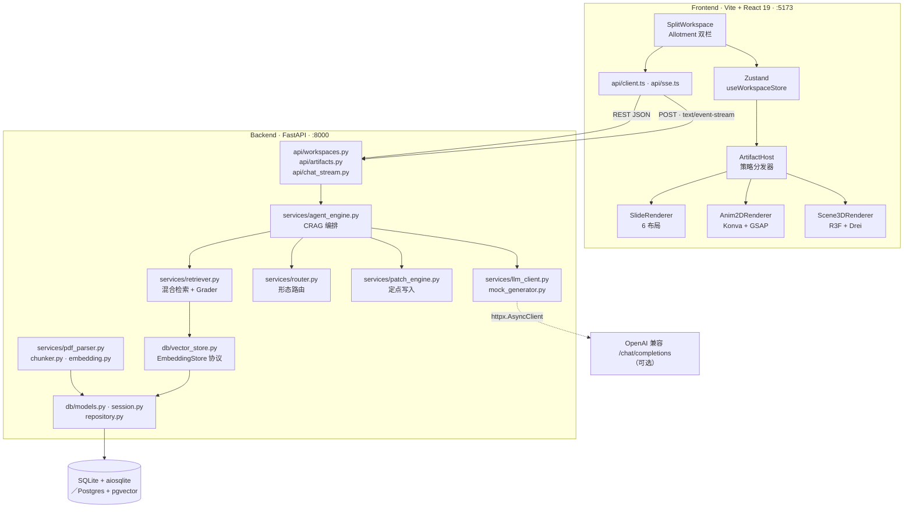
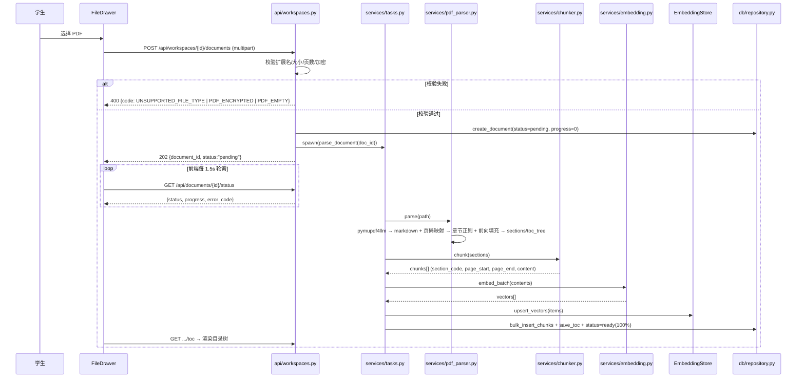
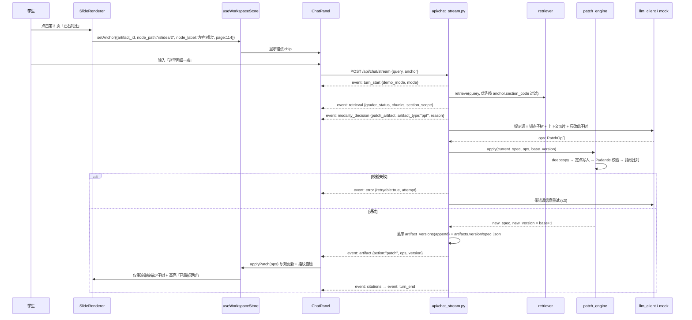
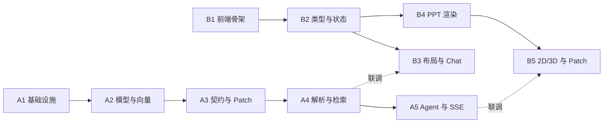

# ARCHITECTURE.md — 多模态沉浸式智能助教 / 系统架构设计与任务分解

| 项 | 内容 |
|---|---|
| 文档版本 | v1.0（MVP 施工图） |
| 作者 | 高见远（架构师） |
| 上游输入 | `docs/PRD.md`（12 条 P0）、`docs/SPEC.md`（原始工程规范，冲突时以 SPEC 为准） |
| 交付目标 | 单机零外部依赖可跑通的全链路 Demo：上传 PDF → 目录树 → 检索 → 路由 → 生成 AST → 渲染 → 锚点 patch → 版本回看 |
| 约束 | 技术栈已锁定，本文档只做落地设计，不重新选型 |

## 1. 实现方案总览

一个 **FastAPI 异步后端 + Vite/React 19 单页前端** 的双进程单机应用。后端把 PDF 解析成「带 `section_code` 与页码的 chunk」写入 SQLite（或 Postgres），用 `EmbeddingStore` 协议把「内存暴力余弦检索」与「pgvector 检索」抽象成同一接口；对话请求走 **POST + SSE** 流式返回，Agent 引擎按「检索 → 相关性评估 → 形态路由 → AST 生成 → Pydantic 强校验 → 失败重试」的固定管线产出 `SlideDeckSpec` / `Keyframe2DSpec` / `SceneGraph3DSpec` 三种 JSON AST。前端不写任何渲染逻辑分支到 LLM，只按 `type` 字段用**策略模式**分发到三个确定性渲染器；画布元素点击后回传 `node_path` 锚点，追问时后端只产出 **PatchOp 列表**，由「深拷贝 + JSON Pointer 定点写入」的补丁执行器落到 AST 上，并用规范化 JSON 指纹证明「未锚定节点字节级不变」。无 `LLM_API_KEY` 时，`MockGenerator` 以**纯函数**方式产出确定性 AST，全链路照跑，顶栏常驻演示模式标识。

**组件拓扑**



## 2. 技术选型与版本锁定

| 层 | 选型 | 版本约束 | 说明 |
|---|---|---|---|
| 后端框架 | fastapi + uvicorn[standard] + sse-starlette | 最新稳定 | 原生 async；`EventSourceResponse` 提供心跳与断连取消 |
| 契约/配置 | pydantic `>=2.9` + pydantic-settings | `>=2.9` | v2 必须；`model_json_schema()` 用于把 Schema 注入 System Prompt；`.env` 加载 `LLM_*` / `DATABASE_URL` |
| ORM/驱动 | sqlalchemy `>=2.0` + aiosqlite（+ asyncpg 可选） | `>=2.0` | 2.0 声明式 `Mapped[]` 风格；asyncpg 仅 Postgres 模式 |
| PDF | pymupdf `>=1.24`、pymupdf4llm `>=0.0.17`（实测 2.0 可用） | 锁 `>=1.24` | 输出保留标题层级与页码的 Markdown |
| HTTP/上传/测试 | httpx + python-multipart + pytest + pytest-asyncio | 最新 | 直连 LLM，**不用 openai SDK**（少一层抽象，便于注入 mock）；`asyncio_mode=auto` |
| 前端 | react / react-dom | **`19.x` 锁定** | 锁定 major，禁止降级到 18 |
| 构建 | vite + typescript | 最新 | `"strict": true` |
| 样式 | tailwindcss | v3 稳定线 | 用 v3 语法，避免 v4 配置格式差异 |
| 状态 | zustand | 最新 | 单 store，无 middleware 组合 |
| 分栏 | allotment | **`1.20.x`** | 需支持 React 19 |
| 2D | konva + **react-konva@19** | `react-konva@19` 必须配 `react@19` | 版本错配会因 `react-reconciler` 报错白屏 |
| 2D 动画 | gsap | 最新 | 只用 `gsap.timeline`，不用 ScrollTrigger 插件 |
| 3D | three `0.186.x` + **@react-three/fiber@9** + @react-three/drei | **R3F v9 才支持 React 19** | v8 与 React 19 不兼容，必须锁 `^9` |
| 动效/文本 | framer-motion + react-markdown + remark-gfm + rehype-katex + katex | 最新 | PPT 布局进场；讲解流渲染，`rehype-katex` 必须排在 `remark-gfm` 之后 |

> **版本锁定的硬要求**：`frontend/package.json` 中 `react`/`react-dom`/`react-konva`/`@react-three/fiber` 使用精确版本或 `~`，**不用 `^`**；并在 `npm install` 后提交 lockfile。React 19 生态里 R3F v9 与 react-konva 19 是唯二支持版本，装错即整块画布不可用。

## 3. 完整文件清单（84 个文件 / 76 行，合并列出的同组文件已注明）

> 目录布局按交付总监决策 D1：**项目根目录即 workspace root**，不再嵌套 `edu-spatial-workspace/`。

### 3.1 后端（43 个文件 / 39 行）

| 路径 | 职责 | 任务 |
|---|---|---|
| `backend/requirements.txt` | 依赖清单（含 Postgres 可选组注释） | A1 |
| `backend/.env.example` | 全部环境变量样例 | A1 |
| `backend/pytest.ini` | `asyncio_mode=auto`、测试路径 | A1 |
| `backend/data/.gitkeep` | SQLite 文件与上传落盘目录 | A1 |
| `backend/app/**/__init__.py` | 包标记，共 5 个（app / db / schemas / services / api） | A1 |
| `backend/app/main.py` | FastAPI 实例、CORS、路由挂载、启动建表、异常处理器注册 | A1 |
| `backend/app/config.py` | `Settings`：DATABASE_URL、LLM_*、阈值、上传上限、CORS | A1 |
| `backend/app/errors.py` | `ErrorCode` 枚举、`AppError`、统一响应包装、全局异常处理器 | A1 |
| `backend/app/logging_conf.py` | JSON 行日志、request_id 上下文 | A1 |
| `backend/app/schemas/common.py` | `ApiResponse[T]`、`PageQuery` | A1 |
| `backend/app/db/session.py` | async engine / sessionmaker / `init_db()` / `get_session` 依赖 | A1 |
| `backend/app/db/models.py` | 6 张表的 SQLAlchemy 2.0 模型 | A2 |
| `backend/app/db/vector_store.py` | `EmbeddingStore` 协议 + `MemoryVectorStore` + `PgVectorStore` + `build_vector_store()` 工厂 | A2 |
| `backend/app/db/repository.py` | workspace/document/chunk/artifact/version/message 的 CRUD | A2 |
| `backend/app/schemas/artifacts.py` | 三种 AST + `AgentTurnResponse` + 判别联合 | A3 |
| `backend/app/schemas/patch.py` | `PatchOp` / `PatchRequest` / `node_path` 校验器 | A3 |
| `backend/app/schemas/chat.py` | `ChatRequest`、`Anchor`、SSE 事件模型、`SseEventName` | A3 |
| `backend/app/services/patch_engine.py` | 深拷贝定点写入、指针解析、指纹计算、越界校验 | A3 |
| `backend/app/services/pdf_parser.py` | PyMuPDF4LLM 抽取、章节正则、目录树、页码映射、降级 | A4 |
| `backend/app/services/chunker.py` | 按章节切片、页码区间、`section_code` 前向填充 | A4 |
| `backend/app/services/embedding.py` | `EmbeddingProvider`：远程 API / 确定性哈希向量 | A4 |
| `backend/app/services/retriever.py` | BM25 + 余弦 + 元数据过滤、`RetrievalGrader` | A4 |
| `backend/app/services/tasks.py` | 进程内解析任务表：进度、取消、状态机 | A4 |
| `backend/app/services/router.py` | `ModalityRouter`：显式覆盖 + 关键词打分 + 兜底 | A5 |
| `backend/app/services/llm_client.py` | httpx 直连 chat/completions、JSON 抽取、重试、超时 | A5 |
| `backend/app/services/mock_generator.py` | 纯函数确定性 AST 生成器（三种类型 + patch） | A5 |
| `backend/app/services/agent_engine.py` | CRAG 全流程编排，产出 SSE 事件流 | A5 |
| `backend/app/api/workspaces.py` | workspace CRUD、PDF 上传、解析状态/取消、目录树、chunk 预览 | A4 |
| `backend/app/api/artifacts.py` | artifact 列表/详情/版本列表/指定版本只读、删除 | A5 |
| `backend/app/api/chat_stream.py` | `POST /api/chat/stream` SSE、非流式 `POST /api/chat` | A5 |
| `backend/tests/conftest.py` | 临时 SQLite、httpx AsyncClient、样本 PDF fixture | A1 |
| `backend/tests/test_contracts.py` | 三 AST 校验、拒绝 HTML 字符串、判别联合 | A3 |
| `backend/tests/test_patch_engine.py` | 指针解析、子树不变断言、非法路径拒绝 | A3 |
| `backend/tests/test_pdf_parser.py` | 混合章节号格式、三级层级、降级兜底 | A4 |
| `backend/tests/test_retriever.py` | Top-5 同章、页码正确、Grader 三态 | A4 |
| `backend/tests/test_router.py` | 10 条预置问句 ≥80% 准确、显式覆盖 100% | A5 |
| `backend/tests/test_mock_determinism.py` | 同输入两次生成指纹相等 | A5 |
| `backend/tests/test_api_smoke.py` | 上传→解析→对话→patch→版本 全链路 | A5 |
| `backend/scripts/make_sample_pdf.py` | 生成公有领域改写版演示 PDF（避免版权，PRD Q5） | A4 |

### 3.2 前端（41 个文件 / 37 行）

| 路径 | 职责 | 任务 |
|---|---|---|
| `frontend/package.json` | 依赖 + 精确版本锁 + scripts | B1 |
| `frontend/tsconfig.json` + `tsconfig.node.json` | `strict` + `noUncheckedIndexedAccess`；node 侧供 vite 配置用 | B1 |
| `frontend/vite.config.ts` | React 插件、`/api` 代理到 :8000 | B1 |
| `frontend/tailwind.config.ts` + `postcss.config.js` | 内容路径、教学配色扩展；tailwind + autoprefixer | B1 |
| `frontend/index.html` + `.env.example` + `src/vite-env.d.ts` | 挂载点与字体；`VITE_API_BASE`；`import.meta.env` 类型 | B1 |
| `frontend/src/index.css` | tailwind 指令、滚动条、画布基线样式 | B1 |
| `frontend/src/main.tsx` | React 19 `createRoot` | B1 |
| `frontend/src/App.tsx` | 顶层 Provider + SplitWorkspace | B1 |
| `frontend/src/lib/theme.ts` | 调色板常量、布局尺寸常量（与后端 palette 对齐） | B1 |
| `frontend/src/types/artifact.ts` | 三 AST 的 TS 接口（严格对齐 §5.3 表） | B2 |
| `frontend/src/types/patch.ts` | `PatchOp`、`Anchor`、`PatchResult` | B2 |
| `frontend/src/types/events.ts` | SSE 事件判别联合（与 §5.4 表逐项对应） | B2 |
| `frontend/src/types/api.ts` | `ApiResponse<T>`、Workspace/Document/TocNode/Message | B2 |
| `frontend/src/api/client.ts` | fetch 封装、统一响应解包、错误码映射 | B2 |
| `frontend/src/api/sse.ts` | POST + `ReadableStream` 手写 SSE 解析器 | B2 |
| `frontend/src/store/useWorkspaceStore.ts` | workspace、messages、activeArtifact、versions、anchor、demoMode | B2 |
| `frontend/src/lib/fingerprint.ts` | 递归键排序规范化 JSON + sha256 | B2 |
| `frontend/src/lib/jsonPointer.ts` | 前端侧指针解析/写入（乐观更新用） | B2 |
| `frontend/src/components/layout/SplitWorkspace.tsx` | Allotment 双栏 | B3 |
| `frontend/src/components/layout/TopBar.tsx` | workspace 切换、新建、演示模式黄标 | B3 |
| `frontend/src/components/chat/ChatPanel.tsx` | 教材面板折叠 + 消息流 + 输入区 | B3 |
| `frontend/src/components/chat/MessageBubble.tsx` | markdown 渲染、页码高亮、超纲区视觉区分、校验失败卡片 | B3 |
| `frontend/src/components/chat/AnchorChip.tsx` | 锚点 chip（节点名 + 页码 + 取消） | B3 |
| `frontend/src/components/chat/Composer.tsx` | 输入框 + 发送 + 形态覆盖选择 | B3 |
| `frontend/src/components/chat/FileDrawer.tsx` | 上传、进度条、取消、可折叠目录树 | B3 |
| `frontend/src/hooks/useChatStream.ts` | 订阅 SSE、事件归约到 store、中断 | B3 |
| `frontend/src/components/canvas/ArtifactHost.tsx` | 策略分发 + 错误边界 + 降级 | B4 |
| `frontend/src/components/canvas/CanvasToolbar.tsx` | PPT/2D/3D 切换、版本入口、全屏 | B4 |
| `frontend/src/components/canvas/VersionMenu.tsx` | 版本列表、只读预览、patch 后高亮 | B4 |
| `frontend/src/components/canvas/EmptyCanvas.tsx` | 空态 + 3 个示例问句 | B4 |
| `frontend/src/components/canvas/SlideRenderer.tsx` | 6 布局 registry、翻页、缩略图、单页点击锚定 | B4 |
| `frontend/src/components/canvas/slideLayouts.tsx` | 6 个布局组件 + `LAYOUT_REGISTRY` | B4 |
| `frontend/src/components/canvas/Anim2DRenderer.tsx` | Konva Stage/Layer、GSAP 补间、时间轴、元素点击 | B5 |
| `frontend/src/components/canvas/Scene3DRenderer.tsx` | R3F Canvas、轨道控制、Annotation、相机导览、简化模式 | B5 |
| `frontend/src/hooks/useArtifactPatch.ts` | 接收 patch 事件 → 本地应用 → 指纹自检 → 版本追加 | B5 |
| `frontend/src/lib/anim2d.ts` | 归一化坐标 → 像素映射、补间参数、页码 tooltip | B5 |
| `frontend/src/lib/scene3d.ts` | primitive → geometry 映射、材质、标注点锚定 | B5 |

## 4. 数据模型

### 4.1 表结构（SQLAlchemy 2.0 声明式，双模式同一套模型）

| 表 | 字段（类型） | 索引 / 关键约束 |
|---|---|---|
| `workspaces` | `id` String(36) PK · `title` String(255) · `created_at` / `last_active_at` DateTime(tz) | `last_active_at` 用于「刷新后恢复最近会话」排序（P0-01②） |
| `documents` | `id` PK · `workspace_id` FK CASCADE · `filename` String(255) · `stored_path` String(512) · `page_count` Int · `status` String(20) `pending｜parsing｜ready｜failed｜cancelled` · `progress` Int 0–100 · `error_code` String(50) · `error_message` Text · `toc_tree` JSON · `parser_mode` String(20) `regex｜page_fallback` · `created_at` | `idx_doc_ws`；进度与错误码支撑 P0-02②，`parser_mode` 让降级可观测 |
| `document_chunks` | `id` PK · `document_id` / `workspace_id` FK CASCADE · `section_code` String(50) **NOT NULL** · `section_title` String(255) · `level` Int(1–4) · `chunk_index` Int · `page_start` / `page_end` Int NOT NULL · `content` Text · `char_len` Int · `created_at` | `idx_chunk_ws_section (workspace_id, section_code)`；`section_code` 禁止空值（P0-04①）；`chunk_index` 保证确定性排序；`char_len` 供 BM25 归一 |
| `chunk_vectors` | `id` PK · `chunk_id` / `workspace_id` / `document_id` String(36) · `dim` Int(1536) · `vector` Text（JSON 数组） · `model` String(80) | `idx_vec_ws`；与 chunk 1:1；`vector` 为两模式共用规范来源，`model` 便于换模型重建 |
| `artifacts` | `id` PK · `workspace_id` FK CASCADE · `title` String(255) · `artifact_type` String(20) `ppt｜anim_2d｜scene_3d` · `version` Int（1 起） · `spec_json` JSON NOT NULL · `anchor_section` String(50) · `created_at` / `updated_at` | `idx_art_ws`；`spec_json` 为当前 AST 冗余快照（读快）；`anchor_section` 作后续追问默认检索范围 |
| `artifact_versions` | `id` PK · `artifact_id` FK CASCADE · `version` Int · `spec_json` JSON NOT NULL · `patch_ops` JSON · `origin_turn_id` String(36) · `created_at` | `uq_ver (artifact_id, version)`；**append-only，永不覆盖/删除**（P0-11③） |
| `messages` | `id` PK · `workspace_id` FK CASCADE · `role` String(16) `user｜assistant` · `content_markdown` Text · `knowledge_scope` String(24) · `citations` JSON `[{label,section_code,page_start,page_end}]` · `anchor` JSON `{artifact_id,node_path,node_label,page,section_code}` · `artifact_id` / `artifact_version` · `demo_mode` Bool · `created_at` | `idx_msg_ws_created`；支撑 P0-01② 会话恢复与演示模式可追溯 |

### 4.2 双模式兼容处理（D2）

- **UUID**：统一 `String(36)`，Python 侧 `uuid4()` 生成；DDL 不用 `gen_random_uuid()`，避免 SQLite 无此函数。
- **JSON**：统一 `sqlalchemy.JSON`。SQLAlchemy 在 PG 上落到 `JSONB` 语义（用 `JSON` 类型即可读写），SQLite 落到 TEXT。**禁止**在模型里写 `JSONB`。
- **时间**：`DateTime(timezone=True)` + 应用层写 `datetime.now(timezone.utc)`。SQLite 存 ISO 字符串，读出为 naive，**统一在 repository 出口补 UTC tzinfo**，禁止业务层做时区转换。
- **向量**：`chunk_vectors.vector` 用 `Text` 存 JSON 数组，两模式完全一致。`PgVectorStore` 在 `init()` 时执行原生 DDL `CREATE EXTENSION IF NOT EXISTS vector` 与 `ALTER TABLE chunk_vectors ADD COLUMN IF NOT EXISTS embedding_vec vector(1536)`，作为**索引镜像**；`vector` 列仍是规范数据源，重建索引可随时重放。
- **分支收敛点**：全库唯一的模式分支在 `db/vector_store.py::build_vector_store(settings)` 与 `db/session.py::_engine_kwargs()`，其余任何文件出现 `is_postgres` / `dialect.name` 判断即为评审不通过。

```python
class EmbeddingStore(Protocol):
    async def upsert_vectors(self, items: list[VectorItem]) -> None: ...
    async def search_similar(self, workspace_id: str, query_vec: list[float],
                             top_k: int = 10, section_prefix: str | None = None,
                             ) -> list[VectorHit]: ...
    async def delete_by_document(self, document_id: str) -> None: ...
```

### 4.3 对 SPEC 表结构的偏离（需评审知悉）

| 偏离 | 原因 |
|---|---|
| `document_chunks.page_number` → `page_start` + `page_end` | P0-04② 要求「页码可回溯区间」，单页码无法表达跨页 chunk |
| 新增 `artifact_versions` | SPEC 只有 `artifacts.version` 单列，P0-11 要求历史版本可回看且不可覆盖，必须独立 append-only 表 |
| 新增 `chunk_vectors` | 让 `document_chunks` 保持纯文本语义，向量存取完全由 `EmbeddingStore` 实现封装 |
| 新增 `messages` | SPEC 目录注释提到 `Message` 模型但未给表；P0-01② 要求会话恢复 |
| 新增 `documents.stored_path/progress/error_code/parser_mode` | P0-02 进度与错误码、§7 降级可观测 |

## 5. 契约层

### 5.1 三种 AST（沿用 SPEC §5，标注扩展）

```python
# ---------- 1. PPT ----------
class TimelineItem(BaseModel):            # 扩展
    year: str
    label: str
    detail: str = ""
    source_page: int | None = None

class QuizQuestion(BaseModel):            # 扩展
    question: str
    options: list[str]
    answer_index: int
    explanation: str = ""

class SlideNode(BaseModel):
    node_id: str                          # slide-1 / slide-2 …，锚点用
    layout: Literal["title_hero", "bullet_points", "timeline",
                    "comparison", "cause_effect", "quiz"]
    title: str
    subtitle: str | None = None
    bullets: list[str] = []
    comparison_left: list[str] | None = None
    comparison_right: list[str] | None = None
    timeline_items: list[TimelineItem] | None = None      # 扩展：timeline 布局需要结构化年份
    quiz_questions: list[QuizQuestion] | None = None      # 扩展：quiz 布局需要选项与答案
    speaker_notes: str
    source_ref: str                       # 'Form 4 Sejarah, Bab 4.1, p.94'

class SlideDeckSpec(BaseModel):
    type: Literal["ppt"] = "ppt"
    topic: str
    slides: list[SlideNode]

# ---------- 2. 2D ----------
class Entity2D(BaseModel):
    id: str                               # 锚点用：/steps/{i}/entities/{j}
    shape: Literal["circle", "rect", "arrow", "label_box", "zone"]
    label: str
    x: float                              # 归一化 0~1000
    y: float                              # 归一化 0~600
    color: str                            # 必须取自 §9.5 调色板
    details: str
    source_page: int | None = None        # 扩展：P0-08③ hover 显示引用

class KeyframeStep(BaseModel):
    step_index: int
    narration: str
    source_ref: str = ""                  # 扩展：P0-08③ 每关键帧可标注页码
    entities: list[Entity2D]

class Keyframe2DSpec(BaseModel):
    type: Literal["anim_2d"] = "anim_2d"
    title: str
    steps: list[KeyframeStep]

# ---------- 3. 3D ----------
class Node3D(BaseModel):
    id: str                               # 锚点用：/nodes/{i}
    primitive: Literal["box", "sphere", "cylinder", "cone",
                       "terrain_plane", "arrow_link"]
    label: str
    position: tuple[float, float, float]
    scale: tuple[float, float, float] = (1.0, 1.0, 1.0)
    rotation: tuple[float, float, float] = (0.0, 0.0, 0.0)   # 扩展：形体朝向
    color: str
    annotation_markdown: str
    source_page: int | None = None        # 扩展：P0-09② 标注点显示课本引用
    parent_id: str | None = None          # 扩展：部件从属关系，patch 子树界定用

class CameraPreset(BaseModel):
    name: str
    position: tuple[float, float, float]
    target: tuple[float, float, float]
    explanation: str

class SceneGraph3DSpec(BaseModel):
    type: Literal["scene_3d"] = "scene_3d"
    title: str
    nodes: list[Node3D]
    camera_tour: list[CameraPreset]

# ---------- 4. 统一响应 ----------
class AgentTurnResponse(BaseModel):
    reply_markdown: str
    knowledge_scope: Literal["syllabus_strict", "hybrid_extended", "none"]
    citations: list[Citation]
    modality_decision: Literal["none", "create_artifact", "patch_artifact"]
    artifact_payload: SlideDeckSpec | Keyframe2DSpec | SceneGraph3DSpec | None = None
```

**AST 硬校验（P0-07②）**：在 `schemas/artifacts.py` 的 `model_validator(mode="after")` 中递归扫描所有字符串字段，命中 `<script`、`<div`、`<style`、`function(`、`=>`、`import `、`THREE.`、`<html` 任一即抛 `ContractValidationError`，触发重试。AST **不携带 `version` 字段**——版本属于 artifact 行，保持 AST 纯内容 → 指纹稳定。

### 5.2 PatchOp 模型（D3 / P0-10）

```python
OpName = Literal["update_node", "insert_node", "delete_node",
                 "replace_subtree", "focus_camera"]

NODE_PATH_RE = r"^/(slides|nodes|steps|camera_tour)(/\d+)?(/(entities)(/\d+)?)?$"

class PatchOp(BaseModel):
    op: OpName
    node_path: str = Field(pattern=NODE_PATH_RE)
    payload: dict[str, Any] | None = None   # 仅局部字段 dict，禁止整树
    reason: str = ""

    @model_validator(mode="after")
    def _op_payload_consistent(self): ...   # insert/replace 必带 payload；delete 禁带

class PatchRequest(BaseModel):
    artifact_id: str
    base_version: int                       # 乐观锁：不匹配即 409 PATCH_BASE_VERSION_CONFLICT
    ops: list[PatchOp] = Field(min_length=1, max_length=20)
```

| op | `node_path` 语义 | payload | 约束 |
|---|---|---|---|
| `update_node` | 指向已存在的 list 元素，如 `/slides/2` | 该节点**局部字段** dict（如 `{"title": "...", "bullets": [...]}`） | 键必须属于该节点 Schema；不允许出现 `node_id` 改值、不允许出现 `type` |
| `insert_node` | 指向父列表 + 插入位，如 `/slides/3`（插入到 index 3 前） | 完整新节点 dict | 新 `node_id` 不得与现存冲突 |
| `delete_node` | 指向待删元素 | 必须为 `None` | 删后列表不得为空 |
| `replace_subtree` | 任意合法路径 | 完整子树 dict | 仅当用户在 UI 明确要求「整块重做」时由后端主动降级使用（PRD Q3） |
| `focus_camera` | `/camera_tour/{i}` | `{"preset_name": "..."}` | 只影响 3D 视角，不改内容 |

**执行器规则（`patch_engine.py`，硬约束）**

```text
apply(spec_dict, ops):
  1. working = copy.deepcopy(spec_dict)          # 绝不可用 Model(**new) 重建
  2. 对每个 op：resolve(working, op.node_path) → 定点写入
  3. Pydantic 强校验 working → 失败则整批回滚，抛 CONTRACT_VALIDATION_FAILED
  4. 返回 (validated_model, working, changed_paths)
```

- **禁止** `model_copy(update=...)` 重建整对象后整体 dump，禁止「删掉再插回」同位置元素（键序会变）。
- 指纹：`canonical_json = json.dumps(obj, sort_keys=True, separators=(",", ":"), ensure_ascii=False)`，`fingerprint = sha256(canonical_json).hexdigest()`。
- 「其余节点字节级不变」的自动化断言方式：对 `working` 与 `original` 各自生成 `path → fingerprint` 的**全路径指纹表**，剔除 `changed_paths` 及其祖先/后代后，两表必须完全相等（`tests/test_patch_engine.py` 与前端 `useArtifactPatch.ts` 各实现一份）。

### 5.3 Pydantic ↔ TypeScript 字段级对应表（防错关键）

> 线上传输**一律 snake_case**，前端 TS 接口**同名同形**，不做 camelCase 转换、不加 `alias`。这是消除「字段名拼错 / 类型错位」的唯一手段。

| 模型 | 字段 | Pydantic → TypeScript |
|---|---|---|
| `SlideDeckSpec` | `type` / `topic` / `slides` | `Literal["ppt"]` → `"ppt"`（判别字段）；`str` → `string`；`list[SlideNode]` → `SlideNode[]` |
| `SlideNode` | `node_id` / `title` / `speaker_notes` / `source_ref` | `str` → `string` |
| | `layout` | `Literal[6 种]` → `SlideLayout` 联合，键与 `LAYOUT_REGISTRY` 一一对应 |
| | `subtitle` / `comparison_left` / `comparison_right` / `timeline_items` / `quiz_questions` | 一律 `T \| None` → `T \| null`，**必须显式 `\| null`，禁止用 `?`**；`string[] \| null` / `TimelineItem[] \| null` / `QuizQuestion[] \| null`（后两者为扩展） |
| | `bullets` | `list[str]` → `string[]`（默认 `[]`，后端恒返回数组，不会 `undefined`） |
| `Keyframe2DSpec` | `type` / `title` / `steps` | `Literal["anim_2d"]` → `"anim_2d"`；`str` → `string`；`list[KeyframeStep]` → `KeyframeStep[]` |
| `KeyframeStep` | `step_index` / `narration` / `source_ref` / `entities` | `int` → `number`；`str` → `string`（`source_ref` 为扩展）；`list[Entity2D]` → `Entity2D[]` |
| `Entity2D` | `id` / `label` / `color` / `details` | `str` → `string`（字段名是 `id`，**不是** `node_id`；`color` 必须取自 §9.5 调色板） |
| | `shape` | `Literal[5]` → `EntityShape` 联合 |
| | `x` / `y` | `float` → `number`（归一化 0–1000 / 0–600，**不是像素**） |
| | `source_page` | `int \| None` → `number \| null`（扩展） |
| `SceneGraph3DSpec` | `type` / `title` / `nodes` / `camera_tour` | `Literal["scene_3d"]` → `"scene_3d"`；`str` → `string`；`list[Node3D]` → `Node3D[]`；`list[CameraPreset]` → `CameraPreset[]` |
| `Node3D` | `id` / `label` / `color` / `annotation_markdown` | `str` → `string` |
| | `primitive` | `Literal[6]` → `Primitive3D` 联合 |
| | `position` / `scale` / `rotation` | `tuple[float,float,float]` → `[number, number, number]`（**JSON 是 3 元数组，TS 必须写元组类型，不能写 `number[]`**） |
| | `parent_id` / `source_page` | `str \| None` → `string \| null`；`int \| None` → `number \| null`（均扩展） |
| `CameraPreset` | `name` / `explanation` / `position` / `target` | `str` → `string`；`tuple` → `[number, number, number]` |
| `PatchOp` | `op` / `node_path` / `payload` / `reason` | `Literal[5]` → `PatchOpName` 联合；`str` → `string`（JSON Pointer 风格）；`dict \| None` → `Record<string, unknown> \| null`；`str` → `string` |

**联合类型**：`type ArtifactSpec = SlideDeckSpec | Keyframe2DSpec | SceneGraph3DSpec`，以 `spec.type` 作判别（discriminated union）。禁止用 `any` 承接 spec，禁止 `as` 强转。

### 5.4 SSE 事件协议（前后端契约，D6）

端点：`POST /api/chat/stream`，`Content-Type: text/event-stream`。前端用 `fetch` + `ReadableStream` 解析（`EventSource` 不支持 POST）。

| `event:` | 触发时机 | `data:` JSON Schema |
|---|---|---|
| `turn_start` | 流开始 | `{turn_id: string, workspace_id: string, mode: "syllabus_strict"\|"hybrid_extended", demo_mode: boolean, has_anchor: boolean, artifact_type_hint: "ppt"\|"anim_2d"\|"scene_3d"\|null}` |
| `retrieval` | 检索+评估完成 | `{grader_status: "SYLLABUS_MATCH"\|"PARTIAL_OR_BEYOND"\|"NO_MATCH", section_scope: string\|null, top_score: number, chunks: [{chunk_id, section_code, section_title, page_start, page_end, score, snippet}]}` |
| `token` | 文本增量（可多次） | `{delta: string}` |
| `modality_decision` | 路由完成 | `{artifact_type: "ppt"\|"anim_2d"\|"scene_3d"\|"none", action: "create_artifact"\|"patch_artifact"\|"none", reason: string, user_override: boolean}` |
| `artifact` | AST 就绪 | create：`{action:"create", artifact_id, artifact_type, version: 1, title, spec: ArtifactSpec}`；patch：`{action:"patch", artifact_id, artifact_type, version: number, base_version: number, ops: PatchOp[]}` |
| `citations` | 引用汇总 | `{citations: [{label: string, section_code: string, page_start: number, page_end: number}]}` |
| `error` | 任一阶段失败 | `{code: ErrorCode, message: string, stage: "retrieval"\|"route"\|"generate"\|"validate"\|"patch", retryable: boolean, attempt: number}` |
| `turn_end` | 流正常结束（必发） | `{turn_id: string, duration_ms: number, ttft_ms: number, version: number\|null, demo_mode: boolean}` |

规则：① `data:` 为**单行紧凑 JSON**（无换行）；② 事件顺序固定为 `turn_start → retrieval → modality_decision → token* → artifact? → citations → turn_end`，`error` 可插入任意位置，之后仍补发 `turn_end`；③ 校验失败重试期间发 `error`（`retryable: true`）但**不中断**流；④ 每 15s 无事件时发 `: ping` 注释行保活；⑤ 无 `LLM_API_KEY` 时 `demo_mode: true` 且在 `turn_start` 与 `turn_end` 双处携带。

## 6. 核心调用时序

> 完整可编辑版本见 `docs/sequence-diagram.mermaid`（含降级链路 C）；类图见 `docs/class-diagram.mermaid`。

### 6.1 链路 A：上传 PDF → 解析 → 切片入库



### 6.2 链路 B：带锚点追问 → 局部 patch



## 7. 关键算法

### 7.1 PDF 章节号识别（P0-03）

**目标**：从 `pymupdf4llm` 输出的 Markdown 中识别层级，输出形如 `4` / `4.1` / `4.1.2` 的 `section_code`，构成前缀树。

```text
输入：pages = [(page_no, markdown_text)]，共 N 页
1. 逐页逐行扫描，跳过空行、代码块、表格行（以 | 开头）
2. 标题候选判定：行长 ≤ 80 字符、不以 '.'/',' 结尾；若有 markdown '#' 则 heading_level = # 个数，否则 None
3. 依次匹配正则表（首个命中即采纳，顺序必须先深后浅）：
   R3  ^(\d{1,2})\.(\d{1,2})\.(\d{1,2})\s+(\S.{0,78})$        → level 3, code="{a}.{b}.{c}"
   R2  ^(\d{1,2})\.(\d{1,2})(?!\.\d)\s+(\S.{0,78})$            → level 2, code="{a}.{b}"
   R1  ^(?i)(?:chapter|bab)\s+(\d{1,2})\b[\s:.\-]*(.*)$        → level 1, code="{n}"
   R1b ^(\d{1,2})[\.\s]+([A-Z][^.]{3,78})$                     → level 1, code="{n}"
   R0  ^(?i)(contents|isi\s+kandungan|daftar\s+isi)$           → 目录页标记，整页跳过
4. 记录 (page_no, line_no, level, code, title)；同一 code 取**首次**出现位置（目录页已由 R0 排除）
5. 前向填充：每个 code 的 [start_page, end_page)，end = 下一个同级或更高级标题的 start_page，末尾 → N
6. 构建 toc_tree（code 前缀关系成父子：'4' → '4.1' → '4.1.2'）
7. 校验：若 max(level) < 3 或 len(level1_codes) == 0 → 判定识别失败，走降级
```

**降级策略**（识别失败时，`documents.parser_mode = "page_fallback"`，并记 `WARN toc_fallback`）：
- 按每 5 页一组切分，`section_code = f"P{start:04d}"`，`section_title = f"第 {start}-{end} 页"`，`level = 1`。
- 目录树变为扁平的页组列表，UI 正常显示但提示「未能识别章节号，已按页码分组」。
- **无论哪种模式，`section_code` 都非空**（P0-04① 100% 命中）。页 1 到首个标题之间的前置内容，`section_code` 继承首个标题的 code。

### 7.2 混合检索打分（P0-04③）

```text
阶段 1 候选集（元数据过滤优先，SPEC §1.2）
  anchor.section_code 存在 → WHERE section_code LIKE '4.1%'（本节+子节）；命中<3 放宽为 '4%'（本章）；仍<3 → 全 workspace
  无锚点但 query 含显式章节号（正则 \b\d{1,2}(\.\d{1,2}){0,2}\b）→ 同上策略；否则 → 全 workspace
阶段 2 双路打分（候选集内，N ≤ 2000）
  BM25：k1=1.5, b=0.75，语料 = 候选集 content，分词 = 小写+去标点，英文按空白、中文按字 bigram
  Vec ：cosine(chunk_vec, query_vec)，向量已 L2 归一化 → 点积
阶段 3 融合（权重来自 config）
  score = 0.35 * bm25_norm + 0.45 * cos + 0.15 * section_bonus + 0.05 * page_bonus
    bm25_norm     = bm25 / max(bm25 in candidates)（max=0 时取 0）
    section_bonus = 1.0 前缀匹配 anchor/query 章节；0.5 同 chapter；否则 0
    page_bonus    = 1.0 - min(|chunk.page_start - anchor.page|, 20) / 20
阶段 4 取 Top-K（默认 K=8），按 (score desc, chunk_index asc) 稳定排序，避免同分抖动
```

### 7.3 Retrieval Grader（P0-05④）

| 输出 | 判定条件（全部满足） | 后续行为 |
|---|---|---|
| `SYLLABUS_MATCH` | `top1_score ≥ 0.55` 且「`score ≥ 0.35` 的 chunk 数 ≥ 2」且 至少 1 个查询关键词（长度≥2）出现在 top3 chunk 文本中 | `mode = syllabus_strict`，每条事实性陈述强制 `[p.页码]` |
| `PARTIAL_OR_BEYOND` | `top1_score ≥ 0.30` 但不满足上一条 | 双层结构：第一层课本标准答案（带页码），第二层「超纲拓展」，UI 用描边+灰底区分并在开头声明「含超纲内容」 |
| `NO_MATCH` | `top1_score < 0.30` 或候选集为空 | 回复固定文案「该问题课本未覆盖」，`knowledge_scope = "none"`，**禁止编造页码**；若用户仍要，另起一段给拓展内容并标 `source_ref = "Extended Knowledge"` |

阈值集中在 `config.py`：`GRADER_MATCH_THRESHOLD=0.55`、`GRADER_SUPPORT_THRESHOLD=0.35`、`GRADER_PARTIAL_THRESHOLD=0.30`。

**引用合法性后校验**：流结束后扫描 `reply_markdown` 中的 `[p.N]`，任一 `N` 不在本次 `retrieval.chunks` 的页码集合内 → 记 `WARN invalid_citation` 并从 citations 列表剔除（不篡改正文，避免破坏流式已渲染内容）。

### 7.4 Artifact 类型路由（P0-06，对齐 PRD §4.1）

```text
route(query, anchor, user_override) -> (artifact_type, reason)
1. user_override 非空 → 直接返回该类型，reason="用户显式指定「3D」"
2. 关键词词典打分（命中即累加，权重 = clamp(len(kw)/2, 1.0, 2.0)）：
   PPT      : 梳理 总结 对比 区别 时间轴 年表 因果 原因 影响 要点 列表 提纲
              测验 习题 背诵 考试 几点 分类 特征 背景 意义
   ANIM_2D  : 演变 疆域 版图 扩张 收缩 路线 航线 迁徙 流动 过程 步骤
              受力 方向 轨迹 推移 进程 变化 传播 推进 转移
   SCENE_3D : 结构 构造 剖面 内部 组成 部件 地形 三维 立体 空间 模型
              形制 布局 方位 建筑 器物 解剖 层次
3. 取最高分；平分时优先级 ppt > anim_2d > scene_3d（PRD Q2：默认更保守的应试形态）
4. 全为 0 分 → 结构启发式兜底：
   含「怎么/如何/为什么/过程」→ anim_2d；含「哪些/列举/分别/区别」→ ppt；否则 ppt
5. reason 必须可读：'query 命中「疆域」「演变」，属时空连续演化型知识点 → 2D 推演动画'
```

**验收用 10 条预置问句**（写入 `tests/test_router.py`，准确率 ≥ 80%）：

| # | 问句 | 期望 |
|---|---|---|
| 1 | 4.1 讲了什么，帮我梳理要点 | ppt |
| 2 | 马来亚联邦与马来亚联合邦有什么区别 | ppt |
| 3 | 按时间顺序列出 1945–1957 的大事年表 | ppt |
| 4 | Malayan Union 成立的原因和影响 | ppt |
| 5 | 出 5 道关于 4.2 的随堂测验 | ppt |
| 6 | 马来亚疆域从 1945 到 1948 是怎么演变的 | anim_2d |
| 7 | 画一下从印度到马六甲的贸易航线 | anim_2d |
| 8 | 桥梁受力时各方向的力如何分布 | anim_2d |
| 9 | 这个建筑的内部结构和剖面是怎样的 | scene_3d |
| 10 | 用 3D 展示这个文物的形制 | scene_3d（显式覆盖） |

## 8. 任务列表

> 两个批次可并行（Batch B 的 B2 起只需本文档 §5 契约，不等后端代码）。每个任务 ≥ 3 个文件。

### Batch A — 后端（5 个任务）

| ID | 任务 | 文件 | 依赖 | 完成定义 |
|---|---|---|---|---|
| **A1** | 项目基础设施与配置 | `requirements.txt` `.env.example` `pytest.ini` `data/.gitkeep` `app/__init__.py` `main.py` `config.py` `errors.py` `logging_conf.py` `schemas/common.py` `db/session.py` `db/__init__.py` `tests/conftest.py` | — | `uvicorn app.main:app` 启动成功；`GET /api/health` 返回 `{code:"OK", demo_mode:true}`；SQLite 文件自动创建；全局异常处理器把 `AppError` 转成统一包装；`pytest` 可跑（0 test 也算通过） |
| **A2** | 数据模型与向量存储 | `db/models.py` `db/vector_store.py` `db/repository.py` | A1 | 6 张表建表成功；`MemoryVectorStore` 的 upsert/search/delete 单测通过；`build_vector_store()` 在 `DATABASE_URL` 两种取值下返回不同实现且不抛错；全库 grep 无 `is_postgres` |
| **A3** | 契约层与 Patch 引擎 | `schemas/artifacts.py` `schemas/patch.py` `schemas/chat.py` `services/patch_engine.py` `tests/test_contracts.py` `tests/test_patch_engine.py` | A1 | 三 AST 正反例校验通过（含 HTML 注入拒绝）；5 种 PatchOp 各有一条用例；「非锚定节点指纹不变」断言通过；非法 `node_path` 返回 `PATCH_PATH_INVALID` |
| **A4** | PDF 解析、切片、检索、文档 API | `services/pdf_parser.py` `services/chunker.py` `services/embedding.py` `services/retriever.py` `services/tasks.py` `api/workspaces.py` `scripts/make_sample_pdf.py` `tests/test_pdf_parser.py` `tests/test_retriever.py` | A2, A3 | 用脚本生成的 ≥100 页样本 PDF 解析：识别出 3 级层级、节点数 ≥ 真实章节 90%、`section_code` 无空值；「Malayan Union 苏丹」Top-5 全同章且页码正确；状态机 pending→parsing→ready 可查、可取消；非法/加密/空 PDF 返回明确错误码 |
| **A5** | Agent 编排、SSE、路由、Mock、Artifact API | `services/router.py` `services/llm_client.py` `services/mock_generator.py` `services/agent_engine.py` `api/chat_stream.py` `api/artifacts.py` `tests/test_router.py` `tests/test_mock_determinism.py` `tests/test_api_smoke.py` | A4 | SSE 8 类事件全部按 §5.4 顺序发出；TTFT ≤ 3s（mock 模式实测应 < 0.5s）；路由 10 问句 ≥ 8 对、显式覆盖 100%；mock 同输入两次指纹相等；连续 3 次 patch 后 version 为 4；历史版本只读可取 |

### Batch B — 前端（5 个任务）

| ID | 任务 | 文件 | 依赖 | 完成定义 |
|---|---|---|---|---|
| **B1** | 前端骨架与样式基线 | `package.json` `tsconfig.json` `tsconfig.node.json` `vite.config.ts` `tailwind.config.ts` `postcss.config.js` `index.html` `.env.example` `vite-env.d.ts` `main.tsx` `App.tsx` `index.css` `lib/theme.ts` | — | `npm i && npm run dev` 起得来；`npm run build` 无 TS 错误；`/api` 代理到 :8000；页面显示占位双栏；React 19 与 R3F v9 / react-konva 19 无 peer 冲突告警 |
| **B2** | 类型、API 层、状态、工具库 | `types/artifact.ts` `types/patch.ts` `types/events.ts` `types/api.ts` `api/client.ts` `api/sse.ts` `store/useWorkspaceStore.ts` `lib/fingerprint.ts` `lib/jsonPointer.ts` | B1 | `types/*` 与 §5.3 表逐字段一致（人工核对清单）；`api/sse.ts` 能解析多事件、多 `data:` 行、忽略注释行；`fingerprint.ts` 对同一对象两次计算结果相同，且与 `jsonPointer` 组合可定位 `/slides/2` |
| **B3** | 布局与 Chat 侧 | `components/layout/SplitWorkspace.tsx` `layout/TopBar.tsx` `chat/ChatPanel.tsx` `chat/MessageBubble.tsx` `chat/AnchorChip.tsx` `chat/Composer.tsx` `chat/FileDrawer.tsx` `hooks/useChatStream.ts` | B2（+A4 接口用于联调） | 可创建/切换/删除 workspace；上传 PDF 显示进度条与百分比、可取消；目录树可折叠、点节点回填输入框；消息流流式追加、`[p.112]` 高亮、超纲区视觉区分；锚点 chip 出现/取消正常；演示模式黄标常驻 |
| **B4** | PPT 渲染器与画布壳 | `canvas/ArtifactHost.tsx` `canvas/CanvasToolbar.tsx` `canvas/VersionMenu.tsx` `canvas/EmptyCanvas.tsx` `canvas/SlideRenderer.tsx` `canvas/slideLayouts.tsx` | B2 | 6 种布局各有可渲染样例；缺字段/超长文本降级不白屏；点击页面出现描边并回传 `node_path=/slides/{i}`；翻页与缩略图可用；版本下拉可切历史版本并只读；空态显示 3 个示例问句；渲染异常被 ErrorBoundary 兜住 |
| **B5** | 2D + 3D 渲染器与 patch 应用 | `canvas/Anim2DRenderer.tsx` `canvas/Scene3DRenderer.tsx` `hooks/useArtifactPatch.ts` `lib/anim2d.ts` `lib/scene3d.ts` | B4 | 2D：播放/暂停/拖拽/逐帧、3 类语义样例可跑、元素点击锚定、hover 显示页码、拖动 60 次无泄漏；3D：轨道旋转/缩放/复位、≥3 个可点标注点、首帧 ≤5s、一键简化渲染；`useArtifactPatch` 应用 patch 后仅目标子树变化且指纹自检通过 |

**依赖图**



## 9. 跨文件共享约定（最容易写歪的地方）

### 9.1 错误码枚举（`errors.py` 唯一定义，前端 `api/client.ts` 镜像同一份字面量）

| 码 | HTTP | 中文提示 | 触发点 |
|---|---|---|---|
| `OK` | 200 | — | 成功 |
| `WORKSPACE_NOT_FOUND` | 404 | 工作区不存在或已删除 | 所有 workspace 子路由 |
| `DOCUMENT_NOT_FOUND` | 404 | 文档不存在 | 文档路由 |
| `ARTIFACT_NOT_FOUND` | 404 | 该画布产物不存在 | artifact 路由 |
| `UNSUPPORTED_FILE_TYPE` | 400 | 仅支持 PDF 文件 | 上传 |
| `PDF_ENCRYPTED` | 400 | 该 PDF 已加密，请先解除密码保护 | 上传 |
| `PDF_EMPTY` | 400 | 该 PDF 没有可用页面 | 上传 |
| `PDF_NO_TEXT_LAYER` | 400 | 该 PDF 无文本层（疑似扫描件），暂不支持 | 解析 |
| `PDF_PARSE_FAILED` | 500 | 文档解析失败，请重试 | 解析 |
| `PARSE_TASK_CANCELLED` | 409 | 解析已取消 | 取消接口 |
| `CONTRACT_VALIDATION_FAILED` | 502 | 生成结果未通过契约校验，已自动重试 | 生成/校验 |
| `PATCH_PATH_INVALID` | 400 | 锚点路径非法 | patch |
| `PATCH_BASE_VERSION_CONFLICT` | 409 | 画布已被更新，请刷新后重试 | patch |
| `RETRIEVAL_EMPTY` | 200 | 课本未覆盖该问题 | Grader NO_MATCH（非错误，仅标记） |
| `LLM_UPSTREAM_ERROR` | 502 | 模型服务返回异常 | LLM |
| `LLM_TIMEOUT` | 504 | 模型响应超时 | LLM |
| `INTERNAL_ERROR` | 500 | 服务内部错误 | 兜底 |

### 9.2 统一响应包装

```json
{ "code": "OK", "data": { }, "message": "", "request_id": "uuid" }
```

- 非流式接口一律用 `ApiResponse[T]`；**SSE 不走包装**，事件体直接是 §5.4 的 data。
- `code != "OK"` 时 `data` 为 `null`；HTTP 状态码同时置为对应值（前端以 HTTP 判失败、以 `code` 判文案）。
- 前端 `client.ts` 统一解包：`if (res.code !== "OK") throw new ApiError(res.code, res.message)`。

### 9.3 日志与可观测

- JSON 行日志，字段：`ts`（ISO8601 UTC）、`level`、`event`、`request_id`、`workspace_id`、`duration_ms`、`extra`。
- 关键 `event`：`doc_parse_start/done/fail`、`toc_fallback`、`retrieval_done`（含 grader_status/top_score）、`route_decision`（含 artifact_type/reason）、`contract_retry`、`patch_applied`（含 version/changed_paths）、`invalid_citation`、`llm_call`（含 model/tokens/耗时）。
- **禁止**记录：完整 PDF 文本、chunk 正文超过 200 字、`LLM_API_KEY`、完整 prompt。

### 9.4 命名约定

| 层 | 规则 |
|---|---|
| Python 模块/函数/变量 | `snake_case`；类 `PascalCase`；常量 `UPPER_SNAKE` |
| JSON / API 字段 | **全部 `snake_case`**，与 Python 一致，不用 `alias`、不转 camelCase |
| TS 变量/函数 | `camelCase`；组件/类型 `PascalCase`；类型文件用 `PascalCase` 接口名 |
| TS 接口字段 | **保持 `snake_case`**（与线上 JSON 同名，禁止映射层） |
| 文件名 | 后端 `snake_case.py`；前端组件 `PascalCase.tsx`、工具 `camelCase.ts` |
| 节点 ID | `slide-{i+1}` / `step-{i}` / `entity-{i}` / `node-{i}`，**序号确定性生成** |
| 路由前缀 | 全部挂 `/api`：`/api/workspaces`、`/api/documents`、`/api/artifacts`、`/api/chat` |

### 9.5 坐标与颜色基准

- **2D**：逻辑画布 `1000 × 600`（`theme.ts` 常量 `CANVAS_W=1000, CANVAS_H=600`），实体 `x/y` 为该逻辑坐标系下的**中心点**；渲染时按容器尺寸等比缩放并居中（`scale = min(w/1000, h/600)`），禁止写死像素。
- **3D**：Y 轴向上，1 单位 ≈ 1 米，场景整体落在原点为中心的 `10×10×10` 立方体内；`CameraPreset.position` 距原点 ≤ 20。
- **调色板**（前后端共用，`lib/theme.ts` 与 `mock_generator.py` 同一份）：`#2563EB` 主蓝、`#0EA5E9` 次蓝、`#F59E0B` 高亮橙、`#EF4444` 警示红、`#10B981` 成功绿、`#6366F1` 紫、`#64748B` 中性灰、`#E2E8F0` 浅底。`Entity2D.color` / `Node3D.color` 必须是其中之一，mock 与 LLM 输出都在校验器里检查。

### 9.6 TypeScript 严格模式

- `tsconfig.json`：`"strict": true`、`"noUncheckedIndexedAccess": true`、`"noImplicitOverride": true`、`"exactOptionalPropertyTypes": false`（与 Pydantic 的 `None` 语义配合，避免 `undefined`/`null` 混淆）。
- 禁止 `any`、禁止 `@ts-ignore`、禁止对 spec 字段用非空断言 `!`；可空字段一律 `T | null` 显式判空。
- 渲染器组件入参必须显式标注 `{ spec: SlideDeckSpec }` 这类具体类型，禁止 `unknown` 泛传。

### 9.7 确定性红线（P0-12②）

- `mock_generator.py` 与 `embedding.py` 的本地实现中**禁止** `random`、`time.*`、`uuid4()`、`datetime.now()`、`os.urandom`、内置 `hash()`（受 `PYTHONHASHSEED` 影响）。
- 确定性哈希统一用 `hashlib.blake2b(token.encode("utf-8"), digest_size=8)` 取 `int.from_bytes(...)`。
- 本地 embedding：`dim=1536`，对每个 token 取 blake2b → `idx = h % dim`，`vec[idx] += tf`，最后 L2 归一化；同输入必然同向量。
- mock 的 `node_id`、文本模板选择、颜色分配全部基于 `(artifact_type, section_code, 序号)` 的纯函数推导。

## 10. 待明确事项（均给默认值，不阻塞施工）

| # | 事项 | 默认决策 |
|---|---|---|
| 1 | LLM 返回非 JSON / 校验失败的重试上限与退避 | 最多 3 次，间隔 0/0.4s/1.0s，全部失败则降级到 `MockGenerator` 并置 `demo_mode=true`（PRD 5.3 要求「不白屏」） |
| 2 | 远程 embedding 是否启用 | 默认**不启用**，用本地确定性哈希向量（`EMBEDDING_MODE=local`）。设 `EMBEDDING_MODE=remote` 才调 API，避免 demo 依赖外部服务 |
| 3 | 版本保留策略 | 每 artifact 保留最近 **20** 个版本（PRD Q4）；超出后最老版本仍可查看但 `patchable=false`，`artifact_versions` 永不物理删除 |
| 4 | 上传大小与页数上限 | 单文件 ≤ 50MB、≤ 600 页；超限返回 `UNSUPPORTED_FILE_TYPE` + 具体原因文案 |
| 5 | 演示样本教材 | `scripts/make_sample_pdf.py` 生成自制公有领域改写版 Sejarah 样本（≥100 页、含 Chapter 4 / 4.1 / 4.1.1 三级结构），不入 git 二进制，构建时生成 |

## 附录：P0 → 实现落点对照

| P0 组 | 主要落点 |
|---|---|
| 01–02 工作区与上传 | `api/workspaces.py` · `db/models.py(workspaces/documents)` · `services/tasks.py` · `TopBar.tsx` · `FileDrawer.tsx` · `useWorkspaceStore`（`last_active_at` 恢复） |
| 03–04 解析与检索 | `services/pdf_parser.py`（§7.1）· `chunker.py` · `embedding.py` · `retriever.py`（§7.2）· `FileDrawer.tsx` 目录树 |
| 05–06 对话与路由 | `api/chat_stream.py` · `agent_engine.py` · `retriever.py` Grader（§7.3）· `router.py`（§7.4）· `MessageBubble.tsx` · `CanvasToolbar.tsx` 理由展示 |
| 07–09 三渲染器 | `schemas/artifacts.py` · `SlideRenderer.tsx` + `slideLayouts.tsx` · `Anim2DRenderer.tsx` + `lib/anim2d.ts` · `Scene3DRenderer.tsx` + `lib/scene3d.ts` |
| 10–12 Patch/版本/Mock | `schemas/patch.py` · `patch_engine.py`（§5.2）· `AnchorChip.tsx` · `useArtifactPatch.ts` · `db/models.py(artifact_versions)` + `api/artifacts.py` + `VersionMenu.tsx` · `mock_generator.py`（§9.7）+ `config.py` + `TopBar.tsx` 黄标 |
