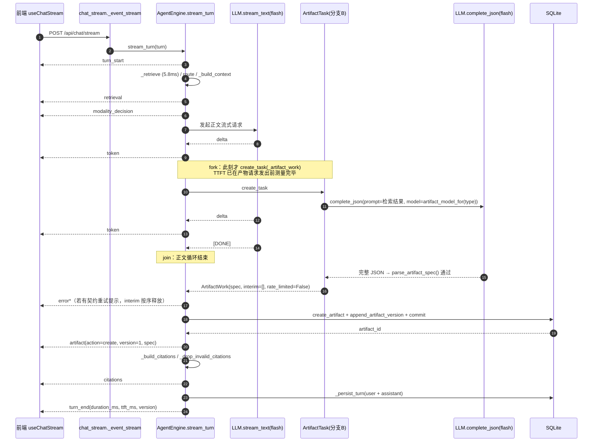
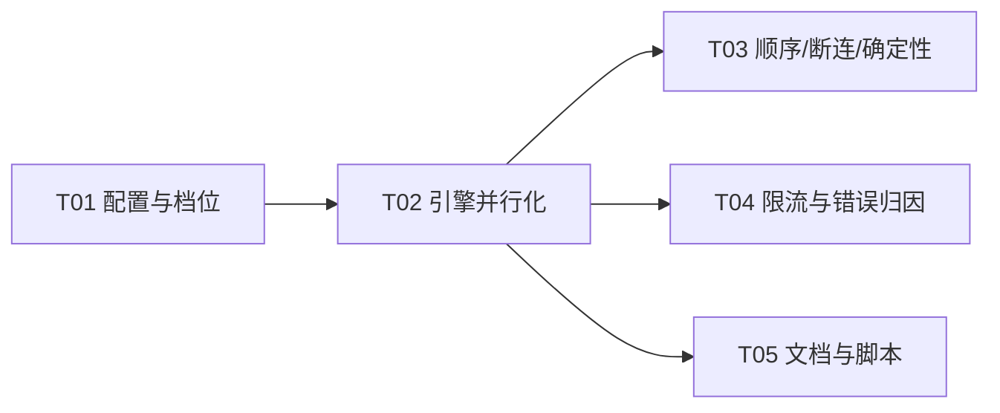

# 增量架构设计：产物换轻量档 + 正文/产物并行

| 项 | 内容 |
|---|---|
| 文档 | `docs/increments/P1-03-latency-DESIGN.md` |
| 版本 | v1.0（增量设计，对应 PRD v1.1） |
| 作者 | 高见远（架构师） |
| 上游 | `docs/increments/P1-03-latency-PRD.md` v1.1 · `docs/increments/latency-profile.md` · `docs/00-源文档/IMPL-NOTES.md`（E11 / §四 / §五） · `HANDOVER.md` §七 |
| 代码基线 | `HEAD 3a7aa4b`（后端 244 测试 / 前端 153 测试全绿） |
| 文档状态 | 待评审 |

> **本文档只描述「怎么做」，不重复论证「为什么做」。** 做与不做的决策已由用户拍板并写在 PRD v1.1 里：产物生成换 `deepseek-flash`、正文与产物并行、**不做分批下发**。
> 本文档中不出现任何「分批 / 中间态 / 多批次版本语义」的设计，这是刻意的。

---

## 0. 关键裁定摘要（先看这张表）

| # | 议题 | 裁定 | 一句话理由 |
|---|---|---|---|
| **D1** | 换档怎么配 | **新增 `LLM_MODEL_ARTIFACT`（默认 `deepseek-flash`）**，不改 `LLM_MODEL_GENERATOR` 的默认值 | `LLM_MODEL_GENERATOR` 在 README / `.env.example` / 架构文档里的语义就是「复杂 AST 用大模型」，改它的默认值会让三处文档同时变成假话，且失去「保留一个重档配置」的能力（§2.1） |
| **D2** | 回退粒度 | 三档：**全局回退**（`LLM_MODEL_ARTIFACT=` 空 → 跟随 GENERATOR）、**分形态回退**（`LLM_MODEL_ARTIFACT_BY_TYPE=anim_2d=…`）、**并行回退**（`ARTIFACT_PARALLEL_ENABLED=false`） | PRD P1-03-01⑤ 要求「G7 未过则按形态回退」；PRD §5.3 要求「一行环境变量切回已知可用状态」（§2.2） |
| **D3** | TTFT 怎么保 | **默认「首个 token 之后才 fork」**（`ARTIFACT_FORK_MODE=after_first_token`）。TTFT 在产物请求发出之前就已测量完毕，**可证不变**（不是「大概率不变」） | PRD §2.3 裁定 2 把 T1 定为红线门禁；`immediate` 模式能再省 3.9s，但它把 TTFT 交给「provider 侧并发是否排队」这个未测假设（§4.3） |
| **D4** | 事件怎么保序 | **产物任务不落库、不发事件**；它只返回一个 `ArtifactWork` 值对象（内含按序排列的中间事件）。落库与发事件全部回到主路径，在 join 之后按原顺序执行 | 一箭三雕：①顺序天然与串行版逐条一致；②取消即无副作用（不会留下「已落库但用户没看到」的孤儿产物）；③DB 写永远只在请求主路径上发生，不引入 aiosqlite 并发问题（§4.4、§5） |
| **D5** | patch 是否并行 | **做**。与 create 复用同一套 fork/join 机制，同一个开关控制 | `_generate_ops_stream(req, spec_dict, context)` 签名里没有 `reply`，ops 与正文无依赖；实测可省 5.2s（26.8s → 21.5s 量级）。T5 的 15s 硬门禁两种模式都过，所以它是「先做 create、有余量再做 patch」的 P1 项（§4.6） |
| **D6** | 要不要进程级并发上限 | **要，但定位是「安全阀」不是「调参旋钮」**：`ARTIFACT_MAX_CONCURRENCY=8`（0=不限） | 单回合最多 2 个并发请求，8 只在「多标签页同时提问」时兜底；真正的限流应对是 429 → 串行降级（PRD ⑦），不是排队等信号量（§4.7、§9 Q-A） |
| **D7** | 契约改动量 | **零**。`ArtifactEvent` / `SseEventName` / `EVENT_ORDER` / `ErrorCode` 全部不动，前端零改动 | 见 §1.4 与 §6.4 的逐条论证 |

---

## 1. 方案总览

### 1.1 一句话

> **把「正文流」与「产物生成」从一条串行流水线拆成两条并行分支：产物分支只做「生成」，不做「落库 + 发事件」；主路径在正文最后一个 token 之后 join 产物分支，再按原顺序落库、发 `artifact`、发 `citations`、发 `turn_end`。**

两个改动叠加后的整轮耗时（用剖析报告实测分量推算）：

| 组合 | 整轮耗时 | 算式 |
|---|---:|---|
| 现状（串行 + v4-pro） | 66.3 s | 4.6 + 6.2 + 55.5 |
| 只换档（串行 + flash） | 20.9 s | 10.78 + 10.06 |
| 只并行（串行档位不变） | 55.5 s | max(10.78, 55.49) |
| **换档 + 并行（`immediate`）** | **≈ 10.8 s** | max(10.78, 10.06) + 0.014 |
| **换档 + 并行（`after_first_token`，默认）** | **≈ 14.7 s** | TTFT 4.62 + max(正文尾 6.16, 产物 10.06) |

### 1.2 两个分支的边界（fork / join 点）

```
检索 → 路由 → _build_context
                 │
                 ├── 分支 A（主路径）：_reply_stream → token* → reply
                 │        ↑ fork 点：默认在「第一个 token 已产出」这一刻
                 └── 分支 B（asyncio.Task）：_artifact_work
                          = 只跑 LLM / mock 生成（_generate_spec_stream / _generate_ops_stream）
                            返回 ArtifactWork(spec | ops | interim[] | rate_limited)
                          ✗ 不落库   ✗ 不发事件   ✗ 不碰 session
                 │
                 join：正文循环结束（含异常分支）
                 │
                 ├── 释放 interim 事件（契约重试提示 / 限流提示），顺序与串行版一致
                 ├── _commit_artifact(work)：落库 → 产出 ArtifactEvent（或 error）
                 ├── citations（不变）
                 ├── _persist_turn（不变）
                 └── turn_end（不变）
```

**fork 点的三种取值**（`ARTIFACT_FORK_MODE` / `ARTIFACT_PARALLEL_ENABLED`）：

| 配置 | fork 时刻 | TTFT 影响 | T4 估算 |
|---|---|---|---:|
| `ARTIFACT_PARALLEL_ENABLED=false` | 不 fork，join 点直接跑 `_create_artifact_stream` | 无（与改动前同） | 20.9 s |
| `after_first_token`（**默认**） | 第一个 `token` 事件产出后 | **零**（产物请求尚未发出，TTFT 已测量完毕） | 14.7 s |
| `immediate` | `_build_context` 之后、正文循环之前 | 未测（取决于 provider 并发排队行为） | 10.8 s |

> `immediate` 的 TTFT 风险预算是 PRD §2.3 裁定 2 给的：基线 4.616 s × 1.1 ≈ **5.08 s**，即允许劣化 **≤ 0.46 s**。这条预算只能靠 A/B 实测（n ≥ 5）来花，不能靠推测花，所以它不做默认值。

### 1.3 时序图（默认配置 `after_first_token`）



### 1.4 契约影响（零变更声明）

| 契约面 | 是否改动 | 论证 |
|---|---|---|
| `ArtifactEvent`（`schemas/chat.py:120-150`） | **不改** | 仍只有 `create` / `patch` 两态，`version: int=Field(ge=1)` 必填，validator 一个字不动。本次没有「部分产物」概念，所以不需要新字段 |
| `SseEventName` / `EVENT_ORDER`（`schemas/chat.py:20-40`） | **不改** | 事件名集合与顺序表原样保留，本次只是让实际发出的顺序**更严格地**符合它 |
| `ErrorCode` | **不改** | 429 用内部异常子类 `RateLimitedError` 区分，仍携带 `LLM_UPSTREAM_ERROR` 这个既有码；它**永远不出现在 SSE 事件里**（在引擎内部被消费掉），所以前端 `ErrorCode` 联合类型无需镜像 |
| `TurnEndEvent` | **不改** | 无「完成度」字段（不分批就没有中间态） |
| 数据库表结构 | **不改** | 落库逻辑与时机（相对事件）完全不变 |
| 前端 | **零改动** | 见 §6.4 |

> ⚠ **一条必须一起读的限定**（否则上表是「半真」）：**契约面零变更 ≠ 产物内容零变更。** 本次新增了生成后页码钳制（§4.9），`spec` 的定义从「模型输出」变为「**模型输出 + 确定性钳制**」：越界的 `source_ref` 会被剥掉页码、越界的 `source_page` 会被置 `null`。
> 影响面：字段集合、类型、校验路径、事件、表结构**都不变**（前端无需任何改动）；变的是**同一份模型输出落库后可能少一个页码**。由此派生的两条纪律写在 §4.9.4：① 钳制是纯函数 → 不破坏 P0-12② 确定性；② 改钳制规则属**内容变更**，只能产生新版本，不得回填历史版本行。

---

## 2. 配置变更

### 2.1 为什么新增 `LLM_MODEL_ARTIFACT` 而不是改 `LLM_MODEL_GENERATOR` 的默认值

三条路都试过推演，结论是「新增独立配置项」：

| 方案 | 问题 |
|---|---|
| **A. 把 `LLM_MODEL_GENERATOR` 默认值改成 `deepseek-flash`** | ① `README.md:175`、`backend/.env.example:18-19`、`docs/01-快速开始/2. 环境搭建与运行.html:321`、`docs/05-运维部署/1. 部署方案.html:120` 四处都把 `LLM_MODEL_GENERATOR` 描述为「复杂 JSON AST 生成 / 大模型」，改默认值后这四处**同时变成假话**；② 改完之后**没有变量能表达「重档」**，想回到重档只能再改一次代码；③ 与 PRD §5.3「回退不依赖代码回滚」直接冲突 |
| **B. 复用 `LLM_MODEL_ROUTER`**（产物也用 router 档） | 语义错位：router 档是「路由 / 评估 / 答疑」用的，将来正文与产物的档位可能需要分别调整（例如 G7 未过时 2D/3D 要回重档，但正文不能跟着变重）。复用会让「改正文档位」和「改产物档位」变成同一件事 |
| **C. 新增 `LLM_MODEL_ARTIFACT`（采纳）** | 分层从两层变三层，语义诚实：`ROUTER`（正文/评估）、`ARTIFACT`（结构化 AST）、`GENERATOR`（重档，作为 ARTIFACT 的回退目标与将来复杂任务的位置）。`LLM_MODEL_GENERATOR` 的文档语义**一个字都不用改**，因为它仍然准确 |

**与 PRD v1.1 P1-03-01② 的差异（必须显式记录）**：PRD ② 写的是「设 `LLM_MODEL_GENERATOR=<重档>` → 产物生成走重档」。采纳方案 C 后，等价操作是二选一：

- `LLM_MODEL_ARTIFACT=deepseek-v4-pro`（只换产物档位，最精确）；或
- `LLM_MODEL_ARTIFACT=`（置空）+ `LLM_MODEL_GENERATOR=deepseek-v4-pro`（**完全等价于 PRD ② 的字面描述**）。

两条都能达到 PRD ② 想要的验收效果，所以不构成需求偏离，只是回退变量的名字更精确。**这一点请在 PRD v1.1 定稿时同步一句**，否则验收脚本会去断言一个不再承载该语义的变量。

### 2.2 新增 / 修改的配置项

| 变量 | 默认值 | 类型 | 语义 | 回退能力 |
|---|---|---|---|---|
| `LLM_MODEL_ARTIFACT` | `deepseek-flash` | `str` | 产物生成（`complete_json`）用的模型。**空串 = 跟随 `LLM_MODEL_GENERATOR`**（回到改动前行为） | ✅ 全局回退 |
| `LLM_MODEL_ARTIFACT_BY_TYPE` | `""` | `str`（`k=v,k=v`） | 分形态覆盖，键限 `ppt` / `anim_2d` / `scene_3d`。空 = 全部走 `LLM_MODEL_ARTIFACT` | ✅ 分形态回退（PRD ①⑤ / G7） |
| `ARTIFACT_PARALLEL_ENABLED` | `True` | `bool` | 关闭后走原串行路径（`_create_artifact_stream` / `_patch_artifact_stream`） | ✅ 并行回退 |
| `ARTIFACT_FORK_MODE` | `after_first_token` | `Literal["after_first_token","immediate"]` | fork 时刻（见 §1.2） | ✅ TTFT 保护档位切换 |
| `ARTIFACT_MAX_CONCURRENCY` | `8` | `int`（`0`=不限） | 进程内产物 LLM 并发安全阀 | 运维兜底 |
| `ARTIFACT_RATE_LIMIT_RETRY` | `1` | `int`（`0`=不重试） | 产物侧遇 429 时，join 之后串行重试的次数 | ✅ 可关 |

**派生属性**（`Settings` 上新增，业务代码不得自己拼字符串）：

```python
@property
def artifact_model(self) -> str:
    """产物生成的全局档位。空串 = 跟随 LLM_MODEL_GENERATOR（改动前行为）。"""
    return self.LLM_MODEL_ARTIFACT.strip() or self.LLM_MODEL_GENERATOR

def artifact_model_for(self, artifact_type: str | None) -> str:
    """按形态取档位：BY_TYPE 覆盖优先，其次全局，最后 GENERATOR。"""
```

`LLM_MODEL_ARTIFACT_BY_TYPE` 的解析规则（写在 `config.py`，约 10 行）：

- 逗号分隔，每项 `type=model`；
- 键不在 `{"ppt","anim_2d","scene_3d"}` 内 → **构造 `Settings` 时抛 `ValueError`**（fail fast，拼错的键不能被静默忽略，否则「配了却没生效」正是 IMPL-NOTES E11 教训 1 的重演）；
- 值允许空串（等价于「该形态跟随全局」）。

### 2.3 同步点（文档必须一起改，否则下一个人会照着旧文档把档位改回去）

| 文件 | 位置 | 改什么 |
|---|---|---|
| `backend/.env.example` | LLM 段（第 15-21 行） | 新增 `LLM_MODEL_ARTIFACT=deepseek-flash` + 3 行注释（实测 55.5s→10.1s、切回重档的两种写法、必须与 `LLM_BASE_URL` 的 provider 一致）；新增 `ARTIFACT_PARALLEL_ENABLED` / `ARTIFACT_FORK_MODE` |
| `README.md` | §四 环境变量表（165-180 行） | 表格新增 3 行；`LLM_MODEL_GENERATOR` 那行的说明改为「重档，作为 `LLM_MODEL_ARTIFACT` 的回退目标」 |
| `backend/app/services/llm_client.py` | `complete_json` docstring（123-128 行） | **必须重写**：现行文字是「准确率优先于延迟，所以用重模型」。实测已推翻该取舍，要写成「flash 实测 55.5s→10.1s、契约 3/3 通过；新的取舍是『延迟优先 + 用 retry 率做护栏』；若 retry 率破 G1 阈值，用 `LLM_MODEL_ARTIFACT` 切回重档」。**不写这段，后来者会照着旧理由把档位改回去** |
| 同上 | `stream_text` docstring（175-182 行） | 第二段「结构化 AST 正相反……必须用准确率更高的 GENERATOR」同步改为「结构化 AST 用 `LLM_MODEL_ARTIFACT`，见 `complete_json` 的实测取舍」 |
| `backend/app/config.py` | LLM 段注释（41-43 行） | 「两个独立配置项」→「三个独立配置项」+ 各自用途 |
| `docs/00-源文档/IMPL-NOTES.md` | 新增 §E12 | 记录本次两个裁定：换档（推翻 E11 问题 2 的取舍，附实测数据与新护栏）+ 并行（fork 点选 `after_first_token` 的理由）。**E11 问题 2 的原文不改**（历史记录只增不改），在 E12 里显式写「E11 问题 2 的取舍已被 E12 推翻」 |
| `docs/01-快速开始/2. 环境搭建与运行.html`、`docs/05-运维部署/1. 部署方案.html` | 环境变量表 | **本次不同步**（已裁决，见 §9.2 Q-6）：只在 IMPL-NOTES E12 里留一句「HTML 站未同步，运维以 `.env.example` 与 E12 为准」+ 一条补更待办。**不要顺手改这两篇 HTML** |

---

## 3. 改动文件清单（精确到函数）

### 3.1 `backend/app/config.py`

| 动作 | 位置 | 内容 |
|---|---|---|
| 改 | LLM 段注释 | 两层 → 三层（§2.3） |
| 增 | `Settings` 字段 | `LLM_MODEL_ARTIFACT` / `LLM_MODEL_ARTIFACT_BY_TYPE`（§2.2） |
| 增 | 新段落 `# ---- 产物生成执行策略 ----` | `ARTIFACT_PARALLEL_ENABLED` / `ARTIFACT_FORK_MODE` / `ARTIFACT_MAX_CONCURRENCY` / `ARTIFACT_RATE_LIMIT_RETRY`，每项带「为什么是这个默认值」的注释 |
| 增 | 派生属性区 | `artifact_model` / `artifact_model_for()` |
| 增 | 模块级 | `_parse_model_overrides(raw: str) -> dict[str, str]`（含键校验，抛 `ValueError`） |

> 纪律：`agent_engine` 里不得出现任何 `"deepseek-flash"` 字面量，也不得出现 `0.2` 之外的新魔法数。

### 3.2 `backend/app/services/llm_client.py`

| 动作 | 位置 | 内容 |
|---|---|---|
| 增 | 模块级（`RETRY_BACKOFF` 之后） | `class RateLimitedError(AppError)`：`__init__` 固定 `code=ErrorCode.LLM_UPSTREAM_ERROR`，附带 `status_code: int = 429` 与 `retry_after: str \| None`。**它不出现在任何 SSE 事件里**，只用于引擎内部分支 |
| 改 | `_post_json`（75-112） | `response.status_code == 429` → `raise RateLimitedError(...)`（**不重试**：429 立刻重试只会继续 429）。其余 `>=400` 分支不变 |
| 改 | `complete_json`（114-162） | ① `model` 解析改为 `model or self._settings.artifact_model`；② docstring 按 §2.3 重写；③ 其余逻辑不变 |
| 增 | `__all__` | 加入 `"RateLimitedError"` |
| 不改 | `stream_text` | 除 docstring 外**一行不动**（PRD R6：正文档位本次不动） |

> 为什么用异常子类而不是新增 `ErrorCode`：新增错误码会扩散到前端 `ErrorCode` 联合类型与 `chat_once` 的 `ErrorCode(event.code)` 反查，而 429 这个信息**只在引擎内部有用**（决定是否串行重试），对用户可见面没有新增语义 —— 用户看到的仍是「模型服务 429」这条 `LLM_UPSTREAM_ERROR`。

### 3.3 `backend/app/services/agent_engine.py`（本次改动的主体）

#### 3.3.1 新增数据结构与模块级 helper

```python
@dataclass
class ArtifactWork:
    """产物分支的返回值。**只是数据，不带副作用** —— 不落库、不发事件。"""
    kind: Literal["create", "patch"]
    spec: dict[str, Any] | None = None          # create：完整 AST
    spec_dict: dict[str, Any] | None = None     # patch：基线快照（deepcopy）
    base_version: int | None = None             # patch
    artifact_type: str | None = None            # patch
    ops: list[PatchOp] | None = None            # patch
    interim: list[Event] = field(default_factory=list)   # 按序的中间事件（error）
    rate_limited: bool = False                  # 触发 429 → 主路径串行重试

async def _drain_generation(gen) -> tuple[Any | None, list[Event]]:
    """把一个 ('spec'|'ops'|'error', payload) 生成器跑完。

    返回 (最终产物, 按序收集的中间事件)。异常**不吞**，原样抛给调用方
    （RateLimitedError 要靠它冒到 _artifact_work 才能走串行降级）。
    """
```

`_drain_generation` 是关键的小工具：它让 `_generate_spec_stream` / `_generate_ops_stream` **保持现有的 async generator 形态不变**（零改动），同时能被「一次性跑完并收集」地调用。这样 `scripts/profile_latency.py` 的 `instrument_async_gen("_generate_spec_stream")` 埋点仍然有效（见 §3.5）。

#### 3.3.2 方法级改动表

| 方法 | 动作 | 改动内容 |
|---|---|---|
| `stream_turn`（254-398） | **重构第 3、4 段** | 见 §4.1 的伪代码。新增 `work_task` 生命周期、fork 时机、join、interim 释放、`finally` 取消 |
| `_create_artifact_stream`（548-602） | **拆分 + 瘦身** | 变成 4 行：`work = await _artifact_work(..., defer_on_rate_limit=False)` → 释放 `interim` → `yield from _commit_artifact(work, ...)`。**保留方法名与 async generator 形态**（串行回退路径 + 脚本埋点依赖它） |
| `_patch_artifact_stream`（668-761） | 同上 | 同上。注意 `apply_patch_request` + 乐观锁写入必须留在 `_commit_patch`（主路径），不能进分支 B |
| `_artifact_work`（**新增**） | 新增 | `async def _artifact_work(self, req, decision, context, result, action, *, defer_on_rate_limit: bool) -> ArtifactWork`。按 `action` 分派到 `_work_create` / `_work_patch`；捕获 `RateLimitedError`（§4.5） |
| `_work_create`（**新增**） | 新增 | `spec, interim = await _drain_generation(self._generate_spec_stream(...))`；`spec is None` 时返回空 work |
| `_work_patch`（**新增**） | 新增 | 读基线（`require_artifact` + `copy.deepcopy`，与现状一致）→ `_drain_generation(self._generate_ops_stream(..., artifact_type))`。**只读，不写** |
| `_commit_artifact`（**新增**） | 新增 | `async def _commit_artifact(self, work, req, context) -> list[Event]`。分派 `_commit_create` / `_commit_patch`；两者就是现有 548-602 / 706-761 里的落库 + 事件构造段，原样搬过来 |
| `_generate_spec_stream`（604-666） | 改 | ① `complete_json(..., model=self._settings.artifact_model_for(decision.artifact_type))`；② `except RateLimitedError: raise`（在通用 `except` **之前**，见 §4.5）；③ 第 608 行注释「方向是分批下发或换更快档位」→ 改为「已换档（见 IMPL-NOTES E12），分批已实测否掉」；④ 调用前 `log_event("artifact_generate", artifact_type=..., model=..., attempt=...)` |
| `_generate_ops_stream`（763-797） | 改 | ① 签名加 `artifact_type: str`；② 同上的 `model=` 与 `RateLimitedError` 处理；③ 同上埋点 |
| `_artifact_prompt` / `_reply_prompt` / `_build_citations` / `_drop_invalid_citations` / `_persist_turn` / `_scope_for` / `_decide_action` / `_build_context` | **不动** | 本次不碰提示词、不碰引用、不碰落库 |

#### 3.3.3 并发安全的自查结论（写进代码注释）

- `MockContext` 是 `@dataclass(frozen=True)`（`mock_generator.py:33`），`RetrievalResult` / `RouteDecision` 均为只读值对象 → 两条分支共享入参无写竞争。
- 分支 B **不触碰** `self._session_factory`（`_work_patch` 的基线读除外，见下）与任何 `self._*` 可变状态。
- 分支 B 的唯一 IO 是「patch 基线只读」+「LLM HTTP」。前者与主路径无并发写（主路径此刻只在流 token），后者与正文流互不共享 httpx client（`stream_text` / `_post_json` 各自 `async with httpx.AsyncClient(...)`）。
- `reply_parts` / `ttft_ms` / `artifact_event` 全部是 `stream_turn` 的局部变量，只有主路径读写。

#### 3.3.4 重构不得破坏的四条「测量约定」（否则 G1/G2 **静默假绿**）

`scripts/flash_quality_check.py` 用**运行期反射**取引擎内部状态，它不 import 引擎、不做类型检查，所以重构破坏这些约定时**不会报错**，只会让指标变成 0% 或空列表 —— 看起来「全绿」，实际什么都没测到。这是 IMPL-NOTES E11 教训 1（「配置了不等于用上了」）在测量层的翻版，**比测试变红更危险**，因为红是可见的。

| # | 约定 | 脚本依赖点 | 破坏后的表现 |
|---|---|---|---|
| **MC-1** | **mock 降级的 error 事件必须是 `stage="validate"` + `retryable=False` + `message` 含「降级」二字** | `flash_quality_check.py:559-563`（判定）、`:962`/`:977`（熔断文案） | G2 降级率算成 **0%**，熔断永不触发。把文案改成「回退演示生成器」「已切换本地生成」即中招 |
| **MC-2** | **`agent_engine.parse_artifact_spec` 必须是模块级可替换属性** | `:179`、`:196`（`instrument_contract_validation` 直接赋值 `engine_module.parse_artifact_spec = wrapper`） | `contract_error_counts` 恒为空 → 「错误条数递增即停手」（E11 的 15→21→26 特征）这条护栏**永久失效**。改成 `from ... import parse_artifact_spec as _parse`、或把校验挪进 `patch_engine` / 新模块，即中招 |
| **MC-3** | **`_reply_stream` / `_create_artifact_stream` / `_generate_spec_stream` 三个方法名必须存在且是 async generator** | `profile_latency.py:478-482` 的 `instrument_async_gen`（按名 `getattr`） | 埋点行整段消失（`AttributeError` 或空 span），阶段表缺行 |
| **MC-4** | **`stage="validate"` 的 error 事件与「失败的 LLM 尝试」必须 1:1**（含降级那条 +1） | `flash_quality_check.py:587`：`failed_calls = max(0, validate_errors - (1 if mock_fallback else 0))` | `failed_calls` 虚高或虚低 → G1 retry 率算错。**这条直接约束了本次设计**：429 的 error **必须用 `stage="generate"`**（见 §4.5 E5），不能用 `"validate"` |
| **MC-5** | **`agent_engine._clamp_spec_pages` 必须是模块级可替换属性**（与 MC-2 同类，QA 补充） | `flash_quality_check.py` 的 `instrument_page_clamp`（`engine_module._clamp_spec_pages = wrapper`） | G3 的「**钳制前**」样本采不到 → 报告里「钳制前」与「钳制后」变成同一份数据，**编造率永远等于 0%**，那个缺陷从指标里静默消失（正是 §4.9 强调「必须双口径」要防的事）。改成实例方法、改名、或把钳制挪进别的模块，即中招 |

**因此本次设计的实现纪律**：

1. 429 的错误事件用 `error(stage="generate", code="LLM_UPSTREAM_ERROR", retryable=True)` —— 它是一次**上游失败**，不是契约校验失败，用 `"validate"` 会虚增 `validate_errors`、污染 G1。
2. 而「429 串行重试也失败 → 降级 mock」那条 error **仍必须**是 `stage="validate"` + `retryable=False` + 含「降级」（MC-1 优先于语义洁癖：G2 的探测就靠它）。语义上略别扭，但这是测量契约，改它必须同一次提交里同步改脚本，否则中间态就是假绿。
3. 并行**只改事件到达时刻，不改事件条数**：`interim` 里的 error 与串行版逐条相同 → **G1/G2 的统计口径不受并行影响**（这一条要写进代码注释，否则后来者会怀疑「并行是不是少发了事件」）。

**T02 必须加的三条断言**（不用新代码，各一条 assert，全部离线可跑）：

```python
# ① MC-1：降级路径的文案不能被顺手改掉
assert "降级" in downgrade_event.message and downgrade_event.stage == "validate" \
       and downgrade_event.retryable is False
# ② MC-2：模块属性必须可替换（脚本靠赋值包住它）
import app.services.agent_engine as engine_module
assert hasattr(engine_module, "parse_artifact_spec")
# ③ MC-4：429 不得伪装成 validate（否则虚增 failed_calls）
assert rate_limited_event.stage == "generate"
```

### 3.4 `backend/.env.example` / `README.md` / `docs/00-源文档/IMPL-NOTES.md`

见 §2.3。

### 3.5 `scripts/profile_latency.py`（**必改，否则验收数据会算错**）

| 位置 | 问题 | 改法 |
|---|---|---|
| `instrument_engine`（476-482） | 埋点 `_create_artifact_stream` / `_generate_spec_stream`。并行模式下 `_create_artifact_stream` **根本不会被调用** → 该行无样本 | 改为同时埋 `_artifact_work`（`instrument_async_fn`），保留 `_generate_spec_stream` 的埋点 |
| 分段表（577-640） | 第 4 阶段用 `marks["artifact"] - marks["token_last"]` 计算。并行后 `artifact` 事件紧跟 `token_last`，该值 ≈ 0，**产物耗时会被算成 0 且各阶段之和不等于总耗时** | 第 4 阶段改用 `_artifact_work` 的 span；新增两列「产物 span 起点相对 t0」与「overlap_ms = 正文尾 ∩ 产物」，让「并行是否真的生效」在表里可读 |
| `_force_generator_model`（459-472） | docstring 说「`_generate_spec_stream` 调用 `complete_json` 时不传 `model`」—— 改后不再成立 | 更新注释：显式 `model=` 会被本 wrapper 覆盖（`kwargs["model"] = model` 在调用前执行），因此探针语义不变 |
| `--probe-models` 跳过逻辑（1238） | `model == settings.LLM_MODEL_GENERATOR` 就跳过。产物档位换到 flash 后，探针 `deepseek-flash` 不会被跳过（它 ≠ GENERATOR），但 `deepseek-v4-pro` 会被跳过 | 跳过条件改为「等于 `settings.artifact_model`」 |

**关于 T3 / T4 的定义（必须写清，否则会被误判成「T3 没改善」）**：

- **T3 ≡ T4 仍然成立。** 因为缓冲保证 `artifact` 事件**永远**在最后一个 `token` 之后（§4.2），所以「首份可交互产物」与「完整产物」还是同一个时刻。**没有任何翻转。**
- 变的是**阶段归因**，不是指标定义：事件边界法（`marks["artifact"] - marks["token_last"]`）在并行下必然算出 ≈ 0，因为产物耗时已经藏进「正文尾」那一段的墙钟时间里了。所以 **阶段表必须走 span，事件时间戳只能用来算 T1 / T3 / T4**。
- **如果将来有人去掉缓冲**（让 artifact 先于最后一个 token 发出），T3 与 T4 就会分离 —— 那一刻必须同步重定义指标，否则 T3 会突然「变好」而实际只是事件顺序变了。

**脚本自检断言（必须加，让退化在跑的时候就暴露）**：`|Σ各阶段耗时 − 总耗时| / 总耗时 ≤ 10%`，不满足则**非零退出并打印阶段表**。理由：这类退化不报错、只给假数字，等验收时被人读成「并行没生效」或「换档没生效」，比脚本直接失败更难查。

### 3.6 前端

**零改动**。论证见 §6.4。

---

## 4. 并行化的完整时序（fork / join / 缓冲 / 错误分支）

### 4.1 `stream_turn` 第 3、4 段伪代码（实现基准）

```python
# ---- 2. 形态路由（不变）----
context = self._build_context(req, result)

wants_artifact = action in ("create_artifact", "patch_artifact")
parallel = wants_artifact and self._settings.ARTIFACT_PARALLEL_ENABLED
work_task: asyncio.Task[ArtifactWork] | None = None

if parallel and self._settings.ARTIFACT_FORK_MODE == "immediate":
    work_task = asyncio.create_task(
        self._artifact_work(req, decision, context, result, action, defer_on_rate_limit=True)
    )

# ---- 3. 正文流式输出 ----
reply_parts: list[str] = []
ttft_ms: int | None = None
try:
    try:
        async for delta in self._reply_stream(req, result, decision, context):
            if not delta:
                continue
            if ttft_ms is None:
                ttft_ms = int((time.perf_counter() - started) * 1000)
                # ★ fork 点（默认）：TTFT 已在上一行定格，产物请求此刻才发出
                if parallel and work_task is None:
                    work_task = asyncio.create_task(
                        self._artifact_work(req, decision, context, result, action,
                                            defer_on_rate_limit=True)
                    )
            reply_parts.append(delta)
            yield "token", TokenEvent(delta=delta)
            await asyncio.sleep(0)
    except AppError as exc:
        yield "error", ErrorEvent(code=..., stage="generate", retryable=True, attempt=1)

    reply = "".join(reply_parts)
    knowledge_scope = self._scope_for(result)
    if ttft_ms is None:
        ttft_ms = int((time.perf_counter() - started) * 1000)

    # ---- 4. 产物：join + 按序释放 ----
    artifact_event: ArtifactEvent | None = None
    if wants_artifact:
        if work_task is None:
            # 串行路径（开关关闭）：走与改动前同名同形态的生成器，回退语义最直观
            if action == "create_artifact":
                stream = self._create_artifact_stream(req, decision, context, result)
            else:
                stream = self._patch_artifact_stream(req, decision, context)
            async for event in stream:
                yield event
                if isinstance(event[1], ArtifactEvent):
                    artifact_event = event[1]
        else:
            work = await self._join_artifact_work(work_task, req, decision, context, result, action)
            for event in work.interim:          # 契约重试提示 / 限流提示，按序释放
                yield event
            for event in await self._commit_artifact(work, req, context):
                yield event
                if isinstance(event[1], ArtifactEvent):
                    artifact_event = event[1]

    # ---- 5. 引用 / 6. 落库 / turn_end：一行不改 ----
finally:
    if work_task is not None and not work_task.done():
        work_task.cancel()
        work_task.add_done_callback(_reap_task)      # 消费异常，避免 "never retrieved" 告警
        with contextlib.suppress(asyncio.CancelledError):
            await work_task                            # 见 §5.3 的说明
```

`_join_artifact_work` 的职责（薄）：

```python
async def _join_artifact_work(self, task, req, decision, context, result, action) -> ArtifactWork:
    try:
        work = await task
    except RateLimitedError:
        work = ArtifactWork(kind=..., rate_limited=True)
    except asyncio.CancelledError:
        raise                                    # 取消必须原样上抛
    except Exception:                            # 兜底：分支 B 的任何意外都不许打断主路径
        logger.exception("artifact_work_unhandled")
        work = ArtifactWork(kind=..., interim=[("error", ErrorEvent(
            code=ErrorCode.INTERNAL_ERROR.value, message=..., stage="generate",
            retryable=False, attempt=1))])

    # 429：正文已结束，此刻系统里只有这一个 LLM 请求 → 串行重试（PRD P1-03-02⑦）
    for _ in range(self._settings.ARTIFACT_RATE_LIMIT_RETRY):
        if not work.rate_limited:
            break
        log_event("artifact_rate_limited", level=logging.WARNING, artifact_type=...)
        work = await self._artifact_work(req, decision, context, result, action,
                                         defer_on_rate_limit=False)
    return work
```

### 4.2 事件缓冲策略（为什么用「返回值里的 list」而不是 queue）

| 备选 | 否决理由 |
|---|---|
| `asyncio.Queue` + 主路径边流 token 边 drain | 会让 `artifact` / `error` 事件插到 token 流中间 → **直接破坏 §5.4 顺序契约**（PRD R1） |
| 分支 B 内部直接 `yield`（async generator 跨任务） | 语法上做不到：async generator 不能被两个任务同时消费，`asend` 跨任务会抛 `RuntimeError` |
| **`ArtifactWork.interim: list[Event]`（采纳）** | 中间事件的数量**有界**（`_generate_spec_stream` 最多 3 条契约重试 error + 1 条降级 error；`_generate_ops_stream` 最多 2 + 1 条），append 顺序即产生顺序，join 后一次性按序释放 |

**释放点**：正文循环结束之后、`_commit_artifact` 之前。这一点与串行版**逐条一致** —— 串行版里 `_generate_spec_stream` 的中间事件本来就发生在正文结束之后（产物阶段在正文之后），所以：
- 事件**内容**相同；
- 事件**相对顺序**相同；
- 事件**相对于 token / citations 的位置**相同；
- 唯一变化是并行模式下它们的**绝对到达时刻**从「生成过程中」推迟到「join 之后」。这没有用户可见差异（前端对 `error` 只做 `setError`，且不 abort）。

**上限与背压**：不需要背压。分支 B 的产出是「有界的几个事件 + 一个 spec」，不是流；内存占用上限 = 一份 spec（实测 2–3 KB）。

### 4.3 TTFT 保护的机制与验证方法

**机制（为什么「可证」而不是「大概率」）**：默认模式下 `create_task` 的调用点位于 `if ttft_ms is None:` 分支**内部、`yield "token"` 之后**。也就是说，第一个 token 已经被 `stream_turn` 拿到（TTFT 已定格）之后，产物 HTTP 请求才第一次被构造。产物分支对 TTFT 的影响在代码结构上**不可能**发生 —— 不是靠调度运气。

**代价**：产物分支晚了 TTFT（4.6 s）才起步，T4 从 10.8 s 变成 14.7 s。这是**确定的 3.9 s 换一个红线指标的确定性**，我认为值得：T4 目标 15 s 仍满足，T1 是 P0 红线。

**验证方法（三层，缺一不可）**：

1. **单元级（必做，离线）**：注入一个记录调用时刻的假 `LLMClient`，断言 `stream_text` 首个 delta 的 `perf_counter` **小于** `complete_json` 的调用时刻。这条断言在 `immediate` 模式下必须**失败**（用它反证测试真的有区分力）。
2. **A/B 实测（必做交付物，真实链路）**：同一批 3 条问句、两种模式各 n ≥ 5。**判定线已由主理人预先定死**（避免看到数据再找理由），三条**同时**满足才允许切 `immediate`：

   | # | 判定线 | 为什么要这一条 |
   |---|---|---|
   | ① | `immediate` 的 TTFT **P50 ≤ 5.08 s** | PRD §2.3 裁定 2 的 1.1× 预算（基线 4.616 s × 1.1） |
   | ② | `immediate` 的 TTFT **P90 ≤ 6.0 s** | **只看 P50 会被单次抖动骗过**；P90 才是「学生偶尔卡住」的真实体感 |
   | ③ | `immediate` 的 T4 **P90 ≤ 15 s** | 否则省下的 3.9 s 又被方差吃掉，等于白冒 TTFT 风险 |

   三条全过 → **只写进 `backend/.env`**，并在旁边注释「本地 A/B 通过于 YYYY-MM-DD，生产需在目标环境复测」；**不进代码默认值、不进 `.env.example`**。
   任一条不过 → 接受 14.7 s，但验收报告必须写清 P90 是多少、破 15 s 的频次（不许只报 P50）。
3. **生产观测**：`log_event("turn_done", ttft_ms=...)` 已有，无需新增埋点；把 `artifact_model` 与 `fork_mode` 一起记进 `turn_done`，便于按配置切分统计（也是将来在目标环境复测 T1 的抓手）。

**`immediate` 的启用条件（写进代码注释）**：**三条判定线（①②③）同时满足才切；只看 P50 会被单次抖动骗过，所以必须有 P90。** 启用方式是改一个环境变量（`backend/.env`），无需发版。**在 A/B 通过之前，`immediate` 只能出现在测试里，不得出现在 `.env` / `.env.example` / 启动脚本里。**

### 4.4 「任何 artifact 事件必须在落库之后发出」这条约束怎么守

前端 `runArtifactPatch` 在 `source === "event"` 时会 `getArtifact()` 拉权威快照覆盖本地（`useArtifactPatch.ts:347-356`）。若事件早于落库，前端刚应用的补丁会被一份**旧**快照擦掉。

本设计的守法是**结构性的**，不靠时序小心：

1. 分支 B（`_artifact_work`）**不持有 `session`、不调用任何写路径**（注意：是「不写」而不是「不能写」，见 §5.2 的措辞修正）；
2. 唯一的落库点是 `_commit_artifact`，它在主路径上、在 `yield "artifact"` **之前** `await session.commit()`；
3. `_commit_artifact` 与事件构造在同一个 `await` 序列里，中间没有其他 `yield` 机会插入。

因此「事件晚于落库」不是靠约定，而是**主路径上只有一个写点、且它排在事件之前**。
（注意：这不是「分支 B 写不了」，见 §5.2 —— 靠的是「不写」+ 唯一写点，不是语言层面的不可能。）

### 4.5 错误归因矩阵

| 场景 | 触发点 | 用户看到的事件序列 | 落库 | 与改动前对比 |
|---|---|---|---|---|
| **E1** 正文失败、产物成功 | `_reply_stream` 抛 `AppError` | `token*`（可能 0 条）→ `error(stage=generate, retryable=true)` → `artifact` → `citations` → `turn_end` | 正文空/模板 + 产物 v1 + 消息落库 | **不变**。注意：`_reply_stream` 内部已 catch `AppError` 降级模板，所以这条分支实际很少触发 |
| **E2** 正文成功、产物契约 3 次全败 | `_generate_spec_stream` 末尾降级 mock | `token*` → `error(validate, retryable=false)` → `artifact`（mock 产物）→ `citations` → `turn_end` | mock 产物 v1 | **不变**（`interim` 里就是这 3+1 条 error，按序释放） |
| **E3** 正文成功、产物落库失败 | `_commit_create` / `_commit_patch` 抛 `AppError` | `token*` → `error(stage=generate/patch, retryable=false)` → `citations` → `turn_end` | 无产物 | **不变**。`citations` 仍会发出（这是现有代码刻意保留的行为，见 581-585 行注释） |
| **E4** 两边都失败 | 两侧各抛 | `error(generate)` → `error(validate)` → `citations` → `turn_end` | 无产物 + 消息落库（正文可能为空） | 顺序与串行一致；两条 error 的先后取决于 join 顺序（正文 error 先，产物 error 后），**确定** |
| **E5** 产物侧 429 | `_post_json` | 先静默串行重试（无事件）→ 成功则正常；再失败则 `error(stage="generate", code=LLM_UPSTREAM_ERROR, retryable=true)` → 再走降级 mock（降级那条仍是 `stage="validate"` + `retryable=false` + 含「降级」，见 §3.3.4 MC-1/MC-4） | 视重试结果 | **新增分支**（PRD ⑦）。用户最多看到一次 error，不会看到两次 |
| **E6** 分支 B 抛未预期异常 | 任意 | `error(stage=generate, code=INTERNAL_ERROR)` → `citations` → `turn_end` | 无产物 | **新增兜底**（串行版里这类异常会冒到 `_event_stream`，导致 `citations` 丢失；现在不会了 —— 是改善） |
| **E7** 客户端断连 | `_event_stream` cancel | 无（连接已断） | **无产物、无消息** | **改善**：串行版会落一个用户看不到的产物 |

> E6 与 E7 是本次顺带修掉的两个「串行版也存在的隐患」，请在 IMPL-NOTES E12 里记一笔。

### 4.6 patch 回合是否并行：**做**（D5）

**依据**：

1. **依赖判定**：`_generate_ops_stream(req, spec_dict, context)` 的入参全部来自「检索结果 + 基线快照 + 用户追问」，**签名里没有 `reply`**，与 create 同理。`_patch_artifact_stream` 里唯一用到正文的地方是**下游**的 `_drop_invalid_citations`（对 `reply` 做页码后校验），它本来就在产物之后执行。
2. **收益**：patch 基线 26.8 s（正文 5.18 s + ops 21.5 s）。并行后 `after_first_token` ≈ `3.26 + max(1.92, ops)`；若 ops 换 flash 后约 4 s（**估算，未实测**），≈ 7.3 s；即使 ops 不换档（21.5 s），也能从 26.8 s 降到 24.8 s。**任何情况下都不会变慢。**
3. **风险**：① 基线快照的读取时刻从「正文之后」提前到「正文之前」，乐观锁窗口从 ~21.5 s 拉长到 ~26.7 s → 多标签页并发 patch 的 409 概率略微上升（`PATCH_BASE_VERSION_CONFLICT` 已有正确的错误码与前端提示，属可接受劣化）；② `apply_patch_request` + 写入必须在主路径（已在 D4 中保证）。
4. **优先级**：T5 的硬门禁（绝对值 ≤ 15 s）在 `after_first_token` + 换档下已经能过，所以 patch 并行是**收益项不是达标项**。实现顺序上排在 create 之后（任务 T02 的后半段），时间紧可以单独砍掉而不影响 T3/T4。

### 4.7 并发与限流

- **单回合并发上限**：2（正文 1 + 产物 1），代码结构上不可能更多（`work_task` 是单变量，`_join_artifact_work` 里最多再串行重试 1 次）。
- **进程级**：`ARTIFACT_MAX_CONCURRENCY`（默认 8）作为安全阀，在 `_artifact_work` 内 `async with self._artifact_semaphore:` 包住生成段。默认 8 时单用户永不阻塞，只有「8 个标签页同时提问」才会排队。
- **429 的正式应对是「串行降级」而不是「排队」**：排队会让产物在信号量上等到正文结束（等价于自动退化成串行），但用户与日志里看不到原因；而显式串行重试有 `log_event("artifact_rate_limited")`，可统计发生率。**若该日志的 30 天发生率 > 5%，再加/调小信号量**（回答 PRD Q-A）。
- **信号量不跨事件循环复用**：`AgentEngine` 是进程级单例（`get_agent_engine()`），`asyncio.Semaphore` 在 3.10+ 不再绑定 loop，但为稳妥起见在 `__init__` 里惰性创建（首次 `_artifact_work` 时建），避免测试里多 loop 场景的 `RuntimeError`。

### 4.8 确定性（P0-12②）

| 保证点 | 论证 |
|---|---|
| 生成内容 | `generate_spec(type, context)` 是纯函数，`MockContext` frozen；并行只改变**何时**调用，不改变入参 |
| 事件序列 | 单点释放（join 之后）+ 单点落库 → 顺序与串行版逐条一致 |
| 无共享可变状态 | `reply_parts` / `ttft_ms` / `artifact_event` 是 `stream_turn` 局部变量；两条分支不写同一对象（§3.3.3） |
| 现有确定性测试 | `tests/test_mock_determinism.py` 断言在 `mock_generator` 层（指纹 / `canonical_json`），与调度无关 → **零影响** |
| 新增防线 | 新增「同一输入两次 `stream_turn` 的事件序列（事件名 + payload，剔除 `duration_ms` / `ttft_ms` / `turn_id`）完全相同」的测试，且在 `parallel=true` / `parallel=false` 两种配置下各跑一遍（§7 C5） |
| **页码钳制（§4.9）** | 钳制是**纯函数** `clamp_pages(spec, allowed_pages) -> spec`：同一 `(模型输出, 允许集合)` 必然得到同一 `spec`；不含随机、不含时间、不依赖遍历顺序（规则见 §4.9.2）。故**不破坏 P0-12②**。新增防线：同一 spec 连续钳制两次，结果字节级相同（幂等，`canonical_json` 比对） |

---

### 4.9 生成后页码钳制（换档前置门 · 任务 #8）

> 本节是**换档的准入条件**，不是可选优化。换档把「页码明显缺失」变成了「页码静默编造」，而 P0-05④「禁止编造页码」是核心卖点 —— 所以先有钳制，才允许默认走 flash。

#### 4.9.1 问题：提示词从不告诉模型页码，而契约示例里硬编码了一个

三个事实（均已核过代码）：

1. **`_artifact_prompt`（`agent_engine.py:930-950`）只给事实、不给页码**：事实以 `- {fact}` 逐行贴出，`source_ref` 的格式要求只出现在契约说明里。
2. **`_ARTIFACT_CONTRACT` 的示例硬编码了 `"4.1.1, p.76"`**（`agent_engine.py:136`、`:159`；格式说明 `:122`、`:144` 也写 `"4.1.3, p.76"`）。模型最容易照抄的就是示例里的具体数字。
3. **根因比「提示词漏了页码」更深**：`build_context` 的 `facts` 是**跨切片抽句、去重、限长后的扁平列表**，`pages` 是**排序去重的页码集合**，两者**没有任何对应关系** —— 系统自己也不知道哪句话来自哪一页，所以**不可能**在提示词里给出正确页码。

实测后果（同 query 对照）：v4-pro 写 `4.3.1, p.?`（**明显缺失**）→ flash 写 `4.3.1, p.76`（**静默编造**，该节真实页 83~91）。schema 只校验「是字符串」，所以不报错、不重试，用户看到一条查不到出处的页码。

> 这就是为什么它必须挡在换档前面：**换档前用户能看出「这里缺页码」，换档后看不出来。**

#### 4.9.2 钳制点、形态与允许集合

**位置**：`_generate_spec_stream` 里 `parse_artifact_spec(candidate)` 成功之后、`yield "spec", candidate` 之前；`_generate_ops_stream` 里 `PatchOp.model_validate` 全部成功之后、`yield "ops", ops` 之前。即在「校验通过」与「交给下游」之间，只有一次确定性改写。

**允许集合（关键细节，别踩）**：

```python
# 唯一来源：result.pages（展开成整段 range 的 set[int]）
# 必须显式传参，不能用 context.pages —— 两者不等价：
#   context.pages = tuple(chunk.page_start for chunk in result.chunks)   # 只有起始页
#   result.pages  = 所有 chunk 的 page_start..page_end 展开后的 set[int]  # 整段
# 用 context.pages 会把「p.77 落在 p.76-77 切片内」这种**合法**页码误剥。
async def _generate_spec_stream(
    self, req, decision, context, *, allowed_pages: frozenset[int]
) -> AsyncIterator[Event]: ...
```

**必须与 `_drop_invalid_citations` 共用同一个集合**（`result.pages`）。否则会出现「钳制放过了 p.77，后校验却把引用剔掉」的口径分裂 —— 同一个回合里两个组件对「哪页合法」给出不同答案，是最难查的一类 bug。

**规则表（确定性、幂等、不重试、不抛错）**：

| 字段 | 命中条件 | 改写动作 |
|---|---|---|
| `SlideNode.source_ref`（`str`）<br>`KeyframeStep.source_ref`（`str`） | 用与 `_PAGE_CITATION_RE` 同族的正则 `p\.(\d+)(?:-(\d+))?` 提取页码；**任一端点不在允许集合内**即整条视为越界（与 `_drop_invalid_citations` 的「不做部分合法宽容」保持同一口径） | **剥离页码，只留章节号**：`"4.3.1, p.76"` → `"4.3.1"`。若剥离后为空串 → 用 `context.section_code`；仍为空 → `"Extended Knowledge"`（与 `MockContext.source_ref` 的既有兜底一致，**绝不产生空字符串**） |
| `Entity2D.source_page`、`TimelineItem.source_page`、`Node3D.source_page`（`int \| None`） | 值不在允许集合内 | 置 `None` |
| `PatchOp.payload`（`update_node` / `insert_node` / `replace_subtree`） | 递归遍历 dict / list，命中键名 `source_ref` / `source_page` | 同上两条规则 |

**副作用只有一条**：`log_event("artifact_page_clamped", level=WARNING, artifact_type=..., field=..., stripped="p.76", allowed=sorted(allowed_pages))`。**不触发 `contract_retry`、不抛错、不改 `parse_artifact_spec` 的校验路径。**

**为什么不「钳制后重新校验」**：改写规则保证 schema-safe by construction（`source_ref` 在 schema 里是**无 min_length、无 pattern 的裸 `str`**，`source_page` 是 `int | None`，见 `schemas/artifacts.py:148/184/105/173/211`），重校验只会给热路径加一个失败分支。改为用测试锁死（§4.9.7 第 2 条）。

#### 4.9.3 为什么是「钳制」而不是「后校验 + 重试」

| 方案 | 代价 | 结论 |
|---|---|---|
| 校验失败 → 回灌错误重试 | 一次重试 = **一次完整调用**（flash 约 10 s），两次吃掉全部换档收益；且 IMPL-NOTES E11 已实测证明「回灌错误会让模型越改越乱」（错误数 15 → 21 → 26） | ❌ |
| 校验失败 → 直接报错不重试 | 用户拿到的是「产物生成失败」，而其实只错了一个页码 —— 惩罚与过错严重不匹配 | ❌ |
| **确定性钳制（采纳）** | 零重试、零额外调用、零延迟；代价是 `source_ref` 从「章节+页码」退化为「只有章节」 | ✅ 诚实降级：**没有可信页码时就不显示页码**，比显示一个假页码好 |

这与 `_drop_invalid_citations` 的既有哲学一致：那条路径也是「发现编造 → 剔除引用，不篡改正文、不重试」（`agent_engine.py:847-848`）。钳制是同一哲学在 **spec 侧**的延伸。

#### 4.9.4 对「契约零变更」声明的影响（**修正 §1.4 的半真**）

- **契约面确实零变更**：`ArtifactEvent` 字段 / `parse_artifact_spec` 校验路径 / `SseEventName` / `EVENT_ORDER` / 表结构，一个字不改。§1.4 的表格继续成立。
- **但产物内容不再等于模型的原始输出**：`spec` 的定义从「模型输出」变成「**模型输出 + 确定性钳制**」。§1.4 已补一句显式声明。
- **确定性（P0-12②）**：不受影响 —— 钳制是纯函数、幂等（已补进 §4.8 论证链）。
- **版本语义（P0-11）**：落库的是**钳制后**的 spec，历史版本之间仍可比，且同一回合的 SSE 事件与 `GET /api/artifacts/{id}` 在**页码字段上**逐字节相同（钳制会把 `"85"` 规范成 `85`，两个出口取值同型）。**但「逐字节一致」只对页码字段成立**，不要推广到整份 spec：`position` / `scale` / `rotation` / `target` / 2D 的 `x` `y` 这些 float 字段，SSE 走 pydantic 序列化会把 `[0, 1, 0]` 写成 `[0.0, 1.0, 0.0]`，而 REST 透传库里的原始 dict —— **值相同、文本表示可能不同**（QA 实测，IMPL-NOTES E12 ⑦ 第 4 条）。前端是 JS，`JSON.stringify` 对二者输出相同，用户不可见，也不影响指纹自检（`ArtifactEvent` 不带 fingerprint）。但必须写死一句：**「同一份模型输出，在钳制规则变更后会得到不同的 spec —— 因此改钳制规则属于内容变更，只能产生新版本，不得回填/重写历史版本行」**。不写这句，将来有人放宽/收紧规则时会误以为「历史版本被改写了」（IMPL-NOTES E8 那类假阳性的翻版）。

#### 4.9.5 patch 路径是否同样钳制 —— **是，两条路径都钳制**（结论 + 依据）

**结论：create 与 patch 共用同一个 `clamp_pages()`，无例外。**

依据三条：

1. **不钳制的 patch 会「复活」假页码**：`update_node` 的 payload 是**局部字段 dict**（IMPL-NOTES F1），完全可能只带 `{"source_ref": "4.3.1, p.76"}`。若 create 钳制而 patch 不钳制，用户点一次节点追问之后，刚被剥掉的假页码又回来了 —— 这是**用户可见的自相矛盾**，且会让「钳制是否生效」无法验收。
2. **`insert_node` / `replace_subtree` 会引入整块新内容**：payload 里可能是一整个节点（含 `source_ref` / `source_page`），不钳制等于给模型留了一条绕过通道。
3. **成本几乎为零**：同一个纯函数、同一次递归遍历（payload 深度 ≤ 3），无额外 LLM 调用。不做的唯一理由是不想写，而不是不该写。

**实现约束**：钳制必须发生在 `_generate_ops_stream` 的 `yield "ops"` **之前**，即早于 `apply_patch_request` —— 这样落库的版本、SSE 下发的 `ops`、前端本地应用的三者**是同一份已钳制的内容**（前端 `runArtifactPatch` 会用同一批 ops 做本地应用 + 指纹自检，若服务端钳制而下发未钳制，指纹自检会报「未声明的改动」）。

#### 4.9.6 残留洞口（诚实清单）

| 洞口 | 现状 | 处置 |
|---|---|---|
| **`SlideNode.subtitle` 里也可能带页码**（契约示例自己就写 `"subtitle":"4.1 · p.76"`，`agent_engine.py:132`） | 钳制**不覆盖** subtitle | 不钳制的理由：subtitle 是自由文案，按正则改它会误伤正常表述（如「1946 年 8 月」）。**代价是 G3 会看到少量残留**，故 G3 的度量口径必须说明「只统计 `source_ref` / `source_page`，subtitle 不计入分母」 |
| **正文（reply）里的页码** | 已有 `_drop_invalid_citations` 兜底（剔除引用条目，不改正文文本） | 本次不动 |
| **提示词层的根治**：把页码与事实成对给模型（需要重构 `build_context` 让 facts 与 pages 对齐）、或把契约示例里的 `p.76` 换成占位符 | **不在本次范围** | 记入 E12 待办。**注意：钳制会掩盖这个提示词缺陷** —— 钳制后「编造」变成「缺失」，看起来达标了，但根因还在。所以 G3 必须双口径（§4.9.7 第 5 条） |

#### 4.9.7 验收点（钳制相关的可脚本化断言）

1. **越界剥离**：构造 spec，`source_ref="4.3.1, p.76"`、允许集合 = `{83..91}` → 钳制后 `source_ref == "4.3.1"`，且**不产生任何 `error` 事件、`complete_json` 调用次数仍为 1**。
2. **钳制后仍合法**：钳制结果必须通过 `parse_artifact_spec()`（参数化覆盖 ppt / anim_2d / scene_3d 三种形态 + 边界：`source_ref` 只有页码、`source_ref` 为空、`source_page=None`）。
3. **合法页码不被误剥**：允许集合含 `p.76-77` 时，`"4.1.1, p.77"` **保持原样**（这条防的是「用 `context.pages` 当允许集合」的实现错误）。
4. **幂等**：`clamp(clamp(spec)) == clamp(spec)`（`canonical_json` 字节级相等）。
5. **patch 同样钳制**：`update_node` 的 payload 带越界 `source_ref` → 下发的 `ops` 里该字段已剥离，且 `GET /api/artifacts/{id}` 读回的 spec 里同样已剥离（三者一致）。
6. **G3 双口径**：验收报告必须**同时**给「钳制前编造率」（`source_ref` 页码越界的 slide 占比，在钳制前采样）与「钳制后达标率」（最终 spec 中页码合法的占比）。**只报后者等于用钳制掩盖提示词缺陷。**


---

## 5. 取消与资源释放设计

### 5.1 生命周期表

| 阶段 | `work_task` 状态 | 断连/异常时发生什么 |
|---|---|---|
| fork 之前 | `None` | 无任务可泄漏 |
| fork 之后、join 之前 | pending（正在 LLM 调用） | `finally` → `task.cancel()` → httpx 请求被取消（`CancelledError` 是 `BaseException`，不会被 `_post_json` / `complete_json` / `_generate_spec_stream` 的 `except Exception` / `except AppError` 吞掉）→ 分支 B 无副作用退出 |
| join 之后、commit 之前 | done | 任务已结束，`finally` 不再 cancel；`work` 是局部变量，随栈释放 |
| commit 之后 | done | 产物已落库且事件已发（或落库失败已报错），属于「已完成的回合」，**不需要回滚** |

### 5.2 「不落库」是取消安全的根

分支 B **不持有 `session` 实例、不调用任何写路径**，因此任何时刻取消都不会留下半份数据。

> **措辞修正（QA 提出，2026-10-26）**：早期版本这里写的是「分支 B 没有 `session`，
> **物理上无法**落库」。这句是**夸大** —— `self._session_factory` 是引擎属性，
> 分支 B 在语言层面当然够得着它。真实保证是「**不写**」，不是「**不能写**」。
> 一个被夸大的结构性保证比一个诚实的弱保证更危险：它会让后来人以为不需要测试兜底。
> 现在的兜底是三件事：① 代码评审（分支 B 里不得出现写路径）；
> ② `_commit_artifact` 是唯一写点；③ 下面的 commit 计数测试。

可断言的强保证（比 PRD ⑥ 的「30 秒内不得有新请求」更强）：

> 断连后 `GET /api/workspaces/{id}/artifacts` 的条数**不得增加**。

这条直接写成测试（§7 C4），串行版做不到（串行版里产物落库后紧接着 yield，中间断连的概率低但不为零；并行版把这个窗口从「毫秒」变成「整个正文时长」，所以必须用测试从行为上锁死）。

### 5.3 `finally` 里 `await task` 的注意事项（易踩坑，写进注释）

- async generator 的 `finally` **可以 await，但不能 yield**（否则 `RuntimeError: async generator ignored GeneratorExit`）。
- 若外层任务已被 cancel（`_event_stream` 的 `producer.cancel()`），`finally` 里的 `await work_task` 可能立刻再抛 `CancelledError` —— 用 `contextlib.suppress(asyncio.CancelledError)` 包住，**不要**用 `suppress(Exception)`（`CancelledError` 不是 `Exception`，会漏）。
- 子任务必须注册 `add_done_callback(_reap_task)`（`_reap_task` 里 `if not t.cancelled(): t.exception()`），否则「任务被取消但异常未被取回」会在关闭时打 `Task exception was never retrieved`。
- **不要**在 `finally` 里做 `await asyncio.sleep(...)` 之类的等待式清理：断连路径要尽量快返回。

#### 5.3.1 已在 Python 3.13.14 上实证（不是推理）

T02 开工前用最小复现脚本跑过三种边界，结论全部支持上面的写法（脚本不进仓库，跑完即弃）：

| 边界 | 实测结果 |
|---|---|
| 断连（`producer.cancel()`）→ 生成器 `finally` | `finally` 执行 ✅；`finally` 内 `await work_task` **成功**（未被二次打断）✅；子任务 `CancelledError` 被捕获、未跑完 ✅；`asyncio.all_tasks()` **零残留** ✅ |
| 子任务延迟响应取消（收到 cancel 后还要 50ms 清理） | 父 `finally` 的 `await` 不被打断 ✅；子任务最终完成清理并退出 ✅ |
| 子任务在父不再 `await` 之后抛 `RuntimeError` | 配 `add_done_callback(_reap_task)` 后**无** `Task exception was never retrieved` 告警 ✅（`-W error::RuntimeWarning` 下通过） |

> 结论：§4.1 伪代码里 `finally` 的写法可以照抄，**不需要**用 `shield` / `wait_for` 之类的额外防护。若将来有人在 `finally` 里改成 `except Exception`，上面第 1 行的「子任务被取消」会静默失效（`CancelledError` 是 `BaseException`）—— 这是「方案成立的前提」，不是实现细节，务必留注释。

### 5.4 与 `_event_stream` 兜底 `turn_end` 的关系

`_event_stream`（`api/chat_stream.py:97-168`）的 `finally` 会在「没见到 `turn_end`」时补发兜底 `turn_end`。并行化**不得**破坏它，具体保障：

- `stream_turn` 的 `turn_end` 仍在其最后一行 `yield`，且 `finally` 只做「取消子任务」这一件不产生事件的事 → 正常路径行为不变；
- 若 `stream_turn` 因未预期异常中断，异常仍会冒到 `producer`，由既有 `except Exception` 分支补 `error` + 兜底 `turn_end`（`_event_stream` 一行不改）；
- **新增约束**：`finally` 中不得吞掉 `CancelledError`（否则 `_event_stream` 的 `producer.cancel()` 会挂到 `await producer` 超时）。§5.3 的 `suppress` 只包住「对子任务的 await」，不包住整个 `finally`。

---

## 6. 对现有测试的影响

### 6.1 结论

> **0 个现有后端测试会因为「串行→并行」直接变红。** 3 个测试的**断言强度不足**，需要补充（不是修红，是补洞）；1 个测试的**语义**需要重新表述。

这个结论不是猜的，逐条依据如下：

1. **没有任何测试 monkeypatch `LLMClient`**（全仓 `grep "complete_json|stream_text|calls\.|call_count"` 在 `backend/tests` 下**零命中**）。所有测试都在 demo 模式（无 Key）下跑，`_llm.enabled == False` → 走 mock 生成，**不涉及模型档位**。
2. **没有任何测试调用或 import `_create_artifact_stream` / `_generate_spec_stream` 等私有方法**（同样零命中）。所以 §3.3 的拆分不会撞到测试。
3. **事件顺序断言全部仍然成立**：并行版把 `artifact` 严格放在「最后一个 token 之后、`citations` 之前」，这恰好是现有断言要求的位置。

### 6.2 逐个文件核对（含"为什么不红"）

| 文件 | 相关断言 | 并行后 | 处理 |
|---|---|---|---|
| `tests/test_api_smoke.py:136-181` | `names[0..2]`、`names[-1]=="turn_end"`、`artifact < citations < turn_end` | 全部成立（`artifact` 仍在 token 之后、citations 之前） | **不改**；另建议**补一条**：`artifact` 的到达索引必须 > 最后一个 `token` 的索引（PRD ②，现在这条其实没被断言到） |
| `tests/test_acceptance_p0_artifact.py` | 内容 / 页数 / 版本 / 409 / 指纹 | 与调度无关 | **不改** |
| `tests/test_acceptance_p0_retrieval.py:155`、`test_acceptance_p0_robustness.py:382,709` | `NO_MATCH` 时不得有 `artifact` 事件 | `action=="none"` → 不 fork，无任务 | **不改** |
| `tests/test_acceptance_p0_robustness.py:600-634` | patch 锚点指向已删产物 → `error` 后必须补 `turn_end` | patch 分支 `_work_patch` 读基线失败 → `interim=[error(stage=patch)]` → 主路径释放 → `citations` → `turn_end` | **不改**（顺序与串行一致） |
| `tests/test_acceptance_p0_robustness.py:637-675` | 断连不泄漏后台任务（用**假引擎**） | 假引擎不经过新代码 | **不改**；**必须新增**真引擎版本（现有这条对并行改造完全没有覆盖力） |
| `tests/test_regression_p2.py:120-190` | 兜底 `turn_end` 的真实耗时（假引擎） | 同上 | **不改** |
| `tests/test_contracts.py:275-300` | `EVENT_ORDER` / `ArtifactEvent` 字段 | 契约零变更 | **不改** |
| `tests/test_mock_determinism.py` | 指纹 / `canonical_json` 确定性 | 在 `mock_generator` 层，与调度无关 | **不改** |
| `tests/test_patch_engine.py` / `test_retriever.py` / `test_router.py` / `test_pdf_parser.py` / `test_vector_store.py` / `test_regression_citation_range.py` / `test_regression_grader_and_versions.py` | 与引擎编排无关 | — | **不改** |
| `tests/conftest.py` | `db_env` / `client` fixture | 无 `Settings` 新字段依赖（新字段都有默认值） | **不改**。唯一注意：若测试里有 `Settings(**kwargs)` 全量构造，新字段有默认值 → 不破 |

### 6.3 必须修改的测试（3 条，都不是"修红"）

| # | 文件 / 行 | 现状 | 改法 |
|---|---|---|---|
| M1 | `tests/test_api_smoke.py:150-154` | 只断言 `artifact` 存在于流中，且 `artifact < citations` | 补：`last_token_index < artifact_index`（PRD P1-03-02②）；补：`names.count("artifact") == 1`（PRD ⑨） |
| M2 | `tests/test_acceptance_p0_robustness.py:637-675` | 用 `_SlowEngine` 假引擎测断连 | 保留原用例，**新增**真 `AgentEngine` + 假 `LLMClient` 版本（断言：无残留 task、产物条数不增、断连后无新 LLM 调用） |
| M3 | `tests/test_api_smoke.py`（新增断言） | 无 | 断言 `turn_end.duration_ms` 在 mock 下 `< 正文耗时 + 产物耗时` 的**结构性版本**不适用于 mock（毫秒级），改为在 C1 的假 LLM 用例里断言（§7 C1） |

### 6.4 前端为什么零改动（逐条对照）

| 前端代码 | 并行后的输入 | 是否兼容 |
|---|---|---|
| `iterateChatStream` 的 `for await` 循环（`useChatStream.ts:222`） | 事件名集合不变 | ✅ 逐帧解析，不假设时序 |
| `case "token"` | 与串行版相同 | ✅ |
| `handleArtifactEvent` → `action === "create"`（`useChatStream.ts:171-196`） | `spec` 仍是完整 spec，`version` 仍为 1 | ✅ 只做 `upsertArtifact` + `setActiveArtifact`，**不发额外请求**，所以「早到/晚到」无差异 |
| `handleArtifactEvent` → patch 分支 → `runArtifactPatch({source:"event"})` | 事件仍在落库之后发出（§4.4 结构性保证） | ✅ 权威快照不会覆盖掉刚应用的内容 |
| `case "citations"` | 仍在 `artifact` 之后 | ✅ |
| `case "turn_end"` | 仍在最后 | ✅ |
| `case "error"` | 可能多出「契约重试」提示（并行后到达时刻变化，内容不变） | ✅ 只 `setError`，不 abort |
| 骨架屏（T2） | 纯本地状态，不等任何后端事件 | ✅ 不受影响 |

**唯一可能要求前端改动的情形**：若将来把 `ARTIFACT_FORK_MODE` 改成 `immediate` 且实测发现「产物比正文早很多到」会让用户在正文没读完时画布就切换（体验上反而是打断），那需要前端做「正文未完成时暂不切画布」—— 但那是产品判断，且当前默认模式（`after_first_token` + 正文尾部短）下不会出现。**本次不做。**

---

## 7. 新增测试用例清单

> 全部离线可跑（假 `LLMClient` 注入），**不消耗真实 token**。命名建议按 `tests/test_artifact_parallel.py` / `tests/test_artifact_model.py` / `tests/test_artifact_rate_limit.py` 三个新文件组织。

### A. 模型档位（对应 PRD P1-03-01）

| # | 用例 | 断言要点 |
|---|---|---|
| A1 | 默认配置下 `complete_json` 实际发出的 `model` 字段 | monkeypatch `LLMClient._post_json` 抓 payload → `payload["model"] == settings.artifact_model`（**断言 payload，不断言配置项**，E11 教训 1） |
| A2 | `LLM_MODEL_ARTIFACT=`（空） | `payload["model"] == LLM_MODEL_GENERATOR`（回退等价于改动前） |
| A3 | `LLM_MODEL_ARTIFACT_BY_TYPE=anim_2d=heavy-x` | `_artifact_model_for("anim_2d") == "heavy-x"`；`ppt` 仍走全局档 |
| A4 | `LLM_MODEL_ARTIFACT_BY_TYPE=foo=bar` | `Settings()` 构造抛 `ValueError`（fail fast，不许静默忽略） |
| A5 | `_generate_spec_stream` 传参 | 用假 LLM 断言收到的 `model` 与 `decision.artifact_type` 对应（分形态真的生效） |
| A6 | patch 路径同档 | `_generate_ops_stream` 也传 `artifact_type` 对应的 model |
| A7 | `stream_text` 未被波及 | 假 LLM 断言正文调用的 `model` 参数为 `None`（即仍由 `stream_text` 内部取 `LLM_MODEL_ROUTER`）→ 守 PRD R6 |

### B. 并行与顺序（对应 PRD P1-03-02）

| # | 用例 | 断言要点 |
|---|---|---|
| B1 | 并行真的并行 | 假 LLM：`stream_text` 每 delta 间隔 50 ms 共 10 个；`complete_json` 睡 100 ms。断言 `duration_ms < 正文耗时 + 产物耗时`，且 `duration_ms ≈ max(...) + 其余`（偏差 ≤ 20%，PRD ④） |
| B2 | 产物先完成也最后发 | 假 LLM：产物 10 ms 完成、正文 300 ms。断言事件序列 `... token*, artifact, citations, turn_end`，且 `artifact` 索引 > 最后一个 token 索引（PRD ②③） |
| B3 | 只发一次 artifact | 断言 `names.count("artifact") == 1`（PRD ⑨） |
| B4 | 100 次采样顺序 100% 合规 | 参数化循环 100 次（mock 模式，毫秒级），每次校验完整正则式序列（PRD ①） |
| B5 | TTFT 保护 | 假 LLM 记录调用时刻：`complete_json` 的调用时刻 > `stream_text` 首个 delta 的时刻（`after_first_token` 模式）；同一断言在 `immediate` 模式下**必须失败**（反证测试有区分力） |
| B6 | 并行关闭时逐字节等价 | 同 query 分别在 `ARTIFACT_PARALLEL_ENABLED=true/false` 下跑，断言事件名序列完全相同、spec 的 `canonical_json` 完全相同 |
| B7 | 确定性 | 同输入两次 `stream_turn`，剔除 `duration_ms`/`ttft_ms`/`turn_id` 后事件序列完全相等（两种配置各一次，PRD P0-12②） |
| B8 | 无 token 的回合 | 假 LLM：`stream_text` 直接抛 `AppError` → 正文降级模板；断言产物分支仍启动并正常下发（PRD ⑤） |

### C. 取消、泄漏、错误归因（对应 PRD ⑥ / F1–F4）

| # | 用例 | 断言要点 |
|---|---|---|
| C1 | 真引擎断连不泄漏 | 驱动 `_event_stream` 读 3 帧后 `aclose()`；`await asyncio.sleep(0.1)` 后 `asyncio.all_tasks()` 无残留；`engine` 的假 LLM 记录到「断连后没有新的 `complete_json` 调用」 |
| C2 | 断连不产生孤儿产物 | 同上，断言 `GET /api/workspaces/{id}/artifacts` 条数与断连前相同（§5.2） |
| C3 | 产物落库失败仍发 citations | 假 `repository.create_artifact` 抛 `AppError` → 断言 `error` 之后仍有 `citations` 与 `turn_end`（保护 581-585 行的既有意图） |
| C4 | 分支 B 未预期异常不打断主路径 | 假 LLM 的 `complete_json` 抛 `RuntimeError` → 断言 `error(INTERNAL_ERROR)` + `citations` + `turn_end` 齐全（E6） |
| C5 | 两侧都失败 | 断言两条 error 的顺序确定（正文先、产物后）且 `turn_end` 收尾 |

### D. 限流降级（对应 PRD ⑦）

| # | 用例 | 断言要点 |
|---|---|---|
| D1 | 429 → 串行重试成功 | 假 LLM：第一次 `complete_json` 抛 `RateLimitedError`，第二次返回合法 spec → 断言最终有 `artifact` 事件、且**没有** `error` 事件 |
| D2 | 429 → 串行重试仍 429 | 断言最终降级 mock 产物 + 恰好 1 条 error（`LLM_UPSTREAM_ERROR`） |
| D3 | 429 不触发契约重试 | 断言 `complete_json` 被调用次数 == 1（而不是 3），即 `RateLimitedError` 在 `_generate_spec_stream` 里**没有被当成契约失败重试** |
| D4 | `ARTIFACT_RATE_LIMIT_RETRY=0` | 断言不重试、直接走 mock 降级 |

### E. 串行回退（对应 PRD §5.3）

| # | 用例 | 断言要点 |
|---|---|---|
| E1 | `ARTIFACT_PARALLEL_ENABLED=false` | 事件序列与 `true` 完全一致；`_create_artifact_stream` 被调用（用 spy 断言走的是老路径） |
| E2 | 回退后行为等价 | 同 query 在「关闭并行 + 空 `LLM_MODEL_ARTIFACT`」下，spec 与改动前一致（用 `canonical_json` 比对） |

---

## 8. 实现任务列表（按依赖排序）

> 5 个任务，每个都带可脚本化的验收标准。**T01 必须先落地**（其余任务都依赖新配置项存在）。

### T01 · 配置层与模型档位（P0）

| 项 | 内容 |
|---|---|
| 源文件 | `backend/app/config.py`、`backend/app/services/llm_client.py`、`backend/.env.example`、`README.md` |
| 依赖 | 无 |
| 内容 | §2.2 的 6 个配置项 + 2 个派生属性 + `_parse_model_overrides`；`complete_json` 的 model 解析与 **docstring 重写**；`stream_text` docstring 同步；`.env.example` / `README` 同步 |
| 验收 | ① A1–A7 全绿；② `grep -r "deepseek-flash" backend/app/` **零命中**（档位只能来自配置）；③ 默认启动下抓 `_post_json` payload，`model` 为 `deepseek-flash`；④ 后端 244 测试全绿 |

### T02 · 引擎并行化（P0）

| 项 | 内容 |
|---|---|
| 源文件 | `backend/app/services/agent_engine.py`、`tests/test_artifact_parallel.py`（新）、`tests/test_artifact_model.py`（新） |
| 依赖 | T01 |
| 内容 | `ArtifactWork` + `_drain_generation`；`_artifact_work` / `_work_create` / `_work_patch` / `_commit_artifact` / `_commit_create` / `_commit_patch`；`stream_turn` 的 fork/join 重构 + `finally` 取消；`_create_artifact_stream` / `_patch_artifact_stream` 瘦身为「drain + commit」（**保留方法名与 async generator 形态**）；`_generate_spec_stream` / `_generate_ops_stream` 传 `model=` 与埋点 |
| 验收 | ① B1–B4、B6–B8 全绿；② B5 在 `after_first_token` 下绿、在 `immediate` 下红（证明测试有区分力）；③ 后端 244 测试仍全绿；④ 串行回退（E1）绿；⑤ **A/B 实测已执行并出报告**：同一批 3 条问句、两种 fork 模式各 n ≥ 5，产出 TTFT 与 T4 的 P50 / **P90** 对照表，落到 `docs/increments/fork-mode-ab.md`。**未跑 A/B 视为 T02 未完成**（不是「可选」）。三条判定线同时满足才准把 `immediate` 写进 `backend/.env`（附「本地 A/B 通过于 YYYY-MM-DD，生产需在目标环境复测」注释，**不进代码默认值、不进 `.env.example`**）：TTFT **P50 ≤ 5.08 s**、TTFT **P90 ≤ 6.0 s**、T4 **P90 ≤ 15 s**。任一条不过 → 保持 `after_first_token`，报告必须给 P90 实际值与破 15 s 频次（只报 P50 会被打回）；⑥ **测量约定不可破坏（§3.3.4 MC-1–MC-5）**：四条离线断言全绿 —— 降级 error 的 `message` 含「降级」且 `stage="validate"`/`retryable=False`；`hasattr(agent_engine, "parse_artifact_spec")`；429 的 error `stage == "generate"`（不得伪装成 `validate`，否则虚增 `failed_calls`、污染 G1）；`hasattr(agent_engine, "_clamp_spec_pages")`（否则 G3 的「钳制前」样本静默采不到） |

### T03 · 顺序 / 断连 / 确定性加固（P0）

| 项 | 内容 |
|---|---|
| 源文件 | `tests/test_api_smoke.py`、`tests/test_acceptance_p0_robustness.py`、`tests/test_artifact_lifecycle.py`（新） |
| 依赖 | T02 |
| 内容 | M1 补断言（artifact 晚于最后 token、只发一次）；M2 真引擎断连用例；C1–C5 |
| 验收 | ① C1–C5 全绿；② 断连后 `asyncio.all_tasks()` 无残留、产物条数不增；③ 全部测试（244 + 新增）绿 |

### T04 · 限流降级与错误归因（P1）

| 项 | 内容 |
|---|---|
| 源文件 | `backend/app/services/llm_client.py`、`backend/app/services/agent_engine.py`、`tests/test_artifact_rate_limit.py`（新） |
| 依赖 | T02 |
| 内容 | `RateLimitedError`；`_post_json` 的 429 分支；`_generate_*_stream` 的 `except RateLimitedError: raise`（放在通用 except 之前）；`_join_artifact_work` 的串行重试；`log_event("artifact_rate_limited")` |
| 验收 | ① D1–D4 全绿；② 429 时 `complete_json` 调用次数为 1（不误当契约失败重试）；③ 日志里能按 `artifact_rate_limited` 统计发生率（Q-A 的数据来源） |

### T05 · 文档同步与测量脚本适配（P0，与 T02 同批交付）

| 项 | 内容 |
|---|---|
| 源文件 | `docs/00-源文档/IMPL-NOTES.md`、`scripts/profile_latency.py`、`scripts/flash_quality_check.py` |
| 依赖 | T02 |
| 内容 | E12 裁定记录，**必须包含六项**：① 换档裁定（`LLM_MODEL_ARTIFACT` 默认 flash，附实测 55.5s→10.1s）；② **显式声明「E11 问题 2 的取舍已被推翻」**（原文不改，只加推翻声明）；③ Q-3 的比率口径裁定（并行口径 vs 串行口径并列、> 50% 写「已归因」不写「已豁免」）；④ Q-6 的 HTML 站滞后留痕句「HTML 站（`docs/01-*`、`docs/05-*`）未同步新增变量，运维以 `.env.example` 与 E12 为准」+ 末尾待办列出 `LLM_MODEL_ARTIFACT` / `ARTIFACT_FORK_MODE` / `ARTIFACT_PARALLEL_ENABLED` / `ARTIFACT_MAX_CONCURRENCY`；⑤ **实现约束「`CancelledError` 是 `BaseException`，`finally` 里不得改成 `except Exception`」**（改了会让「子任务被取消」静默失效、断连继续烧 token；见 §5.3.1 实证）；⑥ **页码钳制（§4.9）定位为「换档带来的连带修复」而非独立缺陷**：写清根因（提示词不给页码 + 契约示例硬编码 `p.76` + facts 与 pages 无对应关系）、钳制与后校验的区别、patch 也钳制，并**必须写明「钳制会掩盖提示词缺陷，因此 G3 必须同时报告钳制前编造率与钳制后达标率」**+ 待办「提示词层根治（facts 与 pages 对齐 / 示例去硬编码）」。另含 §3.5 的四处脚本改动 |
| 验收 | ① `python scripts/profile_latency.py --runs 1 --no-probes` 能跑通，输出表里「产物 span」「overlap_ms」有值；② **脚本自检断言生效**：`|Σ各阶段耗时 − 总耗时| / 总耗时 ≤ 10%`，不满足时**非零退出并打印阶段表**（这类退化不报错、只给假数字，必须让它在跑的时候就炸）；③ `scripts/flash_quality_check.py` 的 docstring 与行为一致，且 §3.3.4 的 MC-1–MC-5 五条测量约定在重构后仍成立（用它跑一次 mock 回合，确认 G1/G2 字段非空、`contract_error_counts` 能被填充）；④ `docs/00-源文档/IMPL-NOTES.md` 里能搜到 `LLM_MODEL_ARTIFACT` |

**依赖图**



> T03 / T04 / T05 之间无依赖，可并行。若时间紧，**T04 与 patch 并行可以砍**（T5 硬门禁仍能过），但 T01/T02/T03/T05 不可砍 —— T05 不可砍是因为测量脚本是「并行是否真的生效」的唯一证据来源。

---

## 9. 风险与未决问题

### 9.1 风险清单（按「会不会毁掉验收」排序）

| # | 风险 | 影响 | 缓解 |
|---|---|---|---|
| **R-1** | **G7（2D/3D 形态覆盖）未过**：flash 在字段密度更高的 `anim_2d` / `scene_3d` 上契约一次通过率未知 | 若两形态都必须回重档，则只有 PPT 拿到收益；2D/3D 回合仍是 55 s 量级 | 已设计分形态配置（`LLM_MODEL_ARTIFACT_BY_TYPE`），回退是**改一行环境变量**。工程侧任务 #7 正在测，结果直接决定默认值要不要写成 `ppt=deepseek-flash,anim_2d=deepseek-v4-pro,scene_3d=deepseek-v4-pro` |
| **R-2** | **T4 只到 14.7 s，离 15 s 目标只剩 2% 余量**（`after_first_token` 的代价） | 若真实链路方差偏大，T4 可能偶发破 15 s | ① 若 A/B 证明 `immediate` 对 TTFT 无影响，切 `immediate` 直接到 10.8 s；② 否则接受 14.7 s（仍在 15 s 目标内，且相对 66.3 s 降 78%）。**这条需要主理人在 T4 实测后拍一次板**（**已裁决，见 §9.2 Q-1**：暂不升默认，A/B 为必交交付物，三条判定线同时满足才可写进 `backend/.env`）。③ 产品侧已提议把 T4 目标重标为 18 s（理由：若目标定 15 s 而安全配置估算 14.7 s，等于逼工程师去选 TTFT 未验证的 `immediate` 才过得了门禁）。**若重标获批，本设计零改动** —— 默认配置不变，只是 §9.1 的余量判断从「2%」变成「18%」 |
| **R-3** | **patch 比率破 50%**（PRD Q-E）：并行把 create 的分母从 20.9 s 压到 10.8 s | P0-10③ 的比率指标可能「被动」破线 | 按 PRD 建议：本次以绝对值 ≤ 15 s 为门禁，比率照实记录并显式说明分母语义变化，**不静默豁免**。**已裁决，见 §9.2 Q-3**：比率降为记录项，但必须标注分母口径、与串行口径比率并列展示，> 50% 写成「已归因」而非「已豁免」，并落进 IMPL-NOTES E12 |
| **R-4** | **`immediate` 模式的 TTFT 劣化**（provider 侧并发排队） | 若被误设为默认值，可能重演 E11 的 TTFT 事故 | 默认值是 `after_first_token`；`.env.example` 里 `immediate` 只以注释形式出现并标注「需 A/B 通过」；B5 测试用反证锁定两种模式的差异 |
| **R-5** | **两个并发请求的 429** | 若 provider 并发限流很严，产物侧频繁 429 → 每次多一次串行重试（≈ +10 s） | T04 的串行降级 + `artifact_rate_limited` 发生率统计；发生率 > 5% 再上信号量（Q-A） |
| **R-6** | **`scripts/profile_latency.py` 分段表算错** | 验收时看到「产物 0 ms」，会误判「并行没生效」或「换档没生效」 | T05 与 T02 **同批交付**，验收标准里明确要求「各阶段之和 ≈ 总耗时」 |
| **R-7** | **孤儿产物**（断连时产物已落库但未下发） | 产物列表多出一条用户没见过的画布 | 本设计已从结构上消除（分支 B 不落库，§5.2）；C2 用例锁死 |

### 9.2 已裁决事项（原未决问题，主理人 2026-10-26 裁定）

> 本节原为「未决问题」，现已全部裁定。每条都保留**依据**，因为依据比结论更容易被后人误读（只抄结论、丢掉理由，就会在下一次「看起来更快」的诱惑前重新犯同样的错）。

| # | 问题 | 裁决 | 依据 / 落地方式 |
|---|---|---|---|
| **Q-1** | `immediate` 是否升为默认值？ | **暂不升。代码默认值保持 `after_first_token`。A/B 从「可选」升级为 T02 的必交交付物。** | 主理人不接受「T4 在目标内」这一句话就放行 2% 余量。判定线**预先定死**（免得看到数据再找理由）：TTFT **P50 ≤ 5.08 s** + TTFT **P90 ≤ 6.0 s** + T4 **P90 ≤ 15 s**，三条同时满足才切。通过 → 只写 `backend/.env`（附「本地 A/B 通过于 YYYY-MM-DD，生产需在目标环境复测」），**不进代码默认值、不进 `.env.example`**；不通过 → 接受 14.7 s，报告必须给 P90 与破 15 s 频次。落地位置：§4.3 验证方法第 2 条、§8 T02 验收 ⑤ |
| **Q-2** | 默认值写全局单档还是分形态？ | **等任务 #7 的 G7 结果。分形态配置能力保留（`LLM_MODEL_ARTIFACT_BY_TYPE` 照做）。** | 过了 → 保持全局单档（配置越简单越好）；未过 → 分形态 `LLM_MODEL_ARTIFACT_BY_TYPE`，且**只回退未过的形态**（如 `anim_2d=v4-pro, scene_3d=v4-pro`，PPT 仍 flash）—— **PPT 的收益是实测过的，不被 2D/3D 拖下水**。**注意：默认值本身不预置分形态**，避免「没测就假设」 |
| **Q-3** | P0-10③ 的比率怎么算 | **绝对值 ≤ 15 s 是门禁；比率降为记录项，但不许静默。** | 理由：比率的分母语义变了 —— create 因**并行**变快，不是 patch 变慢；拿不同管线形态的比值卡门禁「等于用尺子量温度」。要求：① 比率必须标注分母口径（「并行口径 create」），并与「串行口径 create 20.9 s」的比率**并列展示**，两个数都留着；② 比率 > 50% 必须给归因（固定成本主导），写成「**已归因**」而不是「已豁免」。**这条决定要写进 IMPL-NOTES E12**（§8 T05 的交付内容） |
| **Q-4** | 目标部署环境定义（T1 绝对达标的前提） | **不存在。T1 绝对达标记为「未验证」** —— 不是不达标，也不是达标。 | 主理人查证：`docs/05-运维部署/1. 部署方案.html` 只有「建议单机 Docker」，无服务器/域名/生产记录；`CORS_ORIGINS` 停在 localhost；认证标注「公网部署前必须加」。§4.3 验证方法第 3 条（`turn_done` 记 `artifact_model` + `fork_mode`）保留，作为将来在目标环境复测 T1 的抓手 |
| **Q-5** | `source_ref` 缺页码是否本次一并修 | **本次不修。只做 G3 可测量 + 不得更差。** | 改 schema 校验会触发更多 `contract_retry`，与本次「降 retry 率」的目标直接冲突。缺陷本身（剖析报告 §7.2）单独排期 |
| **Q-6** | HTML 文档站（`docs/01-*`、`docs/05-*`）是否同步 | **不同步，但必须留痕。** | ① `README.md` 与 `.env.example` 由 T01 同步（不变）；② IMPL-NOTES **E12 必须显式写一句**「HTML 文档站（`docs/01-*`、`docs/05-*`）未同步本次新增变量，运维以 `.env.example` 与 E12 为准」；③ E12 末尾加待办：「HTML 站补 `LLM_MODEL_ARTIFACT` / `ARTIFACT_FORK_MODE` / `ARTIFACT_PARALLEL_ENABLED` / `ARTIFACT_MAX_CONCURRENCY`」 |

### 9.3 本次明确不做的（防止范围蔓延）

- ❌ 分批下发 / 中间态 / 多批次版本语义（已由数据否掉，PRD §3）
- ❌ 产物流式 + 增量 JSON 解析（PRD §6.2）
- ❌ 加 `max_tokens` / 调 `effort` / 缩短契约（PRD §6.2）
- ❌ 改正文模型档位（PRD R6）
- ❌ 改检索算法、改表结构、加缓存预生成
- ❌ 前端任何改动
- ❌ 新增任何 SSE 事件名或事件字段
