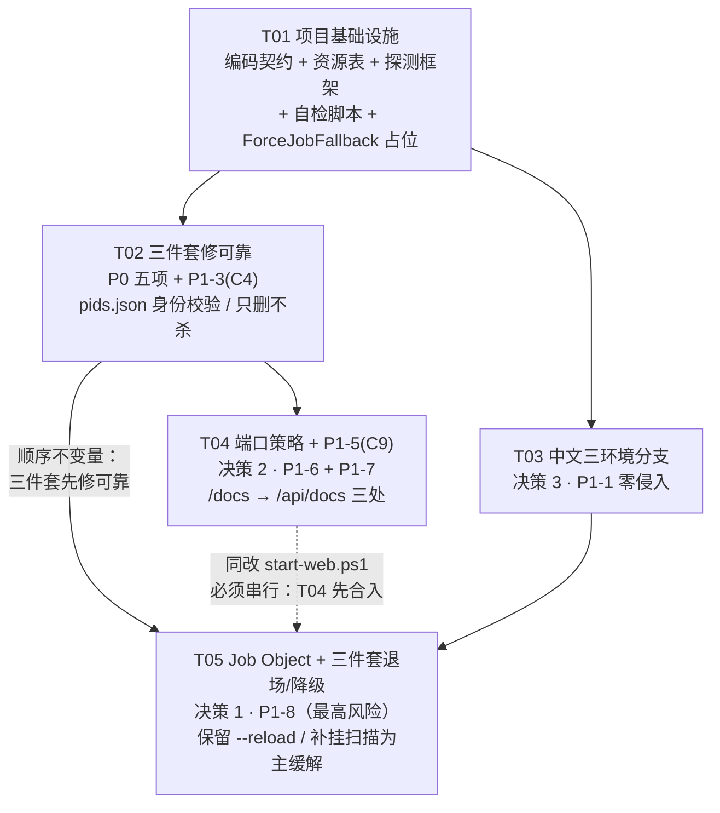

# Windows 一键启动器优化 · 增量设计与任务列表（只设计，不改代码）

| 项 | 内容 |
|---|---|
| 设计人 | 高见远（架构师） |
| 唯一事实基础 | `docs/increments/launcher-optimization-review.md`（513 行评估，2026-11-07）。**本设计不重新推翻评估结论，直接引用其编号**（A / B / C1–C13 / D 方案 a–c / E 的 P0-1~P0-5、P1-1~P1-9、P2-1~P2-5 / F） |
| 上游输入 | ① 用户 2026-11-07 **三项拍板** + 「P0 五项全做」；② 用户 2026-11-07 **对本文 §8 三点建议的全部拍板决议**（逻辑退场 / P1-3+P1-5 纳入 / 保留 `--reload`）；`scripts/start-web.ps1`、`scripts/stop-web.ps1`、两个 `.bat`、`frontend/vite.config.ts`、`SplitWorkspace.tsx:42`、`offline.html`、`backend/app/config.py`、`backend/app/main.py:87`、`2. 启动网页端(Mac-Linux).sh`、`README.md`、`NEXT-ACTION.md`、`docs/**/*.html`（均已只读核对） |
| 日期 / 版本 | 2026-11-07 · **v1.2（修订版）**。v1.0 = 初版设计；v1.1 按上述 ② 的三项决议更新 §1 / §2 / §3.5 / §3.6 / §3.7 / §4.1 / §5.3 / §6 / §7 / §8，新增 **§2.5（P1-3 精确范围）/ §2.6（P1-5 范围与已知遗留）/ §6.2.1 / §6.2.2 / §6.4（可转交施工单摘要）/ §6.5（施工单逐条展开）/ §7.8 / §8.1 / §8.2**；**v1.2 = 本修订**（按交付总监对 T01 上报规格冲突的裁定，只修口径，不改任何代码 / 脚本 / `.bat` / 前端 / 文档站 HTML，不提交 git；明细见下「变更记录 · v1.2」行）。§8 由「待拍板」改为「决议记录」，全文已无待确认项 |
| 变更记录 · **v1.2**（本修订，2026-11-07） | **触发**：T01 已实现并提交（`f7884ea`），其新增的 `scripts/check-launcher-encoding.ps1` 中 `MSG-PAIR` 规则拦下 §5.3 `Job.NoPause` 的 `en` 值含非 ASCII 字节（内嵌中文 `.bat` 文件名），工程师判定为**设计层面的规格冲突**并上报，交付总监裁定后落实。**只改口径、不动代码**：① §5.3 `Job.NoPause` 的 `en` 改为纯 ASCII 的 `powershell -NoProfile -ExecutionPolicy Bypass -File scripts\stop-web.ps1`（与 `3. 停止网页端(Windows).bat` 底层同一个脚本）；② `zh` 值保持原样；③ 升格为 §6.1 **约定 11**：`en` 分支用户可见文案字节级全 ASCII、不得出现中文文件名 / 中文路径 / CJK 字符，需要指向项目内文件时一律给纯 ASCII `scripts\...` 路径与可执行命令；④ 逐条核 §5.3 全表 **23 键**：唯一把中文文件名嵌入用户可见 `en` 文案的键是 `Job.NoPause`，**无第二个违反该约定的键**；另把 `Port.FrontendBusy` 的 `en` 单元格中文占位说明 `…（见 §4.5 全文）` 改为纯 ASCII 标注（该说明是表内编辑标注、非输出文案，§4.5 实际英文降级文案本就纯 ASCII、无中文文件名）；⑤ 明确记为「**T01 实现前发现的规格缺陷**」（§5.3 表下），由工程师自检规则拦下并上报，**不是设计遗漏被静默吞掉**；⑥ §6.5 T01 验收补两句：`-DryRun` 余三行（`Job race`→T05 / `PidFile schema`→T02 / `Docs URL`→T04）由后续任务回填、**不算 T01 欠账**，能力字段刻意留 `deferred(T05)` / `unknown(T03)` 初值、保持现状行为，符合「不预实现」约束。**T01 验收结论不变、仍为已完成**；任务范围 / 依赖 / 验收清单均不变；T02 由工程师并行实现中，本修订未触碰 `scripts/**`、两个 `.bat` 与前端 |
| 交付物 | **本文（本轮修订唯一落盘文件）** |
| 纪律 | 未修改任何 `.bat` / `.ps1` / `.sh` / 前端源码 / 后端配置 / 文档站 HTML；**未执行任何会启停项目服务的命令**；未做 git 提交；未新建除本文外的任何文件 |
| 阶段声明 | 项目当前处于 **「测试期」**（`NEXT-ACTION.md:3`「先停止写代码，先做真实测试」）。本版**全部改动都在启动脚本层**（`.bat` / `.ps1` / `.sh` / `vite.config.ts` 配置 / README），**不改产品代码（`frontend/src/**`、`backend/app/**`）与 UI**，因此**不影响 `docs/用户任务清单.html` 的 6 项真人测试**（导出 PDF、真实教材、真实 Key、PWA、真实 GPU、移动端）与 5 个学生试用任务；但会改变测试者的「停止方式」习惯，真人测试开跑前应先用 `-DryRun` 告知 |
| 不确定项 | 所有 Windows 内核/字体行为不确定处均标注 **「需实现后实测」**，不伪装为已验证 |

> 三项拍板与评估编号的映射（全文沿用，不再另立编号）：
> **决策 1** = P1-8 / D 方案 (a)（Job Object + 能力探测 + 失败降级；三件套退场；`-NoPause` 不设 `KILL_ON_JOB_CLOSE`）；
> **决策 2** = P1-6 + P1-7（前端 5173 固定 + 明确报错，后端可选自动换 = `EDU_BACKEND_PORT` 注入 + `vite.config.ts` 一次性 2 行；**明确不采纳 P2-1 全量自动换**）；
> **决策 3** = P1-1 取评估 A.3「零侵入」分支（条件化 `chcp` + 无 CJK 字体时降级英文提示；**不改用户控制台字体、不改 HKCU**）；
> **另**：P0-1 ~ P0-5 五项全做。
>
> **v1.1 追加的三项决议（2026-11-07，用户已拍板，见 §8）**：
> **决议 4** = 三件套「逻辑退场、文件保留」为**正式口径**（§1 关键取舍升格为决议；§2.3 逻辑不变）；
> **决议 5** = **P1-3（C4）+ P1-5（C9）纳入本轮**，分别挂 T02 / T04（§2.5 / §2.6 / §6.2）；
> **决议 6** = **保留 `uvicorn --reload`**，§3.7「去掉 --reload」明确不做，补挂扫描仍为主缓解手段。

---

## 1. 设计契约（四行）

| | 内容 |
|---|---|
| **一句话目标** | 在**不改动产品代码与 UI、不破坏已安装 PWA 桌面快捷方式**的前提下，把 Windows 一键启动器升级为「关窗口即停（OS 级保证）+ 端口冲突可自愈 + 中文零乱码」，且**任意一步能力探测失败即完整退回现有可靠机制**。 |
| **主屏任务** | 工程师按 **T01→T05 五个 commit**，把三项拍板 + 三项补充决议 + P0 五项健壮性修复 + P1-3 / P1-5 落到 `scripts/`、`1.`/`3.` 两个 `.bat`、`2. 启动网页端(Mac-Linux).sh`、`README.md` 与 `frontend/vite.config.ts` 的 **2 行**；全部结果由 `-DryRun` 无副作用可观测、由提交前自检脚本可复核。**可转交施工单摘要见 §6.4，逐行展开见 §6.5**。 |
| **明确不做什么** | ① **不物理删除**三件套（改为「正常路径休眠 / 降级路径完整启用」，见 §2.3，**已拍板为决议**）；② 不做 P2-1 前后端全量自动换端口；③ 不改 `HKCU\Console` / 控制台字体 / 默认终端应用 / 任何注册表键；④ 不改 `CORS_ORIGINS` / `manifest.webmanifest` / `sw.js` / `preview:4173` / QA 脚本；⑤ 不改 `frontend/src/**` 与 `backend/app/**`（含 `SplitWorkspace.tsx`、`offline.html`），不引入需重新 `npm run build` 的改动；⑥ **文档站 HTML 不改**（P1-5 只改三处脚本/MD，HTML 里的 `/docs` 作为已知遗留显式登记，见 §2.6）；⑦ **不去掉 `uvicorn --reload`**（用户拍板保留开发期热重载，见 §3.7）；⑧ 不纳入 P1-2 / P1-4 / P1-9 / P2-*（见 §2.4）；⑨ 不新增二进制 / 签名 DLL；⑩ 本轮不启停服务、不提交 git。 |
| **关键取舍** | 以「**Job 能力探测成功才退场三件套、任何一步失败即完整回退**」换「关窗口即停的内核级保证」；以「**三件套常驻代码库但正常路径休眠**」换「降级路径 100% 可用」；以「**前端 5173 恒定 + 后端端口可注入**」换「PWA origin 不漂移」；以「**无 CJK 字体时英文提示 + 条件化 chcp**」换「零系统侵入」。 |

> #### 【决议 1 · 2026-11-07 用户已拍板】三件套 = 逻辑退场、文件保留
>
> 「删除停止脚本 / `pids.json` / `PowerShell.Exiting` 三件套」的**正式口径**是：**从主流程与用户认知中退场，不是 `rm` 文件**。四个文件（`3. 停止网页端(Windows).bat`、`scripts/stop-web.ps1`、`pids.json` 写入逻辑、`Register-EngineEvent` 钩子）**全部保留在代码库中**，正常路径休眠、降级 / `-NoPause` 路径完整启用。
> **理由（不可协商）**：决策 1 同时要求「带能力探测 + 失败降级」，降级必须**完整退回**三件套；S1–S6 任一步失败都要求这四项立即可用。若做物理删除，则 §3.3 所有失败分支失去实现基础，「失败降级」成为空话，两条指令直接矛盾。此口径与评估 D.4 原文一致（§2.3 保留 D.4 引文）。
> **本决议为设计契约的一部分，不再是解释性推测**；实现时不得以「用户说删」为由删除任何文件（`git status` 不得出现 `D` 条目，见 T05 验收 ⑦）。

### 1.1 为什么这版不会破坏已安装的 PWA 桌面快捷方式

1. 已安装 PWA 绑定在**精确 origin `http://localhost:5173`**：`manifest.webmanifest` 的 `start_url: "/"` / `scope: "/"` 是 origin-relative，浏览器把安装记录锚在**含端口**的 origin 上，Service Worker 也注册在该 origin（评估 B.1 #24/#25、B.5）。
2. 本版**前端端口固定 5173**（决策 2，明确不采纳 P2-1），并加 **`--port 5173 --strictPort`**（P0-3）：5173 被占时**响亮失败**而不是像现在 `strictPort: false` 那样静默递增到 5174 —— 这恰恰是**保护**已装快捷方式，而非破坏（评估 P0-3 破坏性列标为「有益」）。
3. 后端端口可换**不影响 origin**：前端所有请求走 vite 的 `/api` **同源代理**，`client.ts:resolveApiBase()` 默认 `/api` 不变；评估 B.2 提到的 `VITE_API_BASE` 跨域直连旁路本版**明确不采用**（它会把端口烘焙进生产 bundle，PWA 装完即死）。`CORS_ORIGINS` 列的是「允许访问后端的**前端** origin」，与后端自己监听哪个端口无关（评估 B.1 #10 + B.2 结构性结论）。
4. `frontend/public/manifest.webmanifest`、`frontend/dist/manifest.webmanifest`、`frontend/public/sw.js`、`vite.config.ts` 的 `preview.port: 4173` / `port: 5173` / `strictPort: false` **一个字节都不改**。
5. 结论：已安装桌面快捷方式、书签、SW 注册、`README` / QA 脚本里的地址全部继续有效，**用户无需卸载重装**（评估 B.5 取舍表）。

---

## 2. 目标状态与当前状态的差异表

> 「破坏性」沿用评估 E 的定义：会改变既有用户可观察行为 / 需要用户重新操作 / 需要重新构建前端。
> **v1.1 本版范围** = **P0-1~P0-5 + P1-1 + P1-3（C4）+ P1-5（C9）+ P1-6 + P1-7 + P1-8 + P2-5 的 DryRun 探测输出**（并入 T01/T02/T04/T05）。
> 其中 **P1-3 / P1-5 为 2026-11-07 新拍板纳入**（决议 5），精确范围与已知遗留见 §2.5 / §2.6。评估中其余 P1/P2/C 条目处理方式见 §2.4。

### 2.1 要改的文件（逐文件）

| # | 文件路径 | 改什么 | 为什么（评估编号） | 破坏性 | 任务 |
|---|---|---|---|---|---|
| 1 | `scripts/start-web.ps1` | **主战场**：① 顶部新增 `Get-ConsoleTextCapability`（ACP / FaceName / FontLink 判定）、`$Messages` zh/en 资源表、`Msg()`；② 条件化 `chcp` 取代第 45–52 行无条件 `chcp 65001`；③ 新增 `Get-JobCapability` 探测框架与 `$script:LauncherCapability`；④ P0-1 端口三态判定 + 禁止空 `StartedPids` 覆写 `pids.json` + 原子写；⑤ P0-2 `/api/health` 身份校验（`HttpClientHandler{UseProxy=$false}`）；⑥ P0-3 `npm run dev -- --port 5173 --strictPort`；⑦ P0-5 轮询查 `HasExited` + err.log 致命关键字 + tail 日志；⑧ P1-6 后端端口编排（`$BackendPort` 变量 + `$env:EDU_BACKEND_PORT` 注入 + 完成页/DryRun/健康检查 URL 去字面量）；⑨ P1-7 5173 被占报错文案与 `netstat` 指引；⑩ P1-8 Job Object 全部逻辑；⑪ `-DryRun` 四类探测输出（P2-5）；⑫ **P1-3（新）**：`pids.json` 写入端 `:378-382` 增 `processes` 明细（`pid`/`process_name`/`start_time`，见 §2.5），条件仍未「本轮至少启动了一个进程」；⑬ **P1-5（新）**：完成页 `:404` 的 `/docs` → `/api/docs` | P0-1~P0-5、P1-1、**P1-3**、**P1-5**、P1-6、P1-7、P1-8、P2-5、C4、C9 | **否**（P0-3 占端口时由「静默错站」变「响亮失败」，属预期且对 PWA 有益；P1-3 为向后兼容的字段追加；P1-5 为纯文案；P1-8 的行为变化用户已拍板接受） | T01/T02/T03/T04/T05（**串行**，见 §6 跨任务约定） |
| 2 | `scripts/stop-web.ps1` | ① 条件化 `chcp` + 全部 `Write-Host` 改走 `Msg()` 中英资源表（P1-1）；② 行尾 **LF → CRLF**（C13 最小子集，复用 `.gitattributes`）；③ 文件**保留**，注释改为「降级 / `-NoPause` 路径的应急工具，正常路径不需要」（P1-8）；④ **P1-3（新）**：`:51-67` 停止前校验 `ProcessName` + `StartTime`、陈旧/不匹配**只删不杀**、**兼容旧格式**（见 §2.5），新增 3 条 `Msg()` 键 | P1-1、**P1-3**、P1-8、C13、C4 | **否**（旧格式按旧行为处理，不报错） | T01/T02/T03/T05 |
| 3 | `1. 启动网页端(Windows).bat` | **仅 P0-4**：纯 ASCII 参数扫描 `for %%A in (%*) do if /I "%%~A"=="-NoPause" set "EDU_NOPAUSE=1"`（`-DryRun` 同理），`if errorlevel 1 ( ... if not defined EDU_NOPAUSE pause )`。保持 100% 纯 ASCII、无非 ASCII 字节、无 BOM | P0-4（C6 自动化挂死）；P1-1 无需改（逻辑全在 `.ps1`）；P1-8 无需改（Job 全在 `.ps1`） | **否** | T02 |
| 4 | `3. 停止网页端(Windows).bat` | ① **仅 P0-4**：`pause` 条件化（纯 ASCII）；② 注释更新为「仅当启动窗口提示『未启用自动清理』或 `-NoPause` 时使用」。**文件保留，不物理删除** | P0-4（C6）；P1-8（退场但保留降级入口） | **否** | T02/T05 |
| 5 | `frontend/vite.config.ts` | **仅 2 行功能性改动**：新增 `const backendPort = process.env.EDU_BACKEND_PORT \|\| "8000";`（import 之后、`apiProxy` 之前），第 20 行 `target:` 改为模板字符串 `` `http://127.0.0.1:${backendPort}` ``。**不动** `port: 5173` / `strictPort: false` / `preview.port: 4173` / `proxy: apiProxy` / 注释（注释里 8000 可顺带改，属文档、零功能） | P1-6（评估 B.2「最小一次性改动」）；不动前端端口 = 决策 2 | **否**：Node 侧配置、dev server 启动时求值，无 `VITE_` 前缀、**不需要重新构建**；未设 env 时与现字面量完全等价 | T04 |
| 6 | `2. 启动网页端(Mac-Linux).sh` | 第 81 行 `--port 8000` → `--port "${EDU_BACKEND_PORT:-8000}"`；第 104–105 行文档/健康检查链接用同一变量；**P1-5（新）**：第 104 行 `/docs` → `/api/docs`；第 92 行 `URL=localhost:5173` **不动** | P1-6（评估 B.1 #17）、**P1-5 / C9** | **否**（默认仍 8000） | T04 |
| 7 | `README.md` | 第 135 行补 `EDU_BACKEND_PORT` 说明；第 143 行健康检查改「以启动窗口显示的实际端口为准」；**P1-5（新）**：第 143 行「`/docs` 有完整 OpenAPI」→「`/api/docs` 有完整 OpenAPI」；新增「5173 被占」排障段（`netstat -ano \| findstr :5173` → `taskkill /PID <PID> /T /F`）；新增「关窗口即停 / 三件套已退场」与「后端端口可换、前端恒为 5173」说明。第 121 行 `-TargetUrl` 用法**不动**（P1-4 不在范围） | P1-6、P1-7、**P1-5 / C9**、P1-8 的用户认知更新 | **否** | T04/T05 |
| 8 | `.gitattributes` | **无需改动，仅复核**：已有 `*.ps1 text eol=crlf`、`*.bat text eol=crlf`、`*.sh text eol=lf` 与「BOM 属于内容」注释，正是 C13 需要复用的约束 | C13 / A.4 | **否** | T01（复核） |
| 9 | `scripts/check-launcher-encoding.ps1` | **新增**（提交前自检）：两个 `.bat` 纯 ASCII、两个 `.ps1` BOM + CRLF、PowerShell `ParseErrors=0`、`-DryRun` 冒烟。评估 A.4 建议把编码检查加入提交前自检，项目 `scripts/` 下已有自检惯例 | A.4、§7 回归 | **否**（新文件，不被产品引用） | T01 |

### 2.2 明确不改的文件（逐文件，含理由）

| # | 文件路径 | 结论 | 理由 |
|---|---|---|---|
| 10 | `frontend/src/components/layout/SplitWorkspace.tsx:42` | **不改** | 评估 P1-6 标为「UI 文案（显示）」联动。但该文案只在**后端连不上时**出现；后端端口自动换成功时服务正常、这句根本不显示。且改 `.tsx` = 改产品代码/UI，**需重新 `npm run build` 才能让已装 PWA 生效**（会踩 `NEXT-ACTION.md:196` 记录的 `SAFE_DELETE_BULK_CONFIRM_REQUIRED` 坑），与「测试期只改启动脚本层」纪律冲突。列为**后续单独提交（P2 级纯文案）** |
| 11 | `frontend/public/offline.html:110-112` | **不改** | 同上；且评估 C12 已确认 dev 模式下 `/sw.js` 从不注册，`offline.html` 离线兜底本就不生效，改它零收益 |
| 12 | `frontend/src/vite-env.d.ts:11`、`frontend/.env.example:4` | **不改** | 纯注释里的 8000，零功能影响；`VITE_API_BASE=/api` 默认值不动 |
| 13 | `frontend/src/api/client.ts:47-60`、`frontend/src/api/**` | **不改** | `resolveApiBase()` 默认 `/api`，**走相对路径，对后端端口完全无感**——这是后端可换端口能成立的基石 |
| 14 | `frontend/public/sw.js` | **不改** | `SHELL` / `isApiRequest` 全为相对路径 `/`、`/api/`；前端 origin 不变 → SW 不受影响 |
| 15 | `frontend/public/manifest.webmanifest` + `frontend/dist/manifest.webmanifest` | **不改（严禁改）** | `start_url: "/"` / `scope: "/"`；前端 5173 固定 → origin 恒定 → 已装 PWA 快捷方式有效。见 §1.1 |
| 16 | `backend/app/config.py:161` `CORS_ORIGINS`、`backend/.env.example:78`、`backend/app/main.py:93-94` | **不改** | 白名单列的是**前端 origin**（5173），与后端监听端口无关；请求走 vite 同源 `/api` 代理，**CORS 根本不触发**（评估 B.1 #10、B.2 结构性结论）。仅当采用 `VITE_API_BASE` 跨域直连旁路时才需要 env 覆盖——本版不采用 |
| 17 | `frontend/vite.config.ts:52` `preview.port: 4173` | **不改** | `vite preview`（生产构建验证）与 dev 5173 是两套端口，本版都不碰。**注意**：`preview.proxy: apiProxy` 复用同一对象，故 `EDU_BACKEND_PORT` 注入对 preview **自动生效、无需额外代码**（顺带收益） |
| 18 | `scripts/print_pdf_check.mjs:11-12,29-30` | **不改** | 已具备 `APP_URL` / `API_URL` env 覆盖（`process.env.API_URL ?? "http://127.0.0.1:8000"`）；默认后端端口仍是 8000，无需改；将来真换端口用 env 覆盖即可 |
| 19 | `scripts/e2e_smoke.py:12`、`scripts/real_llm_check.py:17` | **不改** | 已是独立端口 `8123`，与 8000/5173 无关（评估 B.1 #22） |
| 20 | `docs/01-快速开始/*.html`、`docs/04-开发指南/*.html`、`docs/05-运维部署/*.html`（含 `1. 部署方案.html:92-93,194` 的 `EXPOSE 8000` / `proxy_pass`）、`docs/06-项目档案/*.html`、`docs/00-源文档/ARCHITECTURE.md` | **不改** | ① 团队纪律明确「不改文档站 HTML」；② 部署配置是容器/生产拓扑，`EXPOSE 8000` **不应随本地端口变**（评估 B.1 #20）；③ 默认端口仍是 8000，现有文档不失准。排障指引改写在 `README.md`；④ **v1.1：HTML 里残留的 `/docs` 属 P1-5 已知遗留，已在 §2.6 显式登记**，不是静默不一致 |
| 21 | `HANDOVER.md:269-270`、`NEXT-ACTION.md:194,200` | **本版建议不动** | 交接文档处于测试期，避免干扰真人测试排障；`EDU_BACKEND_PORT` 已在 README  documenting。如需同步，列为后续可选 |
| 22 | `backend/data/launcher/*.log`（4 个日志文件） | **不改** | 日志名/清空策略保持不变（C11 轮转不在范围）；但 P0-5 会**读**它们做早失败 tail |

### 2.3 删除哪些文件 / 机制

**物理删除文件数 = 0。** 这是【决议 1 · 2026-11-07 用户已拍板】的**正式口径**（§1 设计契约已升格为决议，不再是解释性推测）：决策 1 要求「采用后删除停止脚本 / `pids.json` / `PowerShell.Exiting` 三件套」，同时要求「带能力探测 + 失败降级」。二者唯一自洽的解释是**逻辑退场、文件保留**，且与评估 D.4 原文一致：

> 评估 D.4：「严格地说，在工程上停止脚本**不能物理删除**，只能从『用户必须知道并手动跑』降级为『极少数环境下的应急工具』——但用户层面『为什么需要这个脚本』的答案是：正常路径下不再需要。」

即：**「删除」= 从主流程与用户认知中退场，不是 `rm` 文件**。若真做物理删除，则 §3.3 的 S1–S6 失败分支无实现基础，与决策 1 的「失败降级」直接矛盾。**本口径已拍板，无需再对齐**（决议记录见 §8.1）。

| 机制 | 现状位置 | 目标状态（正常路径：Job 能力 OK 且非 `-NoPause`） | 降级 / `-NoPause` 路径 |
|---|---|---|---|
| `3. 停止网页端(Windows).bat` + `scripts/stop-web.ps1` | 根目录 / `scripts/` | **文件保留、正常路径休眠**；完成页与 README 不再写「点 X 请跑停止脚本」 | **完整可用**，且是唯一停止入口 |
| `pids.json` 写入 | `start-web.ps1:378-382` | **不生成**（内核按 job 句柄管理，无需 PID 清单）；已有旧文件按 P0-1 规则处理，不盲删 | **照常生成**（含本轮真实 PID）；并按 **P1-3** 写入 `processes` 明细字段（见 §2.5），旧格式仍可读 |
| `Register-EngineEvent PowerShell.Exiting` | `start-web.ps1:190-199` | **不注册**（评估 D.5：点 X 时本就不保证触发，留着给人虚假安全感） | **注册**，作为尽力清理 |
| 「按回车主动 `taskkill /T /F` 杀树」 | `start-web.ps1:420-425`、`Stop-LaunchedServices` | **保留**为「按回车友好停止」入口（与 Job 不冲突，Job 是最后兜底），但**不再作为唯一清理依据**；提示文案改为「按回车立即停止 / 直接关窗口也会自动停止」 | **保留**，是主清理路径，提示为「本次未启用自动清理，请按回车停止」 |
| `uvicorn --reload` 双进程、`cmd→npm→node→esbuild` 链 | `start-web.ps1:355-369` | 进程形态不变（**用户拍板保留 `--reload`**，见 §3.7），但全部进 Job（含孙进程自动继承，见 §3.5） | 不变 |

### 2.4 本版明确不做（避免范围蔓延）

| 评估编号 | 内容 | 处理 |
|---|---|---|
| P1-2 | C1 代理大小写合并取首个非空值 / `NO_PROXY` 追加而非覆盖 | **不纳入本轮**（team-lead 施工单示例里提到的 `Normalize-ProxyEnvironment :70-76` 即属此条）。理由：① 用户三项拍板 + 三项补充决议均未包含 P1-2；② 评估 E 标其风险「中」且**必须回归验证原「Item has already been added」修复仍有效**，会动到已实测通过的代理归一化逻辑，与本轮「测试期只改启动脚本层、低风险」纪律冲突；③ 不动它不影响关窗口即停 / 端口 / 中文 / 降级任一目标。**列为后续独立 commit**（见 §6.4 / §6.5 施工单「不做清单」，工程师不要顺手改） |
| P1-3 | C4 `pids.json` 加 `ProcessName`/`StartTime`/停止前校验 | ✅ **2026-11-07 拍板纳入本轮，挂 T02**。范围与格式见 §2.5；理由见该节 |
| P1-4 | C5 + C10 `-TargetUrl` → `EDU_TARGET_URL` / URL 校验 | 不纳入（README:121 既有用法会变，属破坏性，用户未拍板） |
| P1-5 | C9 `/docs` → `/api/docs` | ✅ **2026-11-07 拍板纳入本轮，挂 T04**。范围限三处、HTML 不改，已知遗留见 §2.6 |
| P1-9 / C7 / C10 / C11 / C12 | 轮询去重 / URL 校验 / 日志轮转 / dev 下 PWA 安装提示 | 不纳入 |
| P2-1 | 前后端全量自动换端口 | **明确不采纳**（用户拍板 2） |
| P2-2 / P2-3 / P2-4 | preview 安装引导 / 日志轮转 / C13 全量 + `.gitattributes` 约束 | 不纳入；其中 **C13 的 `stop-web.ps1` LF→CRLF 作为 T01 编码契约的最小子集顺带完成** |
| A.3 方案 2/3/4 | `SetCurrentConsoleFontEx` / 引导 Windows Terminal / 写 `HKCU\Console\FaceName` | **明确不采纳**（用户拍板 3 = 零侵入） |
| §3.7 缓解 3 | 启动器路径去掉 `uvicorn --reload` 以缩小 Job 竞态面 | **明确不做**（用户 2026-11-07 拍板保留开发期热重载）；补挂扫描仍为主缓解，残留风险如实保留，见 §3.7 |

### 2.5 【新增】P1-3（C4）精确范围：`pids.json` 身份校验

**纳入理由（用户拍板要求写入设计）**：降级路径与 `-NoPause` 路径**仍会写 `pids.json`**（§2.3 表格、§3.5），而 C4 的「PID 复用 → `taskkill /T /F` 误杀无关进程整棵子树」风险在这两条路径里**依然存在**；本机就有多个常驻 `node.exe`/`cmd.exe`（评估 C.4 举了 WorkBuddy MCP 的 PID 3744/8880/12780/17020）。既然三件套在降级时必须「完整可用且可信」，其 PID 文件就不能继续是「裸 PID 清单」。

**`CommandLine` 判断（team-lead 要求架构师裁定）：不写入。** 理由：① `ProcessName` + `StartTime.ToString('o')` 已能唯一识别进程，PID 复用后新进程启动时间必然不同；② 取 `CommandLine` 需 `Get-CimInstance Win32_Process`，在 ConstrainedLanguage / 受限会话下可能失败，而 `Get-Process -Id` 可用面更广；③ 命令行字符串可能含敏感参数（URL / 本地路径）且更长，扩大 JSON 与转义面；④ 评估 C.4 原文即写「**可选** `CommandLine`」。故本版只记 `process_name` + `start_time`。

**新格式（写入端 `start-web.ps1:378-382`，向后兼容追加字段，不删旧字段）**：

```json
{
  "pids": [1234, 5678],
  "processes": [
    { "pid": 1234, "process_name": "python", "start_time": "2026-11-07T13:05:22.1234567+08:00" },
    { "pid": 5678, "process_name": "cmd",    "start_time": "2026-11-07T13:05:23.7654321+08:00" }
  ],
  "updated_at": "2026-11-07T13:05:24.0000000+08:00",
  "target_url": "http://localhost:5173"
}
```

- 保留 `pids` / `updated_at` / `target_url` 三个旧字段**原样**；`processes` 为**新增可选字段**。`start_time` 用 `(Get-Process -Id $ProcId).StartTime.ToString('o')`（ISO 8601，符合 §6.1 约定 6）。
- 写入时若某个 PID 已退出 / `Get-Process` 抛异常 → 该条 `processes` 项省略（不因此中断启动），`pids` 仍照记；**不改变 P0-1 的「本轮至少启动了一个进程才写」条件**。

**停止端 `scripts/stop-web.ps1:43-67` 的四态判定（「只删不杀」是硬要求）**：

| 状态 | 判定 | 动作 |
|---|---|---|
| A 新格式且全部匹配 | `processes` 存在；对每个 PID `Get-Process -Id` 成功，且 `ProcessName` 相等、`StartTime.ToString('o')` 相等 | 才执行 `taskkill /PID <id> /T /F`；任意一个不匹配 → 落入状态 C |
| B 陈旧 | `updated_at` 距今 > 24h（评估 C.4 建议阈值） | **只删 `pids.json`、不杀任何进程**，打印 `Msg('StopScript.Stale')` 并给出 `netstat -ano \| findstr :8000,5173` 定位指引 |
| C 不匹配 / 无法验证 | `processes` 存在但任一 PID 查不到、或进程名/启动时间不一致 | **只删 `pids.json`、不杀任何进程**（宁可漏停，不可误杀），打印 `Msg('StopScript.Mismatch')` |
| D **旧格式兼容** | `processes` 字段缺失 / 为空 / 读不到新字段（现有 `pids.json` 只有 `pids`/`updated_at`/`target_url`） | **按旧行为处理、不报错**：沿用原 `:58-67` 对 `pids` 数组逐个 `taskkill /T /F`，打印 `Msg('StopScript.Legacy')` 说明「旧格式，按兼容模式处理」 |

> 「兼容旧格式」= 读不到新字段时**退回旧行为而不是抛异常**，这是 team-lead 明确的硬要求；状态 B/C 的「只删不杀」是 C4 的安全底线。二者不冲突：旧格式不是「陈旧/不匹配」，而是「字段缺失」，走 D。
> 新增 3 条 `Msg()` 键必须 zh/en 成对（§6.1 约定 3），见 §5.3 补充表。

### 2.6 【新增】P1-5（C9）精确范围与已知遗留登记

**事实依据**：`backend/app/main.py:87` 为 `docs_url="/api/docs"`（`openapi_url="/api/openapi.json"`），故 `/docs` 必然 404（评估 C.9）。

**本轮改动范围（team-lead 裁定，恰好三处，均为非 HTML 文件）**：

| # | 文件 | 精确行 | 改动 |
|---|---|---|---|
| 1 | `scripts/start-web.ps1` | `:404` | `http://127.0.0.1:8000/docs` → `http://127.0.0.1:$BackendPort/api/docs`（与 P1-6 的端口去字面量合并为同一行改动；`/api/health` 在 `:405` 保持） |
| 2 | `2. 启动网页端(Mac-Linux).sh` | `:104` | `http://127.0.0.1:8000/docs` → `http://127.0.0.1:${EDU_BACKEND_PORT:-8000}/api/docs` |
| 3 | `README.md` | `:143` | 「`/docs` 有完整 OpenAPI」→「`/api/docs` 有完整 OpenAPI」（同段健康检查按 §4.1 改为「以启动窗口实际端口为准」） |

**⚠️ 已知遗留（显式登记，避免静默不一致）**：本轮纪律为「**不改文档站 HTML**」，但评估 C.9 / P1-5 原文还列出了「相关 HTML 文档」。经只读全量检索，`docs/**/*.html` 中仍有 `/docs` 字样：

| 位置 | 现状 | 本轮处理 |
|---|---|---|
| `docs/01-快速开始/2. 环境搭建与运行.html:231` | `<td><code>GET /docs</code></td><td>看到 FastAPI 自动生成的 API 文档，21 个端点</td>` | **不改**（本轮纪律），登记为已知遗留；后续「全量推进文档站对齐」时改为 `GET /api/docs` |
| `docs/05-运维部署/*.html` 等其余 HTML | 本轮检索未发现 `/docs` 字面量，但不排除其它表述 | **不改**；一并留待全量对齐 |

**结论**：三处脚本/MD 改完后，启动器完成页、Mac/Linux 完成页、README 三处用户可见入口均指向 `/api/docs`；**文档站 HTML 仍会显示 `/docs`（已知、已登记、非静默）**。这不是遗漏，是纪律约束下的显式取舍；工程师与 QA 不得因「HTML 里还有 /docs」而回头改动 HTML，也不得据此判定 T04 未完成（T04 验收 ⑤ 已明确把 HTML 排除在 diff 之外）。`HANDOVER.md:189` 已有「HTML 文档站滞后」条目，本遗留与之同类。

---

## 3. Job Object 的精确设计（本节最重）

> 对应评估 D.3 方案 (a)、D.4、D.5、P1-8。所有 P/Invoke 代码集中在 `scripts/start-web.ps1` 的一个 here-string 里；**不新增二进制、不引入 DLL、不改产品代码**。
> **重要澄清（不推翻评估，仅补足可执行性）**：团队给的逻辑探测顺序是「`IsProcessInJob` → `Add-Type` → `CreateJobObject` → `Assign`」。但 `IsProcessInJob` 本身是 P/Invoke，**物理上必须先由 `Add-Type` 编译出类型**。因此下文把它拆成：**物理执行 = Add-Type 编译一次（S1）→ 首个 P/Invoke 调用就是 `IsProcessInJob`（S2）**；**逻辑判定顺序**严格按团队给的四步。评估 D.3 的 `CreateJob → SetInformation → Assign` 是机制示意，本设计在**不改变机制**的前提下保留该顺序，并补一条「降级安全不变量」（§3.3）。

### 3.1 P/Invoke 签名与常量

编译目标：`Windows PowerShell 5.1 / .NET Framework 4.x / Windows x64`（本机 Win11 24H2/25H2、NT 10.0.26300）。

```csharp
using System;
using System.Runtime.InteropServices;

namespace EduLauncher
{
    // ---- 常量（winnt.h） ----
    public static class JobConst
    {
        public const int  JobObjectBasicLimitInformation    = 2;   // QueryInformationJobObject 用
        public const int  JobObjectExtendedLimitInformation = 9;   // SetInformationJobObject 用
        public const uint JOB_OBJECT_LIMIT_BREAKAWAY_OK        = 0x00000800;
        public const uint JOB_OBJECT_LIMIT_SILENT_BREAKAWAY_OK = 0x00001000;
        public const uint JOB_OBJECT_LIMIT_KILL_ON_JOB_CLOSE   = 0x00002000;
    }

    // ---- 结构体：LayoutKind.Sequential + 平台默认 Pack（不要写 Pack=1） ----
    [StructLayout(LayoutKind.Sequential)]
    public struct JOBOBJECT_BASIC_LIMIT_INFORMATION
    {
        public long    PerProcessUserTimeLimit;  // LARGE_INTEGER  8B
        public long    PerJobUserTimeLimit;      // LARGE_INTEGER  8B
        public uint    LimitFlags;               // DWORD          4B
        // x64: CLR 自动插 4B padding，使下列 SIZE_T 对齐到 8
        public UIntPtr MinimumWorkingSetSize;    // SIZE_T         8B(x64)/4B(x86)
        public UIntPtr MaximumWorkingSetSize;    // SIZE_T
        public uint    ActiveProcessLimit;       // DWORD          4B
        // x64: CLR 自动插 4B padding，使下列 ULONG_PTR 对齐到 8
        public UIntPtr Affinity;                 // ULONG_PTR
        public uint    PriorityClass;            // DWORD
        public uint    SchedulingClass;          // DWORD
    }

    [StructLayout(LayoutKind.Sequential)]
    public struct IO_COUNTERS
    {
        public ulong ReadOperationCount;
        public ulong WriteOperationCount;
        public ulong OtherOperationCount;
        public ulong ReadTransferCount;
        public ulong WriteTransferCount;
        public ulong OtherTransferCount;
    }

    [StructLayout(LayoutKind.Sequential)]
    public struct JOBOBJECT_EXTENDED_LIMIT_INFORMATION
    {
        public JOBOBJECT_BASIC_LIMIT_INFORMATION BasicLimitInformation;
        public IO_COUNTERS  IoInfo;
        public UIntPtr ProcessMemoryLimit;
        public UIntPtr JobMemoryLimit;
        public UIntPtr PeakProcessMemoryUsed;
        public UIntPtr PeakJobMemoryUsed;
    }

    public static class NativeJob
    {
        [DllImport("kernel32.dll", CharSet = CharSet.Unicode, SetLastError = true)]
        public static extern IntPtr CreateJobObject(IntPtr lpJobAttributes, string lpName);

        [DllImport("kernel32.dll", SetLastError = true)]
        [return: MarshalAs(UnmanagedType.Bool)]
        public static extern bool SetInformationJobObject(
            IntPtr hJob, int infoClass,
            ref JOBOBJECT_EXTENDED_LIMIT_INFORMATION info, uint cbInfoLength);

        [DllImport("kernel32.dll", SetLastError = true)]
        [return: MarshalAs(UnmanagedType.Bool)]
        public static extern bool QueryInformationJobObject(
            IntPtr hJob, int infoClass,
            ref JOBOBJECT_BASIC_LIMIT_INFORMATION info, uint cbInfoLength,
            out uint lpReturnLength);

        [DllImport("kernel32.dll", SetLastError = true)]
        [return: MarshalAs(UnmanagedType.Bool)]
        public static extern bool AssignProcessToJobObject(IntPtr hJob, IntPtr hProcess);

        [DllImport("kernel32.dll", SetLastError = true)]
        [return: MarshalAs(UnmanagedType.Bool)]
        public static extern bool IsProcessInJob(
            IntPtr hProcess, IntPtr hJob,
            [MarshalAs(UnmanagedType.Bool)] out bool Result);

        [DllImport("kernel32.dll", SetLastError = true)]
        [return: MarshalAs(UnmanagedType.Bool)]
        public static extern bool CloseHandle(IntPtr hObject);

        [DllImport("kernel32.dll")]
        public static extern IntPtr GetCurrentProcess();
    }
}
```

调用要点（工程师必须照做）：

- `SetInformationJobObject` 的 `infoClass` 必须是 **`JobObjectExtendedLimitInformation = 9`**，并传**完整 extended 结构体**（`KILL_ON_JOB_CLOSE` 位在 `BasicLimitInformation.LimitFlags` 里）。**常见错误**：用 class 9 却传 basic 结构体 → 长度不符 → `ERROR_BAD_LENGTH(24)` 或静默写坏内核结构。
- `cbInfoLength = (uint)Marshal.SizeOf(typeof(JOBOBJECT_EXTENDED_LIMIT_INFORMATION))`。**编译后立刻断言**：x64 = **144**、x86 = **112**；不等则判能力失败并降级（不要带着错位结构继续调 `SetInformationJobObject`）。
- 所有 `DllImport` 带 `SetLastError = true`；失败统一用 `[Runtime.InteropServices.Marshal]::GetLastWin32Error()` 记入 `$script:LauncherCapability.FallbackReason`（`5 = ERROR_ACCESS_DENIED` 表示进程已在别的 job，`ERROR_GEN_FAILURE` 等）。
- `bool` 返回值 / `PBOOL` 出参必须显式 `[MarshalAs(UnmanagedType.Bool)]`（4 字节 Win32 `BOOL`），不要用 1 字节 `U1`。
- `AssignProcessToJobObject` 需要 `PROCESS_SET_QUOTA | PROCESS_TERMINATE` 权限；用 `Start-Process -PassThru` 返回的 `System.Diagnostics.Process.Handle`（自己的子进程，权限足够），并先判 `HasExited` 再取 `.Handle`，否则抛异常。

### 3.2 结构体字段布局（Windows x64，逐字节）

`JOBOBJECT_EXTENDED_LIMIT_INFORMATION` 在 x64 的完整偏移（Pack = 平台默认 8）：

| Offset | 字段 | 类型 | Size | 备注 |
|---:|---|---|---:|---|
| 0 | `PerProcessUserTimeLimit` | `long` (= LARGE_INTEGER) | 8 | |
| 8 | `PerJobUserTimeLimit` | `long` | 8 | |
| 16 | `LimitFlags` | `uint` | 4 | **KILL 位写这里** |
| 20 | *(padding)* | — | 4 | CLR 自动插入，为 `SIZE_T` 对齐到 24 |
| 24 | `MinimumWorkingSetSize` | `UIntPtr` | 8 | |
| 32 | `MaximumWorkingSetSize` | `UIntPtr` | 8 | |
| 40 | `ActiveProcessLimit` | `uint` | 4 | |
| 44 | *(padding)* | — | 4 | 为 `ULONG_PTR` 对齐到 48 |
| 48 | `Affinity` | `UIntPtr` | 8 | |
| 56 | `PriorityClass` | `uint` | 4 | |
| 60 | `SchedulingClass` | `uint` | 4 | |
| **64** | **`BasicLimitInformation` 结束** | | **64** | |
| 64 | `IoInfo`（6 × `ulong`） | `IO_COUNTERS` | 48 | |
| 112 | `ProcessMemoryLimit` | `UIntPtr` | 8 | |
| 120 | `JobMemoryLimit` | `UIntPtr` | 8 | |
| 128 | `PeakProcessMemoryUsed` | `UIntPtr` | 8 | |
| 136 | `PeakJobMemoryUsed` | `UIntPtr` | 8 | |
| **144** | **`Marshal.SizeOf` 应等于 144** | | **144** | 断言失败即降级 |

**x64 对齐四个必踩的坑**：

1. ❌ `[StructLayout(LayoutKind.Sequential, Pack = 1)]` —— 取消 padding，全部字段错位 8 字节；`SetInformationJobObject` 可能「返回成功」但 `LimitFlags` 落到错误偏移 → **KILL 静默失效**，比报错更危险。
2. ❌ 用两个 `int` / `uint` 表示 `LARGE_INTEGER`（必须 8 字节 `long`）。
3. ❌ 用 `uint` / `int` 表示 `SIZE_T` / `ULONG_PTR`（x64 下是 8 字节，必须用 `UIntPtr` / `IntPtr` / `nuint`），否则 `MinimumWorkingSetSize` 之后全部错位。
4. ❌ 用 `LayoutKind.Explicit` 手写偏移却按 x86 算，或漏 `[MarshalAs(UnmanagedType.Bool)]`。
5. ✅ 正解：`LayoutKind.Sequential` + **不写 Pack**（= 平台默认）+ 上表类型，让 CLR 按平台自动对齐；再用 §3.1 的 `Marshal.SizeOf` 断言兜底。**x86 下应为 112**，断言按 `[IntPtr]::Size` 分支取值。
6. ⚠️ 上述 144/112 数值与偏移为按 winnt.h 推导，**需实现后实测**（在 `-DryRun` 里打印实测 `Marshal.SizeOf`）。

### 3.3 能力探测顺序（逐步失败处理）

状态载体由 T01 定义、T05 填充：`$script:LauncherCapability = [pscustomobject]@{ AddTypeOk; InJob; ParentJobBreakaway; ParentJobUnknown; CreateJobOk; KillFlagApplied; AssignProbeOk; KillOnClose; FallbackReason; TrioEnabled }`。

| 步 | 逻辑顺序 | API / 动作 | 成功 → | **失败 → 处理** |
|---|---|---|---|---|
| **S1** | 编译（物理前置） | `Add-Type -TypeDefinition $hereString -ErrorAction Stop`，类型名 `EduLauncher.NativeJob`；编译前先 `('EduLauncher.NativeJob' -as [type])` 判重避免重复编译异常；先查 `$ExecutionContext.SessionState.LanguageMode`，`ConstrainedLanguage` 直接判失败不尝试 | `AddTypeOk=$true`，进 S2 | **降级**。评估 §F 已记录「本次评估环境的沙箱就拦截了 `Add-Type`」，因此这条**极可能是常态**。见 §3.7：无可靠备选，只能降级 |
| **S2** | **`IsProcessInJob` 判宿主 job** | `IsProcessInJob(GetCurrentProcess(), IntPtr.Zero, out $inJob)` —— `hJob=NULL` 表示「是否在**任意** job 中」。若 `$inJob=$true`，再尽力用 `QueryInformationJobObject(IntPtr.Zero, 2, ...)` 读所属 job 的 `LimitFlags`，检查 `SILENT_BREAKAWAY_OK(0x1000)` | 记录 `InJob` / `ParentJobBreakaway` / `ParentJobUnknown`，进 S3 | API 调用抛异常 → **降级**（无法确定宿主状态）。`ParentJobBreakaway=$true` → **降级**（保守：宿主 job 允许静默脱离，显式 Assign 的嵌套链不可预测；**需实现后实测** Win8+ 嵌套 job 下是否其实仍可成功）。`QueryInformationJobObject` 的 **NULL 句柄语义在嵌套 Job 下的行为需实现后实测**，查询失败一律按 `ParentJobUnknown=$true` → **保守降级** |
| **S3** | **`CreateJobObject`** | `CreateJobObject(IntPtr.Zero, $null)` → `$script:JobHandle`；未命名 job，句柄**不继承给子进程** | `CreateJobOk=$true`，进 S4 | 返回 `IntPtr.Zero` → **降级**（记录 `GetLastWin32Error`） |
| **S4** | **`SetInformationJobObject`（KILL flag）** | 构造 `JOBOBJECT_EXTENDED_LIMIT_INFORMATION`，`BasicLimitInformation.LimitFlags = KILL_ON_JOB_CLOSE`；先做 §3.1 的 size 断言；`-NoPause` 时 **LimitFlags = 0**（见 §3.4） | `KillFlagApplied=$true`，进 S5 | 断言失败或 API 返回 false → `CloseHandle($JobHandle)`（**此时 job 内无任何进程，关闭绝对安全**）→ **降级** |
| **S5** | **`Assign` 探测（决定性一步）** | 在**启动任何真实服务之前**，起一个 1 秒存活的探针进程（`cmd.exe /c ping -n 2 127.0.0.1 >nul`，`-WindowStyle Hidden -PassThru`），`AssignProcessToJobObject($JobHandle, $probe.Handle)`，再 `IsProcessInJob($probe.Handle, $JobHandle, out $r)` **验证 `$r -eq $true`** | `AssignProbeOk=$true` → **能力 = OK**，进 S6 | **降级**：先 `SetInformationJobObject` 把 `LimitFlags` 清零 → 再 `CloseHandle($JobHandle)` → 探针自行退出。因为真实服务尚未启动，**降级零损失**（见 §3.3 下方「降级安全不变量」） |
| **S6** | 正式启动 | 每个 `Start-Process -PassThru` 返回后**立即** `Assign` + `IsProcessInJob` 验证（不等另一个服务、不等就绪检测） | 全部通过 → 三件套休眠，完成页打印「关窗口即停」 | **部分降级**：若第 2 个 Assign 失败，先清 KILL flag → `CloseHandle` → 把**已启动的全部 PID** 写进 `pids.json` → 启用三件套 → 打印降级告知，服务继续可用 |

**降级安全不变量（必须实现）**：只要 job 里已经 Assign 了进程，**就绝不能直接 `CloseHandle($JobHandle)`**（KILL flag 生效时会立刻杀掉这些进程）。任何失败路径都得先 `SetInformationJobObject(..., LimitFlags=0, ...)` 撤销 KILL，再 `CloseHandle`；此时进程脱离 job 但**继续运行**，服务不丢。S5 把探测放在真实服务之前，正是为了让绝大多数降级发生在「job 内无进程」的干净状态。

**句柄生命周期**：`$script:JobHandle` 必须由启动器**持有到进程结束**；不得提前 `CloseHandle`，不要换成会被 GC 提前回收的 `SafeHandle`（除非显式 `GC.KeepAlive`）。`Start-Process` 的子进程默认**不继承**该句柄 → 「最后一个 job 句柄」就是启动器自己 → 启动器被强杀 / 点 X / 崩溃时内核关闭其全部句柄 → 触发 `KILL_ON_JOB_CLOSE`，终止 job 内**所有**进程（含孙进程）。这正是相对 `pids.json` 的本质优势（评估 D.1/D.3）。**该句柄关闭时机需实现后实测**。

### 3.4 `-DryRun` 的能力探测（无副作用）

`-DryRun` 只做 **S1–S4**，且把 S3 创建的 `$script:JobHandle` **在同一进程内立即 `CloseHandle`**（无进程已 Assign，安全）；**不执行 S5 探针进程**（起了进程就不是「无副作用」）。输出里把 S5 标为 `AssignProbe = deferred (verified against first real child at launch)`。

`Add-Type` 的进程内编译（~1s，评估 D.3）是允许的唯一「进程内瞬态」副作用：不落盘、不起服务、不写仓库文件。若 AV/AppLocker 在此拦截，`-DryRun` 正好提前暴露 `AddTypeOk=False`。

### 3.5 `-NoPause` 语义（结论 + 理由）

用户拍板 1：「`-NoPause` 推荐不设 `KILL_ON_JOB_CLOSE`」。落地为单一开关 `$applyKillOnClose = (-not $NoPause)`：

| 项 | `-NoPause` 模式 | 理由 |
|---|---|---|
| 是否仍创建 Job | **是**（保留分组 / 未来资源限制能力，且能力探测与 `-DryRun` 路径统一） | 代码路径统一，只有一个 bool 分支；`-DryRun` 仍能报完整能力 |
| `KILL_ON_JOB_CLOSE` | **不设**（`LimitFlags = 0`） | 服务**有意常驻**供自动化使用；设了就变成「启动器一退出服务全死」，与 `-NoPause` 定义（评估 D.4、`start-web.ps1:14-16,41-43,413-418`）直接冲突 |
| 句柄关闭后果 | 不杀进程，服务继续占 8000/5173 | 符合预期 |
| **`pids.json`** | **仍然需要，必须写** ✅（并按 P1-3 的 §2.5 新格式带 `processes` 明细） | 服务常驻且启动器已退出，**没有任何其它途径**能找到这些 PID；自动化 / 用户需要它来定位。评估 D.5 表格「(a) 但 `-NoPause` 模式」列明确标「必须保留」。**这正是 P1-3 纳入本轮的核心理由**：这条路径一定有 `pids.json`，C4 的 PID 复用误杀风险就在这里 |
| **停止脚本** | **仍然需要，必须可用** ✅（含 P1-3 的四态校验） | 同上：这是停掉常驻服务的**唯一入口**。评估 D.5 标「必须保留」 |
| `Register-EngineEvent` | **保留注册但无清理作为** | 现有代码 `:193` 已有 `if ($script:KeepServicesOnExit) { return }`，本就会跳过；保留它无害，且降级路径需要它。完成页必须**继续打印**「服务常驻，请运行 `3. 停止网页端(Windows).bat` 停止」，**绝不能**写「关窗口即停」 |
| 降级告知行 | 若同时能力失败 → 打印「本次未启用自动清理，请按回车停止」与「服务常驻…」两行（不冲突） | 两件事独立 |

**一句话结论**：`-NoPause` 下 `pids.json` 与停止脚本**两者都必须保留**，因为「不设 KILL」意味着内核不会兜底，人工/自动化停止入口不能消失；这与「正常路径三件套退场」不矛盾——退场只针对**普通双击**（会阻塞在 `Read-Host`）的成功路径。

### 3.6 失败降级路径（完整退回三件套）

**触发条件**：S1–S6 任一步失败，或 `-NoPause`（主动不设 KILL）。

**必须与「三件套不能先删再补」一致**：三件套的**代码从 T01 起就一直存在**，只是由 `$script:LauncherCapability.TrioEnabled` 守卫。正常路径把它置 `$false`，失败路径置 `$true` —— **不存在「先删后补」**。这正是 §2.3「物理删除文件数 = 0」的根本原因。

降级时**完整启用**四项（缺一不可）：

1. `pids.json` **照常写入**（含本轮全部真实 PID；遵守 P0-1「本轮至少启动了一个进程才写」）。**v1.1：按 P1-3 的 §2.5 新格式写**（`pids` / `updated_at` / `target_url` 三个旧字段原样保留 + 新增可选 `processes` 明细 `pid`/`process_name`/`start_time`）；`scripts/stop-web.ps1` 的四态判定（含旧格式兼容）在降级路径同样适用；
2. `Register-EngineEvent -SourceIdentifier PowerShell.Exiting` **注册**；
3. 「按回车 → `Stop-LaunchedServices` → `taskkill /PID <id> /T /F` 杀整棵进程树」**保留为主清理路径**；
4. `3. 停止网页端(Windows).bat` + `scripts/stop-web.ps1` **完整可用**（P0-4 已把它们的 `pause` 条件化，自动化不会再挂死）。

并且启动完成**必须打印一行明确告知**（`Msg('Job.Fallback')`）：

- 中文：`本次未启用自动清理（原因：<FallbackReason>），请在本窗口按回车停止服务后再关闭。`
- 英文降级：`Auto-cleanup NOT enabled this run (<FallbackReason>). Press ENTER here to stop services before closing.`

同时完成页**不显示**「关窗口即停」，并恢复显示「若直接点 X 关窗口，请再运行 3. 停止网页端(Windows).bat 兜底清理」。`FallbackReason` 必须是可诊断的具体原因（`Add-Type blocked / parent job SILENT_BREAKAWAY_OK / CreateJobObject failed (err=…) / Assign probe failed (err=5) / struct size mismatch / -NoPause`），不能只写「失败」。

### 3.7 竞态：`Start-Process` 无法 `CREATE_SUSPENDED`

**残留风险（诚实写清，v1.1 不因决议 6 而写轻）**：`Start-Process` 返回时子进程**已经在跑**。若 `uvicorn --reload` 在 `AssignProcessToJobObject` 完成**之前**派生出 `server` 子进程，或 `cmd → npm → node → esbuild` 链中某环抢先 fork，那个孙进程当时不在 job 内 → 可能逃逸。Windows 的规则是「**进程在 job 内时，其新建子进程自动进入同一 job**」（这正是 Job 能连带清孙进程的原因），所以**只要顶层进程已 Assign，之后派生的孙进程自动在 job 内**；风险窗口仅在「CreateProcess → Assign」之间，通常毫秒级，但 **`uvicorn --reload` 启动很快、且会派生 reloader 父 + server 子两层**（评估 C.3 日志实测 `Started reloader process [10568]` / `Started server process [10188]`），**窗口真实存在且比单进程更宽**（评估 D.3 风险③）。

**推荐缓解（不改用 P/Invoke `CreateProcess`，按团队要求）**：

1. **Assign 尽早**：把 `AssignProcessToJobObject` 提到**每次 `Start-Process -PassThru` 之后紧接的一行**，绝不等两个服务都起完、更不等到写 `pids.json` / `Wait-ServiceReady` 之后统一处理。这是最有效、零成本的一条。
2. **补挂扫描 —— 本版的主缓解手段（决议 6 后地位上升，必须实现）**：每次 Assign 后，用 `Get-CimInstance Win32_Process` 按 `ParentProcessId` 递归列出该顶层进程的**在世后代**，对每个后代先 `IsProcessInJob(child, $JobHandle)`，返回 `$false` 的补一次 `AssignProcessToJobObject`；做 **2 轮、间隔 ~200ms**（覆盖 `--reload` 的 reloader→server 时序）。`Get-CimInstance` 是只读、无副作用。**因为 `--reload` 保留，这条不再是 belt-and-suspenders，而是唯一能覆盖 reloader→server 窗口的手段，不得省略、不得降为 1 轮**。
3. **【决议 6 · 2026-11-07 用户已拍板】明确不做：去掉 `uvicorn --reload`**。原 v1.0 把它列为「可选增强（建议再拍板）」，现降级为**明确不做** —— 用户要求**保留开发期热重载**，`start-web.ps1:356` 的 `--reload` 参数**一个字节都不改**。因此孙进程链仍是 `reloader + server` 两层 + `cmd→npm→node→esbuild`，**竞态面不缩小**；第 2 条的补挂扫描必须按两层去覆盖。此决议不得被解释为「竞态风险已降低」，§3.9 的实测项、§7.3 的孙进程全清验收、以及下面第 4/5 条的残留风险描述**全部保持原强度**。
4. **`-DryRun` 必须报出残留风险**：DryRun 输出固定一行
   `Job race mitigation: immediate-Assign + 2x descendant re-Assign scan (200ms); --reload KEPT (2-level reloader+server chain); NO CREATE_SUSPENDED. Residual risk: a grandchild forked before the first Assign (or using CREATE_BREAKAWAY_FROM_JOB) may escape. Status: 需实现后实测.`
   并在真实启动的完成页打印一行低调提示（中英两版，`Msg()` 键 `Job.RaceNotice`）。
5. **明确不可达的保证**：只要不用 P/Invoke `CreateProcess` + `CREATE_SUSPENDED`（在挂起态 Assign 后再 `ResumeThread`），就**无法 100% 消除**该窗口；彻底方案需重写进程创建与双日志重定向，复杂度陡增，**本版不做**，残留风险如实记录并由 §7 的实测项验证。保留 `--reload` 意味着这个「不可达的保证」在本版**比原方案更显眼**，不得以任何方式在文档或完成页里淡化。

### 3.8 `Add-Type` 被 AV / AppLocker 拦：备选评估

**结论：没有可靠的纯脚本备选，只能降级。不编造备选方案。**

| 候选 | 判定 | 理由 |
|---|---|---|
| `Add-Type -MemberDefinition` / `-TypeDefinition` | 就是被拦的那个 | 同一运行时编译路径，无区别 |
| `Add-Type -Path` 加载预编译 DLL / `[Reflection.Assembly]::LoadFrom` | ❌ | 需随仓库分发**编译产物**（二进制），违反「只改启动脚本层 / 不新增二进制」；且 ConstrainedLanguage Mode / AppLocker 同样会拦未签名程序集；还要处理签名与构建链 |
| `System.Reflection.Emit` 动态 `DefinePInvokeMethod` | ❌ | CLM 下同样被禁；比 `Add-Type` 更脆弱，且仍需运行时 IL 生成 |
| WMI / COM（`Win32_Process`、`wmic`、`rundll32`） | ❌ | **Windows 没有 Job Object 的 WMI/COM 接口**；`Win32_Process.Create` 只能起进程，不能建/分配 Job |
| 外部 helper `.exe`（预编译后持有 job 句柄） | ❌ | 引入二进制 + 又一个常驻进程 + 一套生命周期，违背「简单」原则（评估 D.4 方案 3 已否） |
| `PowerShell 7 / pwsh` 内置 cmdlet | ❌ | 项目明确是 Windows PowerShell 5.1，且 pwsh 也无 Job Object cmdlet |

**唯一结论**：`Add-Type` 失败 ⇒ **完整降级**（§3.6），并打印可诊断的 `FallbackReason=Add-Type blocked (LanguageMode=<...>, err=<...>)`。

可做的**软性优化（不是备选，别误写成备选）**：① 编译前先判 `$ExecutionContext.SessionState.LanguageMode`，`ConstrainedLanguage` 直接判失败、不触发异常噪声；② `Add-Type` 用 `-ErrorAction Stop` 包 `try/catch`；③ 类型名判重避免二次编译；④ 编译只在进程内，**不落盘**。另加一个**测试开关 `-ForceJobFallback`**（T01 预留、T05 实现）供自动化稳定复现降级路径，避免依赖真实机器策略（见 §7）。

### 3.9 「需实现后实测」清单（本节）

- `Marshal.SizeOf(JOBOBJECT_EXTENDED_LIMIT_INFORMATION)` 实际值 / x64 偏移；
- `QueryInformationJobObject(IntPtr.Zero, 2, ...)` 在**嵌套 Job** 下的 NULL 句柄语义与返回值；
- 宿主（WorkBuddy / IDE / CI）是否把 PowerShell 放进带 `SILENT_BREAKAWAY_OK` 的 job；Win8+ 嵌套 job 下 `AssignProcessToJobObject` 是否仍成功；
- 启动器被强杀 / 点 X 时**最后一个 job 句柄**是否确实归零（若测试宿主额外持有句柄会假阴性）；
- `CTRL_CLOSE_EVENT` 与 `Stop-Process -Force` 两种退出方式对 job 回收的差异；
- `--reload` 与 `npm→node→esbuild` 链在 CreateProcess→Assign 窗口内是否真的有孙进程逃逸；
- 本机 `Add-Type` 是否被拦（评估 §F 记录「沙箱就拦了」）。

---

## 4. 端口策略的联动清单

### 4.1 后端可换：`EDU_BACKEND_PORT` 注入路径

| 注入对象 | 方式 | 说明 |
|---|---|---|
| **uvicorn** | 命令行 `--port "$BackendPort"` | 启动器选定端口后直接传参；uvicorn 不读 `EDU_BACKEND_PORT`，但继承到该变量也无害 |
| **vite（`npm run dev`）** | 父 PowerShell 设 `$env:EDU_BACKEND_PORT = "$BackendPort"` 后由子进程继承 | `Start-Process -Environment` 在 **PS 5.1 不可用**（评估 B.2），故用父进程级 `$env:`；`vite.config.ts` 在 **Node 侧、dev server 启动时**求值，能读到。**不需要 `VITE_` 前缀、不需要重新构建** |
| （备选注入） | `cmd.exe /c "set EDU_BACKEND_PORT=<P> && npm run dev"` | 更隔离，但 `-ArgumentList` 拼接更易错；本设计取父进程 `$env:` |
| **启动器自身** | 就绪检测 `Test-PortOpen $BackendPort`、C2 身份校验 `/api/health` URL、完成页「接口文档 / 健康检查」、`-DryRun` 输出、报错文案 | 评估 B.1 #15/#16：把 `start-web.ps1:323,404-405` 等处所有 `8000` 字面量换成 `$BackendPort`。**`:404` 这一行同时承载 P1-5**（`/docs` → `/api/docs`，见 §2.6），两件事在同一行一次改完 |
| **Mac/Linux 启动器** | `EDU_BACKEND_PORT` 环境变量 + `${EDU_BACKEND_PORT:-8000}` | 保证双平台一致（评估 B.1 #17）。**`:104` 同时承载 P1-5**（见 §2.6） |
| **`-TargetUrl`** | **不变**，仍 `http://localhost:5173` | 前端端口固定，与后端端口无关 |

> **v1.1 挂载说明**：P1-5（C9）的三处改动全部落在**本就因 P1-6 端口去字面量而要改的同一行/同一文件**上（`start-web.ps1:404`、`2. ...sh:104`、`README.md:143`），因此**并入 T04**（端口策略任务），不新增任务、不新增文件、不额外触碰任何 HTML。精确范围与已知遗留见 §2.6。

端口取值：`$BackendPort = if ($env:EDU_BACKEND_PORT) { [int]$env:EDU_BACKEND_PORT } else { 8000 }`；`-AutoBackendPort`（P1-6 可选）如启用，用 `TcpListener(IPAddress.Loopback, 0)` 申请空闲端口（评估 B.4 方案 3），并把**确定值**同时传给 uvicorn / vite / 就绪检测 / 完成页。**默认仍 8000**，因此文档与 QA 脚本里的 8000 不失准。

### 4.2 `vite.config.ts` 的那 2 行（可直接照抄）

```ts
// ① 新增（import 之后、apiProxy 之前，约第 6 行）
const backendPort = process.env.EDU_BACKEND_PORT || "8000";
```

```ts
// ② 修改第 20 行
target: `http://127.0.0.1:${backendPort}`,
```

说明：

- 评估 B.2 原片段用 `??`；这里改用 **`||`**，使「环境变量被设成空串」也回退到 8000，避免生成 `http://127.0.0.1:` 畸形 target（加固，不改变语义）。
- `process.env` 在 `vite.config.ts` 可用（Node 侧配置），**无 `VITE_` 前缀**（那是客户端 bundle 的规则）；**dev server 启动时求值一次**，故注入必须在 `npm run dev` 之前生效。
- `server.proxy` 与 `preview.proxy` **共用同一个 `apiProxy` 对象** → 第 ② 行一处改动，dev 与 preview **同时生效**，无需第二处代码。
- 其余 `port: 5173` / `strictPort: false` / `preview.port: 4173` / `proxy: apiProxy` / `manualChunks` 等**全部不动**。

### 4.3 哪些要同步、哪些不用改（因为走 `/api` 相对路径）

| 类别 | 文件 | 结论 |
|---|---|---|
| **必须同步（编排）** | `scripts/start-web.ps1`、`frontend/vite.config.ts`（2 行）、`2. 启动网页端(Mac-Linux).sh` | 见 §4.1 / §4.2 |
| **必须同步（用户文档）** | `README.md` | 后端端口 env 说明、健康检查「以启动窗口实际端口为准」、5173 排障段 |
| **本版不改（显示层文案）** | `SplitWorkspace.tsx:42`、`offline.html:110-112`、`vite-env.d.ts:11`、`.env.example:4` | 理由见 §2.2 #10–12：仅在后端连不上时出现、且需 rebuild 才对已装 PWA 生效，与「测试期只改启动脚本层」冲突；列为后续 P2 级纯文案提交 |
| **不用改（走 `/api` 相对路径，对后端端口完全无感）** | `frontend/src/api/client.ts:47-60`（`resolveApiBase()` 默认 `/api`）、`frontend/src/api/**`、`frontend/public/sw.js`（`SHELL` / `isApiRequest` 相对路径）、`frontend/public/manifest.webmanifest`、`frontend/dist/manifest.webmanifest`、所有业务组件 | 评估 B.2 结构性结论：请求全程走 vite 同源代理，浏览器只见 5173 |
| **不用改（后端侧）** | `backend/app/config.py:161`、`backend/.env.example:78`、`backend/app/main.py:93-94` | 见 §4.4 |
| **不用改（文档站 / QA / 部署）** | `docs/*.html`（含 `EXPOSE 8000` / `proxy_pass`）、`HANDOVER.md`、`NEXT-ACTION.md`、QA 脚本 | 纪律 + 默认端口仍 8000（§2.2 #20–21） |

### 4.4 四项逐条判定（团队点名要求）

| 项 | 是否要改 | 判定理由 |
|---|---|---|
| **`CORS_ORIGINS`**（`backend/app/config.py:161` = `http://localhost:5173,http://127.0.0.1:5173`） | **不需要改** | 列的是「允许访问后端的**前端 origin**」，与后端自己监听哪个端口无关；前端走 `/api` **同源代理**，浏览器不发跨域请求，CORS 中间件根本不触发（评估 B.1 #10、B.2 结构性结论、`main.py:93-94` 消费方已支持 env 覆盖）。只有采用 `VITE_API_BASE` 跨域直连旁路才需 env 覆盖——**本版明确不采用** |
| **manifest `start_url` / `scope`**（`frontend/public/manifest.webmanifest` + `frontend/dist/`） | **不需要改，且严禁改** | 前端端口固定 5173 → origin 恒定；`start_url:"/"` / `scope:"/"` 是 origin-relative，改了反而会破坏已装 PWA。见 §1.1 |
| **`preview.port: 4173`**（`vite.config.ts:52`） | **不需要改** | preview 是生产构建验证端口，与 dev 5173 是两套；本版不碰前端任何端口。注意 `preview.proxy: apiProxy` 复用同一对象 → `EDU_BACKEND_PORT` 注入对 preview **自动生效**，属顺带收益、无需额外代码（评估 C12 / P2-2 不在范围） |
| **QA 脚本** | **全部不需要改** | `print_pdf_check.mjs` 已有 `APP_URL` / `API_URL` env 覆盖（`:29-30`），默认 8000 未变，将来换端口用 env 即可；`e2e_smoke.py` / `real_llm_check.py` 已是独立端口 `8123`（评估 B.1 #22）。三者均不影响 §7 回归 |

### 4.5 前端固定：5173 被占时的报错与 `--strictPort` 落点（P0-3）

**`--port 5173 --strictPort` 落点 = `scripts/start-web.ps1` 第 366–369 行**（零前端源码改动，CLI 覆盖 `vite.config.ts` 的 `strictPort: false`）：

```powershell
$FrontendProc = Start-Process -FilePath 'cmd.exe' `
    -ArgumentList @('/c','npm','run','dev','--','--port',"$FrontendPort",'--strictPort') `
    -WorkingDirectory $FrontendDir -WindowStyle Hidden -PassThru `
    -RedirectStandardOutput $FrontendOut -RedirectStandardError $FrontendErr
```

- `vite.config.ts` 的 `strictPort: false` **保留不动**（手动 `npm run dev` 的默认行为不变）；启动器始终显式传 `--strictPort` 覆盖它。这正是评估 B.4 方案 1「P0、零源码改动」的首选落点。
- 端口被占时 vite **明确失败并写进 `frontend.err.log`**，配合 P0-5 的 `HasExited` + 日志 tail，用户几秒内看到错误，而不是像现在那样静默跑到 5174 又被启动器误判（评估 B.3 三种翻车场景全被堵住）。
- 与 P0-1 / C2 联动：预检先做**身份校验**再决定走哪条文案——

| 5173 占用者身份 | 处理 |
|---|---|
| 本项目自己的 vite（首页 200 且含 Vite 特征） | **不报错**：提示「服务已在运行（PID …）。如需重启请先按回车 / 运行停止脚本」，且**绝不覆写 `pids.json`**（P0-1 三态之一） |
| 外部程序 | 报错退出（下方文案） |
| 空闲 | 正常启动 |

**报错文案（中文）**：

```
[X] 前端端口 5173 已被占用。为保证已安装的桌面应用快捷方式不失效，
    前端地址固定为 5173，不会自动换端口。
    请执行：netstat -ano | findstr :5173      找到占用者 PID
    再执行：taskkill /PID <PID> /T /F        结束它（或关闭占用 5173 的程序）
    详情：Get-NetTCPConnection -LocalPort 5173 | Format-Table
    处理完请重新运行「1. 启动网页端(Windows).bat」。
```

**英文降级版**（`MsgLang=en` 时，见 §5）：

```
[X] Frontend port 5173 is already in use. The frontend address is FIXED at 5173
    (to keep installed desktop shortcuts valid); it will NOT auto-switch.
    Run: netstat -ano | findstr :5173
    Then: taskkill /PID <PID> /T /F
    Retry the launcher afterwards.
```

---

## 5. 中文三环境分支（零侵入）

> 对应评估 A.1（根因是**字体**不是编码）、A.2（三环境必须分开）、A.3 方案 1「条件化 `chcp` + 能力探测降级」、A.4（不破坏两条硬约束）、P1-1 零侵入分支。
> **原则**：只读 `HKLM Nls\CodePage` / `HKCU\Console` / `HKLM FontLink\SystemLink`；**不调用 `SetCurrentConsoleFontEx`、不写 `HKCU\Console\FaceName`、不引导改默认终端、不改任何注册表键**；`chcp` 是唯一可能影响系统状态的动作，且条件化执行。

### 5.1 可执行 PowerShell 判伪代码（工程师按此实现）

```powershell
function Get-ConsoleTextCapability {
    # 1) ACP / OEMCP：只读 HKLM，不写键
    $nls = Get-ItemProperty 'HKLM:\SYSTEM\CurrentControlSet\Control\Nls\CodePage' -ErrorAction SilentlyContinue
    $acp = [string]$nls.ACP
    $oem = [string]$nls.OEMCP

    # 2) 当前控制台字体：双击 .bat 时由 cmd 创建控制台，取 HKCU\Console 全局默认。
    #    HKCU\Console\<exe> 子键在「共用同一控制台」时不生效（评估 A.1）
    $face = (Get-ItemProperty 'HKCU:\Console' -ErrorAction SilentlyContinue).FaceName
    if (-not $face) { $face = 'Consolas' }   # 退化为最常见的「零 CJK 回退」字体

    # 3) FontLink\SystemLink：该字体有无 CJK 回退
    $linkPath = 'HKLM:\SOFTWARE\Microsoft\Windows NT\CurrentVersion\FontLink\SystemLink'
    $linkKey  = Get-ItemProperty $linkPath -ErrorAction SilentlyContinue
    $cjk = 'SimSun|NSimSun|MingLiU|MSMINCHO|MS Gothic|MS PMincho|Yu Gothic|Malgun|Batang|YaHei|宋体|新宋体|明体|黑体|Sarasa|Noto.*CJK|Source Han'
    $faceIsCjk = $face -match $cjk
    $linkProp  = if ($linkKey) { $linkKey.PSObject.Properties | Where-Object { $_.Name -eq $face } } else { $null }
    $linkHasCjk = $false
    if ($linkProp) { $linkHasCjk = ([string]($linkProp.Value -join ' ')) -match $cjk }
    $hasCjkCoverage = $faceIsCjk -or $linkHasCjk

    # 4) 三环境分支（零侵入）
    $isCjkAcp = $acp -in @('936','950','932','949')
    if ($isCjkAcp) {
        # ① 中文 Windows 传统：chcp 65001 反而关掉 DBCS 路径（评估 A.1 反直觉结论）
        $branch = '① CJK-ACP'; $doChcp = $false
        $enc = [Text.Encoding]::GetEncoding([int]$acp)
        $msgLang = 'zh'                       # 中文提示照常
    } elseif ($acp -eq '65001') {
        # ③ 中文 Windows + UTF-8 Beta（本机实测）：chcp 65001 是空操作，瓶颈 100% 在字体
        $branch = '③ UTF-8 Beta'; $doChcp = $false
        $enc = [Text.Encoding]::UTF8
        $msgLang = if ($hasCjkCoverage) { 'zh' } else { 'en' }
    } else {
        # ② 英文 / 西欧：chcp 只解决「字节→码位」，解决不了「码位→字形」
        $branch = '② Western'; $doChcp = $true
        $enc = [Text.Encoding]::UTF8
        $msgLang = 'en'                       # 一律英文，不冒险赌 CJK 字体
    }

    return [pscustomobject]@{
        ACP=$acp; OEMCP=$oem; FaceName=$face
        HasFontLink=[bool]$linkProp; HasCjkCoverage=$hasCjkCoverage
        Branch=$branch; DoChcp=$doChcp; OutputEncoding=$enc; MsgLang=$msgLang
    }
}
```

**为什么 ② 一律英文（即使装了 CJK 字体）**：`chcp 65001` 会把经典 conhost 切到 UTF-8 模式，该模式下 GDI 渲染器对 `FontLink` 的 CJK 回退「Historically 不可靠」（评估 A.1）。②′ 环境技术上可能能显示中文，但本版不冒险，仍用纯 ASCII 英文 —— 英文在任何代码页、任何字体下都能显示。**②′ 若将来要支持中文，需单独验证并标注「需实现后实测」**。

**可选增强（不强制）**：读 `HKCU:\Console\%%Startup` 的 `DelegationConsole` / `DelegationTerminal`；非全零 GUID = Windows Terminal（DirectWrite 回退完善）时可判 `$hasCjkCoverage=$true`（评估 A.3 方案 3 的判据，本机为全零 = 经典 conhost）。**需实现后实测**。

**`[Console]::OutputEncoding` / `$OutputEncoding` 的定位**：评估 A.1 已明确它们**对 `Write-Host` 直连控制台的显示几乎无影响**，影响的是管道 / 重定向输出与原生子进程。设置它们是为了让 uvicorn / vite 的日志字节一致，**不是修乱码的手段** —— 工程师不要误以为「设了 UTF8 就好了」。

### 5.2 三种环境各自走哪支

| 环境 | ACP/OEMCP | 字体 CJK 覆盖 | `chcp` | `OutputEncoding` | 提示语言 |
|---|---|---|---|---|---|
| **① 中文 Windows 传统** | 936（或 950/932/949） | 通常有（新宋体/点阵） | **不执行**（保留原代码页） | `GetEncoding(936)` | **中文** |
| **①′ 中文传统但字体零覆盖** | 936 | 无 | **不执行** | `GetEncoding(936)` | 中文（DBCS 路径通常仍可显示）+ 一行警告；**需实现后在真机 936 实测** |
| **② 英文 / 其他西欧** | 1252 / 437 / 850 | 通常无 | **执行 `chcp 65001`** | UTF8 | **英文** |
| **②′ 英文但装了 CJK 等宽字体** | 1252 / 437 | 有 | 执行 `chcp 65001` | UTF8 | **英文**（保守，见上） |
| **③ 中文 + UTF-8 Beta（本机实测）** | **65001 / 65001** | **无**（`FaceName=Consolas`，`FontLink\SystemLink` 零 CJK 条目） | **跳过**（已是 65001，空操作） | UTF8 | **英文** |
| **③′ UTF-8 Beta + CJK 字体** | 65001 | 有 | 跳过 | UTF8 | **中文** |

本机（评估 §0 快照：ACP=OEMCP=65001、`FaceName=Consolas`、Consolas 无任何 SystemLink 条目）落在 **③ → 英文降级**，这正是「检测系统语言就决定 chcp」的方案在本机必然失效的原因（评估 A.2 特别提示）。

### 5.3 降级英文提示覆盖的文案（中英对照表）

实现方式：`scripts/start-web.ps1` 顶部集中 `$Messages = @{ zh = @{ Key='…' }; en = @{ Key='…' } }`，`Write-Step` / `Write-Ok` / `Fail` / 所有 `Write-Host` 统一走 `Msg('Key')`；`scripts/stop-web.ps1` 同步。**新增任何用户可见文案必须同时提供 zh / en 两条**，否则 T01 的自检脚本报错。

| Key | 中文（zh） | English（en，降级） | 出现位置 |
|---|---|---|---|
| `Banner.Title` | `多模态沉浸式智能助教  ·  一键启动` | `Multimodal Interactive Edu Agent  -  One-click Launcher` | 两个脚本标题 |
| `Banner.DryRun` | `[DryRun] 只检查，不启动、不写文件、不等待` | `[DryRun] Check only; no start, no writes, no wait` | DryRun |
| `Env.PythonMissing` | `未找到 Python。` | `Python not found.` | `[0/5]` |
| `Env.NodeMissing` | `未找到 Node.js。` | `Node.js not found.` | `[0/5]` |
| `Step.StartServices` | `[5/5] 启动服务（后台无窗口运行）...` | `[5/5] Starting services (hidden, no window)...` | `[5/5]` |
| `Ready.Waiting` | `等待服务就绪` | `Waiting for services` | 轮询 |
| `Ready.Timeout` | `服务未就绪（90 秒内两个端口没有同时可连）。` | `Services not ready within 90s.` | 失败 |
| `Done.Title` | `启动完成（只保留这一个窗口）` | `Started (this is the only window)` | 完成页 |
| `Stop.PressEnter` | `按回车键停止服务并关闭（会杀掉整棵进程树）` | `Press ENTER to stop all services and close` | 完成页 |
| `Stop.ReadHost` | `按回车键停止服务并关闭` | `Press ENTER to stop and close` | `Read-Host` |
| `Stop.Done` | `服务已停止，PID 文件已清理。` | `Services stopped; PID file removed.` | 收尾 |
| **`Job.Fallback`** | **`本次未启用自动清理（原因：<R>），请在本窗口按回车停止服务后再关闭。`** | **`Auto-cleanup NOT enabled this run (<R>). Press ENTER here to stop services before closing.`** | **§3.6 强制行** |
| `Job.CloseStops` | `启动完成。直接关闭本窗口即会自动停止全部服务。` | `Started. Closing this window stops ALL services automatically.` | 正常路径 |
| `Job.NoPause` | `-NoPause：服务常驻后台，请运行 3. 停止网页端(Windows).bat 停止。` | `-NoPause: services stay in background. To stop them, run: powershell -NoProfile -ExecutionPolicy Bypass -File scripts\stop-web.ps1` | `-NoPause` |
| `Port.FrontendBusy` | `前端端口 5173 已被占用…（见 §4.5 全文）` | `Frontend port 5173 is already in use... (see section 4.5 for full text)` | P1-7 |
| `Port.HintNetstat` | `请执行：netstat -ano \| findstr :5173  找到占用者 PID` | `Run: netstat -ano \| findstr :5173` | P1-7 |
| `Fail.PressEnter` | `按回车键关闭此窗口` | `Press ENTER to close this window` | `Fail()` |
| `StopScript.NoPid` | `没有找到 pids.json —— 没有需要清理的后台服务。` | `No pids.json found - nothing to clean up.` | stop-web.ps1 |
| `StopScript.Title` | `停止后台服务（兜底清理）` | `Stop background services (fallback cleanup)` | stop-web.ps1 |
| **`StopScript.Stale`**（v1.1 / P1-3） | `pids.json 已过期（超过 24 小时），为避免误杀已删除，未停止任何进程。请用 netstat -ano \| findstr :8000,5173 定位。` | `pids.json is stale (>24h); deleted without killing any process. Locate services with: netstat -ano \| findstr :8000,5173` | stop-web.ps1 状态 B |
| **`StopScript.Mismatch`**（v1.1 / P1-3） | `pids.json 中的进程身份不匹配（PID 可能已被复用），已删除，未停止任何进程。` | `Process identity in pids.json does not match (PID may have been reused); deleted without killing any process.` | stop-web.ps1 状态 C |
| **`StopScript.Legacy`**（v1.1 / P1-3） | `pids.json 为旧格式（无进程身份字段），按兼容模式处理。` | `pids.json uses the legacy format (no identity fields); handling in compatibility mode.` | stop-web.ps1 状态 D |
| **`Job.RaceNotice`**（v1.1 / 决议 6） | `已保留开发期热重载（--reload）；极端情况下早于首个进程加入任务前派生的孙进程可能残留，需实现后实测。` | `Dev hot-reload (--reload) kept; a grandchild forked before the first job assignment may rarely survive. Needs real-world verification.` | 完成页 + DryRun |

> **v1.1 新增 4 条键**（`StopScript.Stale` / `Mismatch` / `Legacy` / `Job.RaceNotice`），均为 P1-3 / 决议 6 引入；按 §6.1 约定 3 必须 zh/en 成对，且 `en` 全为 ASCII（`netstat`/`findstr` 命令片段本身是 ASCII，无 CJK）。
>
> **【v1.2 · T01 实现前发现的规格缺陷】**（交付总监裁定，2026-11-07）：v1.1 把 `Job.NoPause` 的 `en` 写成 `Run 3. 停止网页端(Windows).bat to stop.`，**英文值内嵌中文文件名**，与 §6.1 约定 3「`en` 全为 ASCII」直接冲突。这不是设计遗漏被静默吞掉：**T01 工程师在 `scripts/check-launcher-encoding.ps1` 中实现的 `MSG-PAIR` 规则（拦「`en` 值含非 ASCII 字节」）在实现阶段就把该键挡下并上报为设计层面规格冲突**，因此 T01 未敢收录该键；T05 若照 v1.1 原表写会被同一自检直接拦下。
> **根因（不可协商）**：「**无 CJK 字体覆盖**」正是触发英文降级的原因（§5.2 环境 ③），此时把中文文件名打给用户就是一串方块，**等于没告诉他怎么停服务**；`.bat` 文件名含中文，降级环境里不可用。而 `scripts\stop-web.ps1` 与 `3. 停止网页端(Windows).bat` 底层调的是**同一个脚本**，路径全 ASCII，在无 CJK 字体环境下**仍可读、可复制、可执行**。
> **v1.2 处置**：① `Job.NoPause` 的 `en` 改为 `-NoPause: services stay in background. To stop them, run: powershell -NoProfile -ExecutionPolicy Bypass -File scripts\stop-web.ps1`；② `zh` **保持原样**（中文环境能正常显示中文文件名，双击 `.bat` 更符合用户习惯）；③ 口径升格为 **§6.1 约定 11**（跨任务通用约定）。
> **逐条核 §5.3 全表（23 键）结论**：唯一把中文文件名 / 中文路径嵌入用户可见 `en` 文案的键就是 `Job.NoPause`，**无第二个违反该约定的键**；其余 22 键的 `en` 均为纯 ASCII（`netstat`/`findstr`、`pids.json`、`<R>` 占位符等都是 ASCII）。另有一处**表内编辑标注**：`Port.FrontendBusy` 的 `en` 单元格原写 `…（见 §4.5 全文）`，其中 `（见…全文）` 是**文档内的省略/交叉引用记号、不是要输出给用户的运行时文案**（该键真实 `en` 文案在 §4.5，本身纯 ASCII、无中文文件名）；为使全表 `en` 列**字节级可机检**、不被 `MSG-PAIR` 误拦，v1.2 顺带把它改成纯 ASCII 的 `(see section 4.5 for full text)`，并在文首变更记录中列出。

> **评估未覆盖、本设计补充的一个真实问题**：项目根目录是 `D:\学习目标_笔记\2. 智\…`，**含大量中文**。降级英文时若照常打印 `$LauncherDir` / `$VenvPython` 等**绝对路径**，屏幕上仍会出现 CJK 字符 → 照样豆腐块。
> **解法（零侵入）**：降级模式下所有路径类输出改为**相对 `$Root` 的相对路径**（`$p.Substring($Root.Length + 1)`）——项目内的 `backend\data\launcher\…`、`frontend\…`、日志文件名**全是 ASCII**，中文只出现在 `$Root` 前缀里，去掉即可彻底避开。实现 `Get-DisplayPath($p)`：正常路径显示全路径，`MsgLang=en` 时显示相对路径；若相对化后仍含非 ASCII，用 `-replace '[^\x20-\x7E]','?'` 兜底。

### 5.4 `.bat` 纯 ASCII / `.ps1` BOM 如何保持

- **两个 `.bat` 保持 100% 纯 ASCII**：所有逻辑（含 §5 的三环境判定、§3 的 Job、P0-4 的参数扫描）都在 `.ps1`；`.bat` 只保留现有 22 / 16 行纯 ASCII 引导 + P0-4 的 `for %%A in (%*) do ...` / `if not defined EDU_NOPAUSE pause`（也是纯 ASCII）。**注释也必须是英文 ASCII**。首 4 字节仍为 `40 65 63 68`（`@ech`），**无 BOM、无任何 `>0x7F` 字节**。
- **两个 `.ps1` 保持 UTF-8 with BOM**：BOM 是 PS 5.1 正确读 UTF-8 的**唯一保证**，与 ACP / `chcp` 无关（评估 A.4）。条件化 `chcp` 只改**输出通道**，**绝不改文件编码**。编辑器另存时必须显式选「UTF-8 with BOM」；存成「UTF-8 无 BOM」在 936 环境下中文会先被按 GBK 解读，问题更严重。
- **行尾统一 CRLF**：`start-web.ps1` 现为 CRLF、`stop-web.ps1` 现为 LF（评估 C13）；本版把后者统一为 CRLF，复用 `.gitattributes` 已有的 `*.ps1 text eol=crlf`（BOM 属于内容，不受 eol 规则影响）。
- **校验命令**（固化进 `scripts/check-launcher-encoding.ps1`，T01）：
  ```powershell
  # .bat 纯 ASCII
  $bytes = [IO.File]::ReadAllBytes($bat)
  if (@($bytes | Where-Object { $_ -gt 127 }).Count -gt 0) { throw "non-ASCII in $bat" }
  # .ps1 BOM（前 3 字节 EF BB BF）
  $b = [IO.File]::ReadAllBytes($ps1); if ($b[0] -ne 0xEF -or $b[1] -ne 0xBB -or $b[2] -ne 0xBF) { throw "missing BOM: $ps1" }
  # PS 语法
  $tok=$null; $err=$null
  [System.Management.Automation.Language.Parser]::ParseFile($ps1,[ref]$tok,[ref]$err) | Out-Null
  if ($err.Count -ne 0) { throw "ParseErrors=$($err.Count): $ps1" }
  # 行尾
  git ls-files --eol scripts/start-web.ps1 scripts/stop-web.ps1
  ```

---

## 6. 有序任务列表（含依赖图）

### 6.1 跨任务约定（先读，再开工）

1. 编号映射、范围、纪律见文首表格与 §2.4；**所有编号引用评估，不重新定义**。v1.1 的三项决议见 §8。
2. `$script:LauncherCapability` 的**字段结构由 T01 定义并冻结**（§3.3 那 10 个字段），T05 只填值、不改调用点 → T01 的 `-DryRun` 从第一天就能输出完整四类状态。
3. 所有用户可见文案走 `Msg(<Key>)`；新增文案必须 zh/en 成对（§5.3）。**v1.1 新增 4 键**（`StopScript.Stale` / `Mismatch` / `Legacy` / `Job.RaceNotice`），随 P1-3 / 决议 6 落地。
4. **`scripts/start-web.ps1` 被 T01/T02/T03/T04/T05 共同修改 → 必须严格按 T01→T02→T03→T04→T05 串行合入，禁止并行改同一文件**（依赖图里 T04⇢T05 的虚线即此约束）。`scripts/stop-web.ps1` 被 T01/T02/T03/T05 修改，同样串行。
5. 每个 commit 结束必须跑 `scripts/check-launcher-encoding.ps1` + `powershell -NoProfile -ExecutionPolicy Bypass -File "scripts\start-web.ps1" -DryRun`，两项都过才允许下一个任务。
6. 时间格式沿用现有 `(Get-Date).ToString('o')`（ISO 8601）；4 个日志文件名不变。**v1.1：`pids.json` 按 P1-3 追加可选 `processes` 字段（§2.5），三个旧字段原样保留、旧格式必须可读** —— 这是「向后兼容的字段追加」，不是格式替换。
7. Windows 行为不确定项一律标注「**需实现后实测**」，禁止在代码注释/文档里写成「已验证」。
8. `-ForceJobFallback`（T01 预留参数、T05 实现）是**纯测试开关**，用于稳定复现降级路径，不改变默认行为；**与 `-DryRun` 提前暴露 Add-Type 被拦共同构成本轮最高风险的缓解组合，两条都不得丢**（见 §6.2 风险映射表、§7.4）。
9. **顺序不变量（不得违反）**：**T02 先把三件套修可靠（P0-1 + P1-3 身份校验），T05 才上 Job**。因为 T05 的失败降级要「完整退回」一个**可信**的清理机制；若三件套在 T02 未修好，降级路径本身就带 C8 覆写 + C4 误杀两个缺陷。P1-3 挂 T02 而非 T05 正是由此决定。
10. **保留 `uvicorn --reload`**（决议 6）：`start-web.ps1:356` 的 `--reload` 参数不动；T05 的补挂扫描必须按「reloader+server 两层」实现，不得省略。
11. **【v1.2 新增 · 跨任务通用约定】`en` 分支用户可见文案的纯 ASCII 约束**：所有走 `Msg(<Key>)` 的**英文降级文案（`en` 值）一律纯 ASCII**，**不得出现任何中文文件名、中文路径或 CJK 字符**（含全角标点）；需要指向项目内文件时，**一律给纯 ASCII 的 `scripts\...` 路径与可直接执行的命令**（如 `powershell -NoProfile -ExecutionPolicy Bypass -File scripts\stop-web.ps1`），**不得给出含中文的 `.bat` 文件名**。理由：「无 CJK 字体覆盖」正是触发英文降级的原因，中文文件名在降级环境下显示为一串方块、等于没给出可用指引；`scripts\stop-web.ps1` 与 `3. 停止网页端(Windows).bat` 底层是同一脚本且路径全 ASCII，可读可复制可执行。`zh` 分支不受此约束（中文环境双击 `.bat` 更符合习惯）。校验：T01 的 `scripts/check-launcher-encoding.ps1` 中 `MSG-PAIR` 规则拦「`en` 值含非 ASCII 字节」、T03 验收 ④ 复核全表；对照表见 §5.3，冲突由来见 §5.3 的【T01 实现前发现的规格缺陷】块。**此约定对 T01–T05 全部 `Msg()` 键生效，不限于 `Job.NoPause` 一个键**。

### 6.2 任务列表（5 条，每条一个 commit）

| ID | 任务名 | 涉及文件 | 依赖 | 验收方式 |
|---|---|---|---|---|
| **T01** | **项目基础设施**：编码契约 + 中英资源表 + 能力探测框架 + 提交前自检 | `scripts/start-web.ps1`（顶部：`Get-ConsoleTextCapability` 骨架、`$Messages` zh/en、`Msg()`、`Get-JobCapability` 占位、`$script:LauncherCapability` 字段冻结、`-DryRun` 四类输出骨架、`-ForceJobFallback` 参数占位）、`scripts/stop-web.ps1`（资源表接入、LF→CRLF）、`.gitattributes`（复核不改）、**新增** `scripts/check-launcher-encoding.ps1` | **无（根任务）** | ① `-DryRun` 无副作用输出四行：`Job capability` / `Console env` / `Ports` / `Legacy trio`（占位值可辨）；② 两个 `.bat` 纯 ASCII；③ 两个 `.ps1` 首 3 字节 `EF BB BF` + CRLF；④ `[Parser]::ParseFile` 对两个 `.ps1` 得 `ParseErrors=0`；⑤ 未起服务 / 未写 `backend/data/launcher/` / 未改产品代码 |
| **T02** | **P0 五项健壮性修复 + P1-3（C4）** —— 把三件套修可靠（C8 / C2 / C6 / C3 / strictPort 落点 + pids.json 身份校验） | `scripts/start-web.ps1`、`scripts/stop-web.ps1`、`1. 启动网页端(Windows).bat`、`3. 停止网页端(Windows).bat` | **T01** | ① P0-1：端口三态（本项目已运行 / 外部占用 / 空闲）；二次双击**不覆写** `pids.json`、不显示「启动完成」；② P0-2：`/api/health` 校验 `code=="OK"`、`UseProxy=$false`，8000 被外部占用时明确报错而非跳过启动；③ P0-3：`npm run dev -- --port 5173 --strictPort`，5173 被占时 vite 明确失败、写进 `frontend.err.log`，几秒内报错；④ P0-4：`-NoPause` / `-DryRun` 失败时两个 `.bat` **不挂起**，且仍 100% ASCII；⑤ P0-5：子进程秒退时 <10s 失败并 tail err.log；⑥ `-DryRun` 仍无副作用；**⑦ P1-3（§2.5）：写入端 `:378-382` 追加 `processes` 明细（不写 `CommandLine`）；停止端 `:43-67` 四态判定 A/B/C/D —— 新格式全匹配才 `taskkill`、陈旧 >24h 与不匹配**只删 `pids.json` 不杀进程**、旧格式（无 `processes`）按旧行为处理且不报错；3 条新 `Msg()` 键 zh/en 成对；`git status` 无 `D` 条目** |
| **T03** | **中文三环境分支全量落地**（决策 3 / P1-1 零侵入） | `scripts/start-web.ps1`（§5.1 完整实现、§4.5 报错文案接入 `Msg()`、条件化 `chcp`、全部 `Write-Host` 资源化、`Get-DisplayPath` 相对路径）、`scripts/stop-web.ps1`（全部文案资源化 + 条件化 `chcp`）、`scripts/check-launcher-encoding.ps1`（加 ACP/字体分支冒烟） | **T01** | ① `-DryRun` 打印 `ACP / OEMCP / FaceName / HasFontLink / HasCjkCoverage / Branch / DoChcp / MsgLang`；② 本机（③ 65001 + Consolas）判 `MsgLang=en`、`DoChcp=False`，执行前后各查一次 `chcp` **值不变**；③ 三环境各验一次（①/② 可用 `HKCU` **只读**模拟或另机，**需实现后实测**）；④ 降级模式下 18 条对照文案全部 ASCII、路径输出不含 `>0x7F` 字节；⑤ 未调用 `SetCurrentConsoleFontEx`、未写 `HKCU`、未改默认终端（代码审查）；⑥ BOM / 纯 ASCII / ParseErrors 复核通过 |
| **T04** | **端口策略联动 + P1-5（C9）**（决策 2 / P1-6 + P1-7 + `/docs`→`/api/docs`） | `frontend/vite.config.ts`（**仅 2 行**）、`scripts/start-web.ps1`（`$BackendPort` 编排 + `$env:EDU_BACKEND_PORT` 注入 + 完成页/DryRun/健康检查去字面量 + `:404` 的 `/docs`→`/api/docs` + 5173 报错 + T02 的 `--strictPort` 保留）、`2. 启动网页端(Mac-Linux).sh`（`:81` 端口变量 + `:104` 的 `/docs`→`/api/docs`）、`README.md`（`:135/143` 端口说明 + `:143` 的 `/docs`→`/api/docs` + 5173 排障段） | **T02**（复用 P0-1 三态与 strictPort 落点；契约来自 T01） | ① 不设 env 时行为与现状完全一致（后端 8000 / 前端 5173）；② 设 `EDU_BACKEND_PORT=8001` 时：uvicorn 起在 8001、vite 代理指向 8001、`/api/health` 通、完成页链接显示 8001、**前端仍 5173**、`TargetUrl` 不变；③ 5173 被占时输出 §4.5 中英文报错 + `netstat` 指引，不静默换端口；④ `vite.config.ts` diff **恰好 2 行**；⑤ `manifest` / `CORS_ORIGINS` / `sw.js` / `preview:4173` / QA 脚本 / **文档站 HTML** 零改动（`git diff --name-only` 核对）；⑥ 后端 `pytest` / 前端 `npm test` 不破（见 §7）；**⑦ P1-5（§2.6）：三处 `/docs` 全部改为 `/api/docs`，`git grep -n "/docs" -- '*.ps1' '*.sh' README.md` 无残留（HTML 里的 `/docs` 属已登记遗留，不在此检查范围）；完成页/`.sh` 链接打开返回 200 而非 404** |
| **T05** | **Job Object + 三件套条件退场 / 完整降级**（决策 1 / P1-8，最高风险） | `scripts/start-web.ps1`（§3 全部：here-string C#、S1–S6 能力探测、Assign 尽早 + **按 reloader+server 两层的 2 轮补挂扫描**、`$script:JobHandle` 生命周期、`-NoPause` 分支、§3.6 降级、`Job.Fallback` + `Job.RaceNotice` 告知行、`-ForceJobFallback` 实现、DryRun 回填真实能力值；**`--reload` 参数保留不动**）、`scripts/stop-web.ps1`、`3. 停止网页端(Windows).bat`（注释/提示更新，文件保留）、`1. 启动网页端(Windows).bat`（仅当需透传 `-ForceJobFallback` 时加纯 ASCII 扫描）、`backend/data/launcher/pids.json`（运行时机制，不提交） | **T01、T02（含 P1-3，三件套已修可靠）、T03**；且与 **T04 串行**（都改 `start-web.ps1`，T04 先合入） | ① `-DryRun` 输出真实 `AddTypeOk/InJob/ParentJobBreakaway/CreateJobOk/KillFlagApplied/AssignProbe(deferred)/KillOnClose/FallbackReason/TrioEnabled` + `--reload KEPT` 残留风险行；② `Marshal.SizeOf` 断言 x64=144；③ 真实启动 `-NoBrowser`：单窗口、服务进程 `MainWindowHandle=0` / `MainWindowTitle=""`；④ **关窗口即停实测**（§7.3）通过，含 **reloader + server + node + esbuild 孙进程全清**；⑤ `-NoPause`：不设 KILL、服务常驻、`pids.json` 存在（**按 §2.5 新格式**）、停止脚本可用、完成页不写「关窗口即停」；⑥ `-ForceJobFallback`：三件套**四项全部可用** + 打印 `Job.Fallback` 中英两版；⑦ **物理删除文件数 = 0**（`git status` 无 `D` 条目）；⑧ 全部 §7 回归通过 |

> **T05 粒度说明**：评估 D.3 估计 Job 主体约 40–60 行 P/Invoke，加上降级 / NoPause / 补挂扫描约 100–150 行，集中在 `start-web.ps1` 一个文件，**一个 commit 可装下**。若工程师认为过大，允许内部拆成 `T05a`（C# here-string + S1–S5 能力探测）/ `T05b`（三件套条件化 + 降级 + NoPause）**两个 commit**，对外仍计为一个任务、一次验收。

#### 6.2.1 两项新增小修的挂载位置与理由（team-lead 要求说明）

| 新增项 | 挂在哪条任务 | 理由 |
|---|---|---|
| **P1-3（C4）** | **T02**（不是 T05） | ① **顺序不变量的直接要求**：T05 的失败降级必须「完整退回一个可信的三件套」；P1-3 是三件套自身的安全性修复（PID 复用误杀），若拖到 T05 才做，则 T05 上线时降级路径仍带 C4 缺陷，违反 §6.1 约定 9。② 与 P0-1（C8）同属「`pids.json` / `stop-web.ps1` 可靠性」同一文件、相邻代码段，一个 commit 内完成最自然。③ 评估 E 标 P1-3 破坏性「文件格式变更（向后兼容）」，与 T02 的 P0-1「禁止空覆写 + 原子写」共用同一写入点，合并可避免两次改 `:378-382`。 |
| **P1-5（C9）** | **T04**（不是 T02 / T05） | ① 三处待改行（`start-web.ps1:404`、`2. ...sh:104`、`README.md:143`）**全部落在 T04 本就要改的同一行/同一批文件**上（P1-6 端口去字面量正好改这几行），合并后同一个 diff、零额外文件、零额外冲突面。② 挂在 T02 会与 T04 抢同一行；挂在 T05 会让「纯文案修正」混进最高风险 commit。③ 不新增任务，保持 §6 的 5 条上限。④ HTML 不改，已知遗留单独登记在 §2.6，不作为 T04 未完成项。 |

#### 6.2.2 最高风险 → 缓解项 → 验收项 映射（team-lead 要求）

**最高风险**：`Add-Type` 被 AV / AppLocker / ConstrainedLanguage 拦（评估 §F 记录本机沙箱就拦了）→ Job 能力探测失败 → **常态跑降级路径**，但用户以为主路径的「关窗口即停」仍然生效 → 关窗口后服务残留占端口。

| 环节 | 缓解项（落在哪条任务） | 对应验收项 |
|---|---|---|
| **提前发现能力不可用** | `-DryRun` 无副作用输出 `AddTypeOk` / `FallbackReason` / `TrioEnabled`（T01 建四类输出骨架并冻结 `$script:LauncherCapability` 字段 → **T05 回填真实值**） | T01 验收 ①、T05 验收 ①、§7.1 |
| **稳定复现降级路径** | **`-ForceJobFallback` 纯测试开关**（T01 在 `param` 预留 `[switch]` → **T05 实现**），不依赖真实机器策略 | T01 验收 ①、T05 验收 ⑥、§7.4 |
| **不依赖真实策略也能测** | §3.8 的 LanguageMode 预判 + `Add-Type -ErrorAction Stop` try/catch，避免「被拦时脚本抛异常而不是干净降级」 | T05 验收 ⑥、§7.4 |
| **让用户不会误以为自动清理仍生效** | 降级时**强制打印** `Msg('Job.Fallback')` 中英两版、完成页**不显示** `Job.CloseStops`、恢复显示停止脚本兜底提示（T03 资源表 → T05 接入） | T05 验收 ⑥、§7.4 |
| **降级路径本身可信** | **T02 先把三件套修可靠**（P0-1 禁止空覆写 + 原子写；**P1-3 身份校验 / 只删不杀 / 旧格式兼容**） | T02 验收 ① / ⑦、§7.4 第 1 项 |
| **残留风险不被写轻** | 决议 6 保留 `--reload` 后，补挂扫描升为主缓解（2 轮 / reloader+server 两层）、`-DryRun` 打印 `--reload KEPT` 残留风险行、完成页 `Job.RaceNotice` | T05 验收 ① / ④、§7.1、§7.3 |

> 结论：**`-ForceJobFallback` 与 `-DryRun` 提前暴露 Add-Type 被拦这两条均未丢失**，且分别有任务落点（T01 预留 / T05 实现与回填）和验收落点（T01①、T05①⑥、§7.1、§7.4）。

### 6.3 任务依赖图



依赖设计说明（v1.1）：

- **仍是 5 条任务**，P1-3 / P1-5 作为**挂载项并入 T02 / T04**，不新增任务（遵守 §6 上限）。
- T02/T03 只依赖 T01（可并行准备），T04 依赖 T02（叠加在三态判定与 strictPort 之上），T05 依赖 T01/T02/T03（复用探测框架、**已修可靠的三件套**、Msg 资源表）、并与 T04 串行以避免同文件冲突。
- **T02 → T05 的实线标注「顺序不变量」**：T02 包含 P0-1 + **P1-3**，是 T05 失败降级能「完整退回可信机制」的前提，这条依赖**不可省略、不可倒置**（§6.1 约定 9、§6.2.1）。
- **除 T04⇢T05 的串行约束外无长线性链**；T03 与 T04 互不依赖。

### 6.4 工程师施工单 · 实现规格摘要（可直接转交，约 300 字）

> 行号按 2026-11-07 HEAD；`PS>` = `powershell -NoProfile -ExecutionPolicy Bypass -File`；**T01→T05 严格串行，每条一个 commit**；逐行展开见 §6.5。每个 commit 结束都要跑 `scripts/check-launcher-encoding.ps1` 与 `-DryRun`，两项过才进下一条。三个不可违反的约束：**三件套文件只保留不删除**（`git status` 不得有 `D`）、**T02 先于 T05 把三件套修可靠**、**`--reload` 一字不改**。本轮只动启动脚本层与 `vite.config.ts` 的 2 行，产品代码、UI、文档站 HTML 一律不碰，不提交 git。

**T01**｜`scripts/start-web.ps1`：`param`(32-37) 加 `[switch]$ForceJobFallback`；45-52 无条件 `chcp` 改 `if($cap.DoChcp)`；顶部加 `$Messages`/`Msg()`/`Get-ConsoleTextCapability`/冻结 `$script:LauncherCapability`；`DryRun`(310-333) 加四类输出。`scripts/stop-web.ps1`：`chcp` 条件化、`Write-Host`→`Msg()`、LF→CRLF。新增 `scripts/check-launcher-encoding.ps1`。验：`PS> "scripts\start-web.ps1" -DryRun` 打印四行状态且 `backend/data/launcher/` 无新文件；自检 `ParseErrors=0`。

**T02**｜`scripts/start-web.ps1`：305-306 端口三态 + `/api/health`(`UseProxy=$false`)；366-369 前端加 `-- --port $FrontendPort --strictPort`；378-382 仅 `StartedPids.Count>0` 才原子写 `pids.json` 并追加 `processes[{pid,process_name,start_time}]`（**不写 `CommandLine`**）；149-166 加 `HasExited` + err.log tail-20。`scripts/stop-web.ps1`：43-67 四态（全匹配才 `taskkill`；陈旧>24h / 身份不匹配只删不杀；旧格式按旧行为不报错）。两个 `.bat`：16-21/12-14 加纯 ASCII `%*` 扫描 + `if not defined EDU_NOPAUSE pause`。验：造 A 全匹配 / B 陈旧 / C 篡改 / D 旧格式四份 `pids.json` 跑停止脚本 → A 杀树、B/C 零 `taskkill`、D 不报错；`git status` 无 `D`。

**T03**｜`scripts/start-web.ps1`：落实 §5.1 三处注册表只读（ACP/OEMCP、`HKCU:\Console` 的 FaceName、`FontLink\SystemLink`）+ §5.2 六档分支 + 全部 `Write-Host`→`Msg()` + `Get-DisplayPath` 相对化；`scripts/stop-web.ps1` 同步。验：`-DryRun` → `ACP=65001, FaceName=Consolas, HasCjkCoverage=false, DoChcp=false, MsgLang=en`；执行前后 `chcp` 相同。

**T04**｜`frontend/vite.config.ts`：插 `const backendPort = process.env.EDU_BACKEND_PORT || "8000";`、20 行 `target` 改模板串（**恰好 2 行**）。`scripts/start-web.ps1`：100 行读 env、355 行 `--port $BackendPort`、323/404/405 去 `8000` 字面量、404 行 `/docs`→`/api/docs`。`2. 启动网页端(Mac-Linux).sh`：81/104/105 同步 + 104 行去 `/docs`。`README.md`：135/143 去 `/docs`。验：`$env:EDU_BACKEND_PORT=8001; PS> "scripts\start-web.ps1" -DryRun` → `backend=8001, frontend=5173`；`git diff --numstat frontend/vite.config.ts` = `1 1`；三处 grep `/docs` 无命中（HTML 里的 `/docs` 是 §2.6 已登记遗留）。

**T05**｜`scripts/start-web.ps1`：插 §3.1 C# here-string；S1–S6（`IsProcessInJob`→`CreateJobObject`→`SetInformationJobObject(KILL_ON_JOB_CLOSE)`→探针 Assign 验证→每次 `Start-Process -PassThru` 后即 Assign→`Get-CimInstance` 补挂 **2 轮×200ms**）；断言 `Marshal.SizeOf`=144；190-199/378-382 由 `$TrioEnabled` 守卫；`-NoPause` 置 `LimitFlags=0`；实现 `-ForceJobFallback`；**356 行 `--reload` 保留不动**。验：`-DryRun` 出真实 `AddTypeOk/TrioEnabled`；`-DryRun -ForceJobFallback` → `TrioEnabled=yes` 且无副作用；`-NoBrowser` 后 `Stop-Process -Id <launcherPid> -Force`，5s 内 8000/5173 无 Listen、reloader+server+node+esbuild 全清；`git status` 无 `D`。

**不做**：`scripts/start-web.ps1:58-84` 的 `Normalize-ProxyEnvironment`/`$env:NO_PROXY` 属 **P1-2(C1)**，评估 E 标风险「中」且须回归「Item has already been added」修复，本轮不纳入（§2.4）；`docs/**/*.html`、`frontend/src/**`、`backend/app/**` 一律不动。

### 6.5 施工单逐条展开（精确到行 / 函数 / 命令与期望输出）

> 与 §6.4 一一对应，供工程师落地时核对；行号以 2026-11-07 HEAD 为准，每个 T 一个 commit，串行合入。

**T01 基础设施**
`scripts/start-web.ps1`：`param`(32-37) 加 `[switch]$ForceJobFallback`；45-52 无条件 `chcp 65001` 包成 `if ($cap.DoChcp)`；顶部插 `$Messages`(zh/en，键见 §5.3)、`Msg()`、`Get-ConsoleTextCapability` 骨架；冻结 `$script:LauncherCapability` 十字段；`DryRun` 块(310-333) 追加四类输出。`scripts/stop-web.ps1`：20-25 `chcp` 同样条件化、`Write-Host`→`Msg()`、行尾 LF→CRLF。新增 `scripts/check-launcher-encoding.ps1`（ASCII / BOM / CRLF / ParseErrors 四检）。
验：`PS> "scripts\start-web.ps1" -DryRun` → 打印 `Job capability:` / `Console env:` / `Ports:` / `Legacy trio:` 四行，且 `backend/data/launcher/` 无新文件；`PS> "scripts\check-launcher-encoding.ps1"` → 全 PASS、`ParseErrors=0`。

> **【v1.2 补写 · T01 验收口径，两句】**
> ① **T01 的 `-DryRun` 只输出四类状态**（`Job capability` / `Console env` / `Ports` / `Legacy trio`）。§7.1 完整输出块里的另外三行分属后续任务：`Job race` → **T05**（补挂扫描 / `--reload` 竞态）、`PidFile schema` → **T02**（P1-3 的 `processes` 字段）、`Docs URL` → **T04**（P1-5 三处 `/docs`→`/api/docs`）。工程师这个拆分是**正确的**，**余三行由后续任务回填，不算 T01 欠账**；T01 验收以「四类状态齐全 + 无副作用」为准，**T01 已是完成状态**。
> ② T01 的能力字段**刻意留 `deferred(T05)` / `unknown(T03)` 初值**（如 `AssignProbe=deferred`、控制台 ACP / 字体待 T03 实现），**只冻结字段结构与调用点、保持现状行为、不提前实现后续任务的探测逻辑**，符合「不预实现 / 每个 commit 只做本任务」约束（§6.1 约定 2：T05 只填值、不改调用点）。这是刻意的初值设计，**不是能力缺失或 T01 未完成**。

**T02 P0 五项 + P1-3（先把三件套修可靠）**
`scripts/start-web.ps1`：305-306 端口检测拆三态（本项目已运行 / 外部占用 / 空闲）并在 354 前加 `/api/health` 校验（`HttpClientHandler{UseProxy=$false}`、`code=="OK"`）；366-369 前端参数改 `@('/c','npm','run','dev','--','--port',"$FrontendPort",'--strictPort')`；378-382 `pids.json` 改为「仅 `StartedPids.Count>0` 才写 + 原子写（临时文件→`Move-Item -Force`）+ 追加 `processes:[{pid,process_name,start_time}]`」（§2.5，**不写 `CommandLine`**）；149-166 `Wait-ServiceReady` 加 `$BackendProc/$FrontendProc.HasExited` + err.log `Traceback|ERROR` tail-20 早失败。`scripts/stop-web.ps1`：43-67 改四态（§2.5）——`processes` 存在且 `ProcessName`+`StartTime.ToString('o')` 全匹配才 `taskkill /PID /T /F`；`updated_at`>24h 或身份不匹配 → **只 `Remove-Item $PidFile`、不杀**；`processes` 缺失 → 旧行为不报错；加 `StopScript.Stale/Mismatch/Legacy` 三键。两个 `.bat`：16-21 / 12-14 加纯 ASCII `for %%A in (%*) do if /I "%%~A"=="-NoPause" set "EDU_NOPAUSE=1"`（`-DryRun` 同），`pause`→`if not defined EDU_NOPAUSE pause`。
验：造 4 份 `pids.json`（A 新格式全匹配 / B 陈旧 / C 篡改 `start_time` / D 旧格式），分别跑 `PS> "scripts\stop-web.ps1"` → A 杀树并删文件、B/C 只删不杀且零 `taskkill`、D 按旧行为不报错；`PS> "scripts\start-web.ps1" -DryRun` 无副作用；`git status --short` 无 `D`。

**T03 中文三环境（零侵入）**
`scripts/start-web.ps1`：落实 §5.1 `Get-ConsoleTextCapability`（只读 `HKLM:\SYSTEM\CurrentControlSet\Control\Nls\CodePage` 的 ACP/OEMCP、`HKCU:\Console` 的 FaceName、`HKLM:\SOFTWARE\Microsoft\Windows NT\CurrentVersion\FontLink\SystemLink`）、§5.2 六档分支、`Get-DisplayPath` 相对化；108-118 `Write-Step/Write-Ok/Fail` 及全部 `Write-Host`→`Msg()`。`scripts/stop-web.ps1` 同步。
验：`PS> "scripts\start-web.ps1" -DryRun` → `ACP=65001, OEMCP=65001, FaceName=Consolas, HasCjkCoverage=false, Branch=③ UTF-8 Beta, DoChcp=false, MsgLang=en`；执行前后 `chcp` 值相同；`MsgLang=en` 输出无 `>0x7F` 字节；代码审查确认未调 `SetCurrentConsoleFontEx` / 未写 HKCU。

**T04 端口联动 + P1-5**
`frontend/vite.config.ts`：import 后插 `const backendPort = process.env.EDU_BACKEND_PORT || "8000";`，20 行 `target` 改 `` `http://127.0.0.1:${backendPort}` ``（**恰好 2 行**）。`scripts/start-web.ps1`：100 行改 `$BackendPort = if ($env:EDU_BACKEND_PORT) { [int]$env:EDU_BACKEND_PORT } else { 8000 }`；355 行 `--port "$BackendPort"`；`Start-Process` 前设 `$env:EDU_BACKEND_PORT="$BackendPort"`；323/404/405 去 `8000` 字面量，**404 行 `/docs`→`/api/docs`**；补 §4.5 的 5173 占用报错文案。`2. 启动网页端(Mac-Linux).sh`：81 行 `--port "${EDU_BACKEND_PORT:-8000}"`、**104 行 `/docs`→`/api/docs`**、105 行变量化。`README.md`：135/143 补 `EDU_BACKEND_PORT` 与 5173 排障段、**143 行 `/docs`→`/api/docs`**。
验：`$env:EDU_BACKEND_PORT=8001; PS> "scripts\start-web.ps1" -DryRun` → `Ports: backend=8001, frontend=5173`；`git diff --numstat frontend/vite.config.ts` = `1 1`；`grep -rn "/docs" scripts/start-web.ps1 "2. 启动网页端(Mac-Linux).sh" README.md` 无命中；`git diff --name-only` 不含 HTML / 产品代码。

**T05 Job Object + 降级（最高风险）**
`scripts/start-web.ps1`：插 §3.1 C# here-string（`EduLauncher.NativeJob`，`Add-Type` 前判 `LanguageMode` / 类型判重）；实现 §3.3 S1–S6（`IsProcessInJob(GetCurrentProcess(),NULL)`→`CreateJobObject`→`SetInformationJobObject(KILL_ON_JOB_CLOSE)`→探针进程 Assign+`IsProcessInJob` 验证→**每个 `Start-Process -PassThru` 后紧接 Assign**→`Get-CimInstance Win32_Process` 递归补挂 **2 轮×200ms**）；`Marshal.SizeOf` 断言 x64=144；`$script:JobHandle` 持有到进程结束；190-199 `Register-EngineEvent` 与 378-382 `pids.json` 由 `$TrioEnabled` 守卫；`-NoPause` 置 `LimitFlags=0`；降级先清 KILL flag 再 `CloseHandle`；实现 `-ForceJobFallback`；完成页 `Job.Fallback`/`Job.RaceNotice` 走 `Msg()`；**356 行 `--reload` 保留不动**（决议 6）。`3. 停止网页端(Windows).bat` 仅改注释，文件保留。
验：`PS> "scripts\start-web.ps1" -DryRun` → 真实 `AddTypeOk/.../TrioEnabled` 且含 `--reload KEPT` 风险行；`PS> "scripts\start-web.ps1" -DryRun -ForceJobFallback` → `TrioEnabled=yes` 且无副作用；`Marshal.SizeOf`=144；`PS> "scripts\start-web.ps1" -NoBrowser` 就绪后 `Stop-Process -Id <launcherPid> -Force`，5s 内 8000/5173 无 `Listen`、reloader+server+node+esbuild 全消失（§7.3，**不要用 `taskkill /T` 以免假阳性**）；`PS> "scripts\start-web.ps1" -NoBrowser -ForceJobFallback` → 打印 `Job.Fallback` 中英两版、三件套四项可用；`git status --short` 无 `D`。

> **不做清单（防止顺手改）**：`scripts/start-web.ps1:58-84` 的 `Normalize-ProxyEnvironment` / `$env:NO_PROXY` 属 **P1-2（C1）**，本轮**不纳入** —— 评估 E 标其风险「中」且必须回归验证原「`Item has already been added`」修复仍有效，与本轮「测试期低风险」纪律冲突，且不影响关窗口即停 / 端口 / 中文 / 降级任一目标（详见 §2.4）；`docs/**/*.html` 的 `/docs` 属 §2.6 已登记已知遗留；`frontend/src/**`、`backend/app/**`、`frontend/public/**` 一律不动。

---

## 7. 验收标准与回归清单

> 全程**不启动 / 不停止项目服务**的验证（`-DryRun`、静态校验、测试套件）由工程师在设计评审通过后执行；**§7.2 / §7.3 / §7.4 的真实启动实测需用户另行批准窗口**，本轮设计不执行。

### 7.1 `-DryRun` 必须能无副作用输出四类状态

命令：`powershell -NoProfile -ExecutionPolicy Bypass -File "scripts\start-web.ps1" -DryRun`（评估 A.3 验证入口）。输出至少包含：

```
Job capability : AddType=OK|FAIL, InJob=bool, ParentJobBreakaway=bool, ParentJobUnknown=bool,
                 CreateJob=OK|FAIL, KillFlag=applied|skipped(-NoPause), AssignProbe=deferred,
                 StructSize=144, KillOnClose=yes|no, Fallback=<reason|none>
Console env    : ACP=65001, OEMCP=65001, FaceName=Consolas, HasFontLink=false,
                 HasCjkCoverage=false, Branch=③ UTF-8 Beta, DoChcp=false, MsgLang=en
Ports          : backend=8000 (EDU_BACKEND_PORT=<none>), frontend=5173 (--strictPort),
                 TargetUrl=http://localhost:5173
Legacy trio    : enabled=yes|no  (pids.json / stop script / PowerShell.Exiting / Enter-kill)
Job race       : immediate-Assign + 2x descendant re-Assign (200ms); --reload KEPT
                 (2-level reloader+server chain); NO CREATE_SUSPENDED;
                 residual risk noted; 需实现后实测
PidFile schema : v2 (pids/updated_at/target_url + optional processes[]) ; legacy=compat
Docs URL       : /api/docs (3 places updated; HTML left as registered legacy)
```

**无副作用判定**：DryRun 前后 `backend/data/launcher/` 内文件 mtime / 数量不变、无新文件；无 uvicorn / node / vite 进程；无浏览器；执行前后各查一次 `chcp`，**值不变**（③/① 分支）；S3 创建的 job 句柄在同一进程内立即 `CloseHandle`。
**v1.1 追加**：`-DryRun -ForceJobFallback` 必须输出 `Legacy trio: enabled=yes` 且**同样无副作用**（测试开关不得绕过 DryRun 的无副作用保证）；`-DryRun` 必须能提前暴露 `AddType=FAIL` 与 `Fallback=Add-Type blocked`（这是本轮最高风险的第一道缓解，见 §6.2.2）。

### 7.2 真实启动（单窗口 / 隐藏 / 双栈就绪 / 浏览器）

- **单窗口**：只有 `.bat` 打开的那一个 conhost 可见；服务全部 `Start-Process -WindowStyle Hidden`。
- **隐藏进程**：`Get-Process` 查 uvicorn / python / cmd / node / esbuild，`MainWindowHandle = 0` 且 `MainWindowTitle = ""`（评估 D.1 实测方法）。
- **后端**：`http://127.0.0.1:8000/api/health` 返回 `{"code":"OK", ...}`，`UseProxy=false` 校验通过。
- **前端**：**`::1:5173`（IPv6）与 `127.0.0.1:5173` 都要验** —— `localhost` 解析为 `::1` + `127.0.0.1`，vite 默认绑 `::1`（评估 §0 快照、`README.md:145`、C7/C13）。就绪检测沿用 `Test-PortOpen` 的多地址族探测。
- **浏览器**：自动打开 `$TargetUrl = http://localhost:5173`（`-NoBrowser` 时不打开）。
- **完成页**：正常路径显示 `Job.CloseStops`；`-NoPause` 显示 `Job.NoPause`；降级显示 `Job.Fallback`。

### 7.3 关窗口即停的实测方法（重点）

**如何在自动化测试里模拟宿主退出**：

1. 用 `Start-Process -FilePath "1. 启动网页端(Windows).bat" -ArgumentList "-NoBrowser" -PassThru` 启动，拿到 `$launcherPid`（`-NoBrowser` 避免弹窗干扰）；等 §7.2 双端口就绪。
2. **不按回车**，用 **`Stop-Process -Id $launcherPid -Force`** 精确强杀**启动器单个 PID**。
   - ❌ **不要用 `taskkill /PID $launcherPid /T /F`**：它会连坐杀掉服务，产生**假阳性**，验不出 Job 的效果。
   - ❌ 不要用 `CloseMainWindow()`：隐藏服务没有窗口；启动器窗口关掉走的是 `CTRL_CLOSE_EVENT` 路径，与「强杀」是两种不同退出方式，**两种都要测**（评估 D.1 第 4 点）。
   - 进阶：另跑一轮用 `GenerateConsoleCtrlEvent(CTRL_CLOSE_EVENT, 0)` 模拟「点 X」，对比两者差异，**需实现后实测**。
3. **前提**：`$script:JobHandle` 未被测试宿主额外持有 —— 若调试器 / WorkBuddy 也持有该 job 句柄，「最后一个句柄归零」不成立，**不会触发** KILL。必须在干净会话里跑；**需实现后实测**。
4. 等待 ≤ 5 秒后检查「**孙进程也清了**」：
   - `Get-NetTCPConnection -LocalPort 8000,5173` 无 `Listen` 项；
   - 启动前用 `Get-CimInstance Win32_Process` 记录完整进程清单（**含 `uvicorn --reload` 的 reloader 父 + server 子、`cmd → npm → node → esbuild` 全链**），退出后逐个 `Get-Process -Id` 确认**全部消失** —— 只验父进程不算通过，Job 相对 `pids.json` 的核心价值就是连带清孙进程；
   - `http://127.0.0.1:8000/api/health` 与 `http://localhost:5173` 均不可连；
   - 正常路径下 `pids.json` **不应被创建**（三件套已退场）；若出现说明误走了降级分支。
5. **标注「需实现后实测」项**：job 句柄关闭时机、嵌套 Job / `SILENT_BREAKAWAY_OK`、`CTRL_CLOSE_EVENT` vs `Stop-Process -Force`、孙进程逃逸。

### 7.4 降级路径实测

- **人为让 `Add-Type` 失败**：
  - ① 推荐用 **`-ForceJobFallback`**（T05 提供的纯测试开关，无侵入、`-DryRun` 也能用，可稳定复现）；
  - ② 环境级备用：`$ExecutionContext.SessionState.LanguageMode = 'ConstrainedLanguage'` / `__PSLockdownPolicy` 模拟 AV / AppLocker。
- **确认三件套完整可用（四项逐项验）**：
  1. `pids.json` 存在且含本轮真实 PID、`updated_at`、`target_url`、**以及 §2.5 新格式的 `processes` 明细（`process_name` + `start_time`）**；
  2. `Register-EngineEvent PowerShell.Exiting` 已注册；
  3. 在完成页按回车 → `Stop-LaunchedServices` → 8000/5173 全部释放、孙进程全清；
  4. 独立运行 `3. 停止网页端(Windows).bat`（`-NoPause` 场景）能杀树并删除 `pids.json`，且 `pause` 不会挂起自动化；**该脚本必须按 §2.5 四态判定工作（这正是 P1-3 挂在 T02 而不是 T05 的原因）**。
- **告知行**：启动打印 `Job.Fallback` 中英两版各验一次；完成页**不出现**「关窗口即停」，**恢复出现**停止脚本兜底提示；`FallbackReason` 可诊断（不是笼统「失败」）。
- **服务仍可用**：降级不应导致服务起不来 / 被误杀（§3.3 降级安全不变量）。
- **用户认知不误解（最高风险的兜底）**：`-ForceJobFallback` 启动后，确认屏幕**没有任何一处**写「关窗口即停」，且明确写了「请按回车停止」—— 这条是「Add-Type 被拦 → 常态降级 → 用户误以为关窗口即停」的直接防线，见 §6.2.2。

### 7.5 测试套件不破

| 命令 | 期望 | 判据与坑 |
|---|---|---|
| `pytest tests -q --basetemp=<新临时目录>` | **404 passed / 1 deselected** | 必须带 `--basetemp`（`NEXT-ACTION.md:193`：`EXIT=1` 但 `0 FAILED` 的**假红**源于 pytest 清理 `garbage-*` 被 safe-delete 守卫拦）。**先数 `FAILED` 条数，0 条 = 环境问题**。后端 Python 代码本版零改动 |
| `npm test` | **158 passed / 8 files** | 前端 `.tsx` / `public/` 零改动；`vite.config.ts` 的 2 行只在 dev/preview 启动时代入 `EDU_BACKEND_PORT`，未设时 `\|\| "8000"` 与原字面量**完全等价**，vitest 不受影响 |

**为什么不会破**：本版改动仅在启动脚本层 + 2 行 Node 侧配置 + README/`.sh`；产品代码（`frontend/src/**`、`backend/app/**`）与 UI **零改动**；不重新构建前端，`dist/` 不动。若出现失败，优先按上述假红判据排查环境，而非回退本次改动。

### 7.6 编码 / 语法硬校验（每个 commit 都跑）

| 检查 | 命令 / 判据 |
|---|---|
| 两个 `.bat` **100% 纯 ASCII** | `[IO.File]::ReadAllBytes($p) \| Where-Object { $_ -gt 127 }` 为空；首 4 字节 `40 65 63 68`；无 BOM；`LC_ALL=C grep -nP '[^\x00-\x7F]'` 无输出 |
| 两个 `.ps1` **UTF-8 with BOM** | 前 3 字节 `EF BB BF`（`od -An -tx1 -N8`）；`Format-Hex` 复核 |
| 两个 `.ps1` **CRLF** | `git ls-files --eol scripts/start-web.ps1 scripts/stop-web.ps1` 显示 `w/crlf`；`stop-web.ps1` 由 LF 统一为 CRLF 后 diff 不整文件飘红 |
| **PowerShell `ParseErrors=0`** | `[System.Management.Automation.Language.Parser]::ParseFile($p,[ref]$tok,[ref]$err); $err.Count -eq 0`（两个 `.ps1` 都跑；here-string 内的 C# 不影响 PS 解析） |
| 固化 | 以上全部写进 `scripts/check-launcher-encoding.ps1`（T01 新增），作为提交前自检；评估 A.4 建议加入 |

### 7.7 「测试期」回归声明（必读）

- 本版**不改产品代码与 UI**：`frontend/src/**`、`backend/app/**`、`frontend/public/**`（含 `manifest.webmanifest`、`sw.js`、`offline.html`）、`frontend/dist/**` 全部零改动。
- 因此 `docs/用户任务清单.html` 的 **6 项真人测试**与 `docs/学生试用观察清单.html` 的 **5 个任务**不受影响；其中第 4 项 **PWA** 因前端 5173 固定 + manifest 不动而**特意受到保护**（§1.1）。
- 唯一会改变的是**测试者的操作习惯**：从「按回车 / 点 X 后跑停止脚本」变成「关窗口即停」。真人测试开跑前，请用 `-DryRun` 与完成页提示告知测试者；若某台机器走了降级路径，按 `Job.Fallback` 指引操作即可。
- 本版**不新增、不延后、不替代**任何真人测试；也**不提前做** `NEXT-ACTION.md:204` 的「测试之后的路线」。

### 7.8 【v1.1 新增】P1-3 / P1-5 专项验收

| 项 | 验收方式 | 期望 |
|---|---|---|
| **P1-3 写入端** | `-NoPause` 或 `-ForceJobFallback` 启动后读 `backend/data/launcher/pids.json` | 三个旧字段（`pids`/`updated_at`/`target_url`）**原样保留**；新增 `processes` 数组，每项含 `pid`/`process_name`/`start_time`（ISO 8601 `.ToString('o')`）；**不含 `CommandLine`** |
| **P1-3 状态 A（全匹配）** | 造一份 `processes` 与真实进程一致的文件，跑 `scripts\stop-web.ps1` | 逐个 `taskkill /PID /T /F`，随后删除 `pids.json` |
| **P1-3 状态 B（陈旧）** | 把 `updated_at` 改成 25 小时前 | **只删 `pids.json`，零 `taskkill`**；打印 `StopScript.Stale` 中英两版 + `netstat` 指引 |
| **P1-3 状态 C（不匹配）** | 篡改任一 `start_time` 或 `process_name` | **只删 `pids.json`，零 `taskkill`**；打印 `StopScript.Mismatch` 中英两版 |
| **P1-3 状态 D（旧格式兼容）** | 造 `{ pids:[...], updated_at, target_url }`（无 `processes`） | **不抛异常**，按旧行为逐个杀树；打印 `StopScript.Legacy` |
| **P1-5 三处** | `grep -rn "/docs"` 限定 `scripts/start-web.ps1`、`2. 启动网页端(Mac-Linux).sh`、`README.md`；并实际打开完成页链接 | 三处 grep **无命中**（`/api/docs` 不算命中）；`http://127.0.0.1:8000/api/docs` 返回 **200**、`/docs` 返回 **404**（对照 `main.py:87`） |
| **P1-5 已知遗留** | `grep -rn "/docs" docs/**/*.html` | 允许有命中（`docs/01-快速开始/2. 环境搭建与运行.html:231` 等），**属 §2.6 已登记遗留，不算 T04 未完成**；本轮不得改动任何 HTML |
| **决议 6 保留 `--reload`** | `git diff scripts/start-web.ps1` 检查 `:356` | `--reload` 参数**一字未改**；后端日志仍能同时看到 `Started reloader process` 与 `Started server process` |

---

## 8. 用户拍板决议记录（2026-11-07，§8 原三点建议已全部关闭）

> v1.0 的 §8 曾列三点「建议用户再拍板」。**用户已于 2026-11-07 全部拍板**，本节改为决议记录，**不再有待确认项**。所有决议已回写进 §1 / §2 / §3.7 / §6 / §7，本设计与决议完全一致。

| # | v1.0 待拍板项 | **决议（2026-11-07）** | 已落地章节 |
|---|---|---|---|
| 1 | 「删除三件套」是否允许物理删除文件 | ✅ **已拍板：采纳逻辑退场**（三件套 = 逻辑退场、文件保留）。§2.3 的「物理删除文件数 = 0 / 正常路径休眠 / 降级路径完整启用」为**正式口径**，逻辑不变。**理由保留**：降级必须完整退回，物理删会让 §3.3 的 S1–S6 失败分支无实现基础，与决策 1 的「带能力探测 + 失败降级」直接矛盾。已升格为 §1 设计契约中的【决议 1】，不再是解释性推测 | §1（决议块）、§2.3、§3.6、T05 验收 ⑦ |
| 2 | 是否顺带纳入 P1-3 与 P1-5 | ✅ **已拍板：两项都纳入本轮**。P1-3 挂 **T02**（`pids.json` 加 `ProcessName`/`StartTime`、**不写 `CommandLine`**，停止前校验，陈旧/不匹配**只删不杀**，旧格式兼容且不报错）；P1-5 挂 **T04**，范围由 team-lead 裁定为三处（`start-web.ps1:404`、`.sh:104`、`README.md:143`），**文档站 HTML 不改**，HTML 里残留的 `/docs` 作为**已知遗留显式登记**（§2.6） | §2.1 / §2.4 / §2.5 / §2.6 / §4.1 / §5.3 / §6.2 / §6.3 / §6.4 / §7.8 |
| 3 | 是否在启动器路径去掉 `uvicorn --reload` | ✅ **已拍板：保留 `--reload`（开发期热重载）**。§3.7 缓解 3 由「可选增强」降级为「**明确不做**」；**补挂扫描升为主缓解手段**（2 轮 / reloader+server 两层）；残留风险**如实保留、不写轻**，`-DryRun` 打印 `--reload KEPT` 风险行 | §1 明确不做什么 ⑦、§2.3 / §2.4、§3.7、§3.9、§6.1 约定 10、T05 验收 ①④、§7.1 / §7.8 |

### 8.1 架构师裁定（team-lead 要求，非新增待拍板项）

| 事项 | 裁定 | 理由 |
|---|---|---|
| P1-3 是否写 `CommandLine` | **不写**，只记 `process_name` + `start_time` | 评估 C.4 原文写「**可选** `CommandLine`」；`Get-Process -Id` 已能唯一识别进程（PID 复用后启动时间必然不同），而取 `CommandLine` 需 `Get-CimInstance Win32_Process`（受限会话可能失败）、可能含敏感参数、扩大 JSON 与转义面。详见 §2.5 |
| P1-3 / P1-5 挂载位置 | **P1-3 → T02，P1-5 → T04**（均非 T05） | 详见 §6.2.1。核心是 §6.1 约定 9 的**顺序不变量**：T02 先把三件套修可靠，T05 才上 Job；P1-3 属三件套自身安全性，必须早于 T05 |
| P1-2（C1）是否纳入 | **不纳入本轮** | team-lead 施工单示例提到的 `Normalize-ProxyEnvironment :70-76` 属此条。评估 E 标风险「中」且必须回归验证原「`Item has already been added`」修复；与本轮「测试期低风险 / 不改已验证逻辑」纪律冲突。列为后续独立 commit，见 §2.4 与 §6.4 / §6.5 的「不做清单」。**此项为架构师范围裁定，非重新向用户征求拍板** |
| 任务数 | **仍 5 条**（T01–T05） | 两项小修作为挂载项并入既有任务，不新增任务，遵守 §6 上限 |

### 8.2 已知遗留（非静默不一致，显式登记）

1. **文档站 HTML 里的 `/docs`**（P1-5 范围外）：`docs/01-快速开始/2. 环境搭建与运行.html:231` 等仍写 `GET /docs`，本轮纪律「不改 HTML」，留待全量推进文档站时一并对齐。详见 §2.6 表格；T04 验收 ⑤ 已把 HTML 排除在 diff 之外，QA 不得据此判定 T04 未完成。
2. **P1-2（C1）代理归一化**：`Normalize-ProxyEnvironment :70-76` 与 `$env:NO_PROXY :84` 的缺陷仍存在，列为后续独立 commit（评估 P1-2）。
3. **Windows 内核 / 字体行为不确定项**：全部标注「需实现后实测」，清单见 §3.9 与 §7.3；不得在代码注释里写成「已验证」。

---

## 附：本设计引用的评估编号索引

| 本设计章节 | 引用评估编号 |
|---|---|
| §1 | A.3 / B.1 #24-25 / B.2 / B.5 / D.4 / D.5 / E(P0-3) / **决议 1（逻辑退场）、决议 6（保留 --reload）** |
| §2 | P0-1~P0-5、P1-1、**P1-2**、**P1-3**、**P1-5**、P1-6、P1-7、P1-8、P2-1~P2-5、**C1 / C4 / C9** / C13、A.4、B.1 #1-25 |
| §3 | D.1、D.3 方案 (a)、D.4、D.5、P1-8、F（Add-Type 被拦）、B.2（PS 5.1 无 `-Environment`）、**C.3（reloader+server 双层）、C.4（P1-3 落地）、决议 6** |
| §4 | B.1 #1-25、B.2、B.3、B.4、B.5、P0-3、P1-6、P1-7、**P1-5 / C9（§2.6 范围）**、C12、C13 |
| §5 | A.1、A.2、A.3 方案 1、A.4、P1-1、C6、C13、**P1-3 三键 + Job.RaceNotice** |
| §6 | E（全部 P0/P1/P2 编号）、A.4、C13、**C1 / C4 / C9 / P1-2 / P1-3 / P1-5**、**决议 4/5/6** |
| §7 | A.3、A.4、C3、C6、C7、C13、D.1、D.3、F、`NEXT-ACTION.md:193`、**§7.8 P1-3/P1-5 专项** |
| §8 | **三项拍板决议（逻辑退场 / P1-3+P1-5 纳入 / 保留 --reload）**、C1、C4、C9、D.4 |

---

*本文为设计交付物（**v1.2 修订版**），不含任何已实现代码；所有 Windows 内核 / 字体行为未经本机验证处均标注「需实现后实测」。**v1.2 本轮修订只改本文口径**（§5.3 `Job.NoPause` 的 `en` 去中文文件名并升格 §6.1 通用约定、§6.5 补 T01 验收两句、文首变更记录），未改任何代码 / 脚本 / 两个 `.bat` / 前端 / 文档站 HTML，未启停项目服务，未提交 git；T01 已实现提交（`f7884ea`），T02 由工程师并行实现中。*
