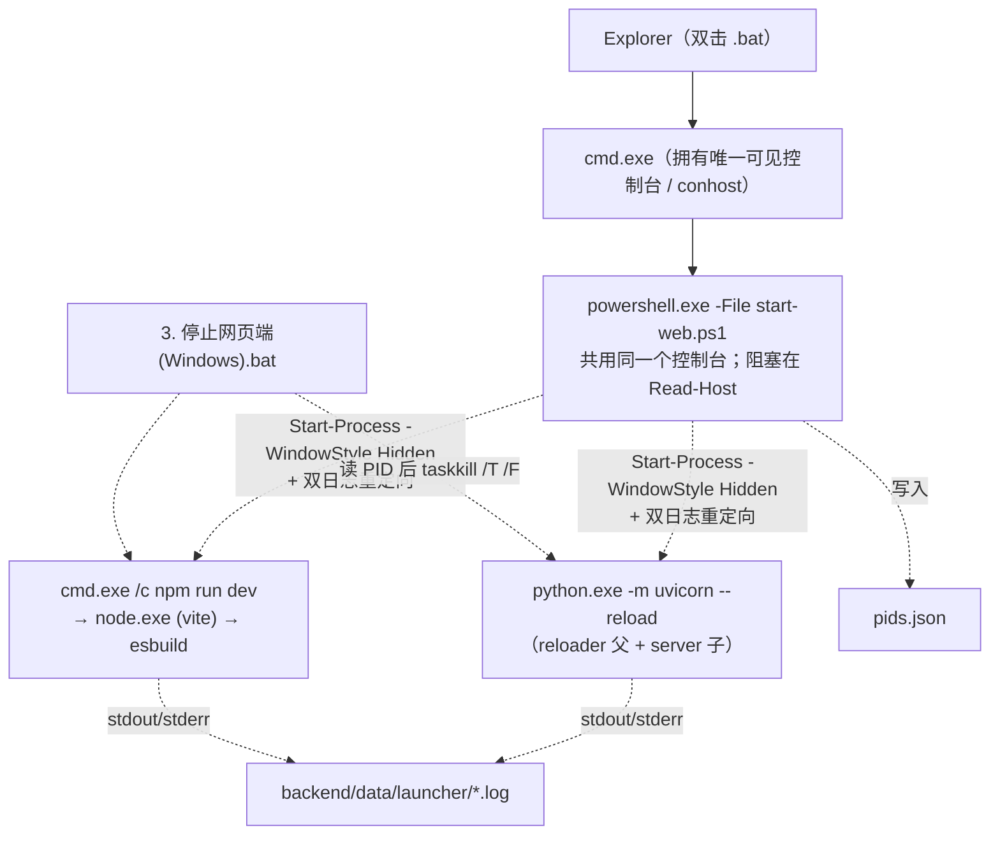

# Windows 一键启动器优化评估（只评估，不改代码）

| 项 | 内容 |
|---|---|
| 评估人 | 高见远（架构师） |
| 评估对象 | HEAD `493985f`「单窗口改造」后的 `1. 启动网页端(Windows).bat`、`3. 停止网页端(Windows).bat`、`scripts/start-web.ps1`、`scripts/stop-web.ps1`，及其端口耦合点 |
| 评估日期 | 2026-11-07 |
| 交付物 | 本文（唯一落盘文件） |
| 纪律 | **本轮只做分析与评估：未修改任何代码 / 前端 / 配置 / git，未提交，未启动或停止任何项目服务** |
| 验证方式 | 只读命令：读源码、`od` 查 BOM/编码、注册表查询、`Get-NetTCPConnection` / `netstat`、`Get-CimInstance`、`GetHostAddresses`、临时目录（`%TEMP%`）里的 cmd 参数解析探针（探针文件已删除，未落在仓库内） |

---

## 0. 结论速览

| 议题 | 一句话结论 |
|---|---|
| **A 中文乱码** | **根因是控制台字体，不是编码**。本机 `HKCU\Console\FaceName=Consolas`，而 Consolas 在 `FontLink\SystemLink` 中**没有任何 CJK 回退项**；`chcp 65001` 把 conhost 切到 UTF-8 模式后，GDI 渲染器拿不到 CJK 字形 → 豆腐块/问号。文件编码完全正确（.bat 纯 ASCII、.ps1 UTF-8 BOM 均已核实）。**必须按 ACP 分环境处理，不能一刀切**。 |
| **B 换端口** | 前端端口**不建议自动换**（会破坏已安装 PWA 快捷方式 + CORS 白名单 + 文档 + Mac/Linux 脚本）。后端端口可自动换，但需要**一次性**改 `vite.config.ts` 2 行；`strictPort: false` 是当前最危险的陷阱，**用 CLI `--strictPort` 即可零源码改动堵住**。推荐「前端 5173 固定 + 明确报错，后端可选自动换」。 |
| **C 其他 bug** | 初筛 8 条中：**7 条属实**（C1 需修正表述、C7 数字需修正）、**1 条被低估并升级为 P0**（C8：二次启动会把 `pids.json` 覆写成空列表，导致永久失去停止能力）。另补充 5 条真实缺陷（详见 C9–C13）。 |
| **D 关窗口即停** | 只有 **(a) Windows Job Object + `KILL_ON_JOB_CLOSE`** 能真正回答用户问题 2；采用后 `3. 停止网页端(Windows).bat`、`pids.json`、`Register-EngineEvent` **三者均可删**。**但它与 `-NoPause` 语义直接冲突，必须由用户拍板**。(b) `-NoNewWindow` 三者一个都删不掉。 |
| **E 改动清单** | P0 五项（全部非破坏性、不碰 PWA），P1 九项，P2 五项。会破坏已装 PWA 桌面快捷方式的只有「前端端口变化」这一类。 |

### 本机实测环境快照（决定性证据，非臆测）

```
OS                 : Windows NT 10.0.26300.0 (Win11 24H2/25H2)
PowerShell         : 5.1.26100.9818
System Locale      : zh-CN (Chinese Simplified, PRC)
ACP / OEMCP / MACCP: 65001 / 65001 / 65001     ← 「Beta: 使用 Unicode UTF-8」已开启，不是默认 936
当前 chcp          : 65001
[Console]::OutputEncoding : utf-8 (cp65001)

HKCU\Console (全局默认)      : FaceName=Consolas, FontFamily=54(等宽 TrueType)
HKCU\Console\...powershell.exe : FaceName=Lucida Console
HKCU\Console\...python3.10.exe : FaceName=新宋体, CodePage=936   ← 证明「按应用固定 CJK 字体+代码页」在这台机器上真实存在
HKCU\Console\%%Startup       : DelegationConsole/DelegationTerminal = {00000000-...} → 经典 conhost，非 Windows Terminal

FontLink\SystemLink :
  Consolas        : (无条目)      ← 零 CJK 回退
  Lucida Console  : (无条目)      ← 零 CJK 回退
  Cascadia Mono   : (无条目)      ← 零 CJK 回退
  SimSun/NSimSun  : MINGLIU / MSMINCHO / BATANG / Microsoft YaHei UI / ... ← 有完整 CJK 回退
  Tahoma/Segoe UI : SimSun / MingLiU / MS Gothic / Malgun / ...  ← 有完整 CJK 回退

Dns.GetHostAddresses('localhost') : InterNetworkV6 ::1 ; InterNetwork 127.0.0.1
hosts 文件 : 两行 localhost 均被注释（由 DNS 内部处理）

文件编码 :
  1. 启动网页端(Windows).bat  首字节 40 65 63 68 (`@ech`)，非 ASCII 行数 0  → 100% 纯 ASCII ✓
  3. 停止网页端(Windows).bat  同上                                          → 100% 纯 ASCII ✓
  scripts/start-web.ps1       首字节 ef bb bf (UTF-8 BOM)，行尾 CRLF          ✓
  scripts/stop-web.ps1        首字节 ef bb bf (UTF-8 BOM)，行尾 LF            ✓（行尾风格不一致，见 C13）

监听端口 8000 / 5173 : 均无监听（评估时未运行服务，未干扰任何进程）
backend/data/launcher/*.log : 上次运行的日志仍在（11:55），记录了 uvicorn --reload 的
  reloader[10568] + server[10188] 双进程，以及 vite 的 `Local: http://localhost:5173/`。
```

> 特别提示：本机是**第三种环境**——中文 Windows 但 ACP=65001（UTF-8 Beta 开启）。团队原始描述里只区分了「中文 Windows 默认 936」与「英文 Windows」，实际上还存在这一档，且它的表现与 936 完全不同：`chcp 65001` 在这里是空操作，**但字体依然是 Consolas，所以照样乱码**。任何「检测系统语言就决定是否 chcp」的方案在这台机器上都会失效，必须检测的是「控制台字体是否具备 CJK 覆盖」。

---

## A. 中文在部分字体下乱码（用户实测现象，优先）

### A.1 根因判定：是控制台字体，不是编码

先排除编码问题。四个文件的字节级核实结果见上表：

- 两个 `.bat` 是 100% 纯 ASCII（无非 ASCII 字节、无 BOM），在任何 ACP 下解析一致；
- 两个 `.ps1` 是 UTF-8 **with BOM**，Windows PowerShell 5.1 靠 BOM 识别 UTF-8，与系统 ACP 无关；
- `Write-Host` 在直连控制台时走 `WriteConsoleW`（UTF-16），字节层面本来就不经过代码页转换。

也就是说：**PowerShell 交给 conhost 的字符序列是正确的 Unicode**，乱码发生在「conhost 把这些码位画到屏幕上」这一步。

决定性证据是字体回退表：

| 字体 | `HKLM\...\FontLink\SystemLink` 条目 | 能否显示 CJK |
|---|---|---|
| **Consolas**（本机 `HKCU\Console` 全局默认） | **无** | 不能，字形缺失 → 豆腐块 / `?` / 空白 |
| **Lucida Console**（powershell.exe 子键） | **无** | 不能 |
| Cascadia Mono / Cascadia Code | 无 | 经典 conhost 下不能（Windows Terminal 的 DirectWrite 回退另说） |
| 新宋体 / NSimSun、SimSun | 有（MingLiU、MS PMincho、Malgun、YaHei UI…） | 能 |
| Tahoma / Segoe UI | 有（SimSun、MS Gothic、Malgun…） | 能 |

因为双击 `.bat` 时由 `cmd.exe` 创建控制台，控制台字体取 `HKCU\Console` 全局默认 = **Consolas**；`powershell.exe` 是 cmd 的子进程、**共用同一个控制台**，所以 `HKCU\Console\..._powershell.exe` 里的 `Lucida Console` 根本不会生效。两者都是「等宽拉丁字体 + 零 CJK 回退」。

而 `chcp 65001` 会把经典 conhost 切到 UTF-8 模式，该模式下 GDI 渲染器对 `FontLink` 的 CJK 回退Historically 不可靠；相比之下 ACP=936 时 DBCS 字符走的是另一条原生路径，直接从「新宋体」这类点阵/等宽 CJK 字体取字形。

> **反直觉但最关键的一点**：脚本注释写着「控制台切到 UTF-8：让中文提示在非中文 Windows 上也能正常显示」，但在**中文 Windows 上这句 `chcp 65001` 恰恰是把本来能正常显示的中文弄坏的那一步**——它关掉了 936 的 DBCS 渲染路径，却没有补上 CJK 字体。用户报告的「部分字体下乱码」正对应此现象：在 Windows Terminal / 装了 CJK 等宽字体的终端里正常，在默认 conhost + Consolas 里乱码。

综上：**编码正确、字体缺字形是根因**；`[Console]::OutputEncoding` 与 `$OutputEncoding` 的设置对 `Write-Host` 直连控制台的显示几乎无影响（它们影响的是管道/重定向输出和原生子进程），把它们当成修复手段是找错了层。

### A.2 三种环境必须分开处理（拒绝一刀切）

| 环境 | 典型 ACP/OEMCP | 中文提示默认能否显示 | 推荐做法 |
|---|---|---|---|
| **① 中文 Windows（传统，默认 936）** | ACP=936 / OEMCP=936 | **能**（conhost 走 DBCS 路径，字体通常是新宋体/点阵 CJK） | **不要执行 `chcp 65001`**，保留原控制台代码页；`[Console]::OutputEncoding` 设为 `[Text.Encoding]::GetEncoding(936)` 以匹配。.ps1 仍靠 BOM 正确读取，中文提示照常输出。 |
| **② 英文 / 其他西欧 Windows** | ACP=1252 / OEMCP=437 | **取决于是否装了 CJK 字体**；通常完全没装 | `chcp 65001` 只解决了「字节→码位」，解决不了「码位→字形」。这台机器上往往连 CJK 字体都没有，**唯一稳健方案是降级为 ASCII/英文提示**（或安装 CJK 等宽字体 / 强制用 Windows Terminal）。可把中文提示抽成资源表，按能力探测选择语言。 |
| **③ 中文 Windows + UTF-8 Beta 开启（本机实测）** | ACP=OEMCP=65001 | **不能**（`chcp 65001` 是空操作，字体仍是 Consolas） | 与 ① 不同、与 ② 也不同：代码页已经"对"了，瓶颈 100% 在字体。必须**改控制台字体**或**回退英文**，仅调 `chcp` 无效。 |

判据应该是「**当前控制台字体有无 CJK 覆盖**」+「**ACP 是否为 CJK 代码页**」两个维度的组合，而不是「系统语言是不是中文」。可用的只读探测：

```powershell
$acp = (Get-ItemProperty 'HKLM:\SYSTEM\CurrentControlSet\Control\Nls\CodePage').ACP
$face = (Get-ItemProperty 'HKCU:\Console' -ErrorAction SilentlyContinue).FaceName
$hasLink = (Get-ItemProperty 'HKLM:\SOFTWARE\Microsoft\Windows NT\CurrentVersion\FontLink\SystemLink' -ErrorAction SilentlyContinue).PSObject.Properties.Name -contains $face
# 或按字体名白名单判断：新宋体/NSimSun/SimSun/MS Gothic/Yu Gothic/Malgun/Sarasa/Noto Sans Mono CJK
```

### A.3 可验证的修复方向（按侵入性从低到高）

1. **【推荐，零侵入】条件化 `chcp` + 能力探测降级**
   - 把 `try { chcp 65001 > $null; ... }` 换成：先读 ACP / 字体；ACP 为 936/950/932/949 → **不切代码页**；ACP 为 65001 或 1252/437 且字体无 CJK 覆盖 → 保持 UTF-8 字节设置，同时把 `Write-Step/Write-Ok/Fail/Write-Host` 的中文资源降级为 ASCII 英文（或仅保留数字/符号 + 英文）；字体有 CJK 覆盖 → 照常输出中文。
   - 验证方法：在三种环境的 `cmd` 里分别跑 `powershell -NoProfile -ExecutionPolicy Bypass -File "scripts\start-web.ps1" -DryRun`，肉眼确认中文/英文提示；用 `chcp` 确认代码页未被意外改动（执行前后各查一次）。这是**可验证**的，且 DryRun 无副作用（当前脚本的 DryRun 已保证不写文件、不起服务）。
   - 注意：DryRun 本身也会打印中文，正是最好的验证入口。
2. **【可选，用户可见】显式设置 CJK 控制台字体**：通过 P/Invoke `SetCurrentConsoleFontEx` 把当前控制台字体切到 `新宋体`/`NSimSun`（zh-CN）、`MS Gothic`/`Yu Gothic`（ja-JP）、`Malgun Gothic`（ko-KR）。**代价**：`Add-Type` 运行时编译（约 1s、可能被 AV/AppLocker 拦；本次评估环境的沙箱就拦截了 `Add-Type`），且会改变用户看到的窗口外观；`HKCU\Console` 全局默认值若一并改写，会影响用户所有新开的控制台 —— 属于需要用户同意的侵入性变更。
3. **【可选，需用户操作】引导改用 Windows Terminal**：WT 用 DirectWrite，字体回退完善，`chcp 65001` 下中文正常。本机 `DelegationConsole/DelegationTerminal` 均为全零 GUID（即经典 conhost），可在 `.bat` 里探测 `wt.exe` 并改用 `wt.exe` 承载，或提示用户在「终端设置 → 默认终端应用」里选 Windows Terminal。**需要用户重新操作**，且改变了启动形态。
4. **【不推荐】写 `HKCU\Console\FaceName`**：只对**新**控制台生效，对当前已打开的窗口无效；且是全局用户设置，副作用面大。

### A.4 如何不破坏两条硬约束

- **`.bat` 纯 ASCII**：上述所有逻辑都放进 `.ps1`；`.bat` 保持现在 22 行纯 ASCII 引导不做任何改动（A 方案甚至不需要动 `.bat`）。即便要做「按 `-NoPause` 跳过 pause」的 C6 修复，也只用 ASCII 的 `for %%A in (%*) do ...` + `findstr`，不引入任何非 ASCII 字节。
- **`.ps1` UTF-8 with BOM**：BOM 是 PS 5.1 正确读文件的**唯一保证**，与 `chcp` 无关。条件化 `chcp` 只是改变**输出通道**，不改变**文件编码**。改动后必须用 `od -An -tx1 -N8` 复核首 3 字节仍为 `ef bb bf`；若用编辑器另存为，务必显式选「UTF-8 with BOM」，否则在 936 环境下 `.ps1` 里的中文会先被按 GBK 解读，问题反而更严重。
- 建议把「BOM / 纯 ASCII」检查加入提交前自检（项目已有 `scripts/` 下多处自检脚本的惯例），避免以后有人误存。

---

## B. 端口被占用就自动换端口

### B.1 完整耦合点清单（补全团队初筛）

团队已列出的 5 处之外，还有以下**真实耦合点**（按「换端口时是否必须联动」分类）：

| # | 文件:行 | 内容 | 后端端口变更 | 前端端口变更 | 类型 |
|---|---|---|---|---|---|
| 1 | `frontend/vite.config.ts:20` | `target: "http://127.0.0.1:8000"` | **必须** | — | 运行时硬阻断 |
| 2 | `frontend/vite.config.ts:47-48` | `port: 5173, strictPort: false` | — | **必须** | 自动递增陷阱 |
| 3 | `frontend/vite.config.ts:52` | `preview.port: 4173` | — | **必须** | PWA 验证/预览端口（初筛遗漏） |
| 4 | `frontend/vite.config.ts:8,15,17` | 注释中的 8000 / PWA 说明 | 文档 | 文档 | 注释 |
| 5 | `frontend/src/components/layout/SplitWorkspace.tsx:42` | 「请确认 `uvicorn` 已在 :8000 启动」 | 显示 | — | UI 文案 |
| 6 | `frontend/public/offline.html:111-112` | 8000 / `127.0.0.1:8000/api/health` | 显示 | — | UI 文案 |
| 7 | `frontend/src/vite-env.d.ts:11` | 注释「代理到 127.0.0.1:8000」 | 文档 | — | 注释 |
| 8 | `frontend/.env.example:4-5` | 注释 + `VITE_API_BASE=/api` | 可选旁路 | — | 配置（**已有 escape hatch**） |
| 9 | `frontend/src/api/client.ts:47-60` | `resolveApiBase()` 读 `VITE_API_BASE` | 可选旁路 | — | 运行时 |
| 10 | **`backend/app/config.py:161`** | `CORS_ORIGINS = "http://localhost:5173,http://127.0.0.1:5173"` | 不需要 | **必须** | **CORS 白名单（初筛遗漏，关键）** |
| 11 | **`backend/.env.example:78`** | 同上默认值 | 不需要 | **必须** | 配置 |
| 12 | **`backend/app/main.py:93-94`** | `CORSMiddleware(allow_origins=_settings.cors_origins)` | 不需要 | 间接 | 消费方（**已支持 env 覆盖**） |
| 13 | `scripts/start-web.ps1:100-101` | `$BackendPort=8000` / `$FrontendPort=5173` | **必须** | **必须** | 启动器 |
| 14 | `scripts/start-web.ps1:35,22` | `TargetUrl` 默认 `http://localhost:5173` | — | **必须** | 启动器 |
| 15 | `scripts/start-web.ps1:323,404-405` | DryRun/完成页写死 `:8000`、`127.0.0.1:8000/docs` | 显示 | — | 启动器 |
| 16 | `scripts/start-web.ps1:305-306,347-374` | 端口预检 → 决定是否跳过启动 | **必须** | **必须** | 启动器核心 |
| 17 | **`2. 启动网页端(Mac-Linux).sh:81,92,104-105`** | `--port 8000`、`URL=localhost:5173`、文档链接 | **必须（否则双平台不一致）** | 同左 | **并行启动器（初筛遗漏）** |
| 18 | `README.md:121,135,140,143,145` | 全部写死 | 文档 | 文档 | 文档 |
| 19 | `docs/01-快速开始/2. 环境搭建与运行.html`、`docs/05-运维部署/2. 故障排查.html`、`docs/04-开发指南/5. 测试与调试.html`、`docs/06-项目档案/2. 踩坑记录.html`、`docs/00-源文档/ARCHITECTURE.md` | 大量 8000/5173 | 文档 | 文档 | 文档 |
| 20 | `docs/05-运维部署/1. 部署方案.html:92-93,194` | `EXPOSE 8000`、`proxy_pass http://backend:8000` | 部署配置 | — | 部署（**不应随本地端口变**） |
| 21 | `scripts/print_pdf_check.mjs:11-12,29-30` | 4173 / 8000 | QA | QA | QA 脚本 |
| 22 | `scripts/e2e_smoke.py:12`、`real_llm_check.py:17` | `BASE = http://127.0.0.1:8123` | 已是独立端口 | — | QA 脚本 |
| 23 | `HANDOVER.md:269-270`、`NEXT-ACTION.md:194,200` | 排障命令 / PWA 约束 | 文档 | 文档 | 文档 |
| 24 | **`frontend/public/manifest.webmanifest` + `frontend/dist/manifest.webmanifest`** | `"start_url": "/"`, `"scope": "/"` | **无影响** | **致命** | **PWA origin 绑定（初筛遗漏，关键）** |
| 25 | `frontend/public/sw.js` (`SHELL`, `isApiRequest`) | 相对路径 `/`、`/api/` | 无影响 | origin 变化 → 旧 SW 失效 | PWA |

**两个重要的结构性结论**：

- **后端端口变化不需要改 CORS。** `CORS_ORIGINS` 列的是「允许访问后端的前端 origin」，与后端自己监听哪个端口无关；只要请求仍走 vite 的 `/api` 代理（同源），连 CORS 都不会触发。
- **前端端口变化才会同时踩爆 CORS 白名单 + PWA origin + README/docs + Mac/Linux 脚本**。所以「换端口」的代价几乎全部落在前端侧。

### B.2 「自动换端口」可行性 / 联动文件 / 能否靠环境变量不改源码

**结论：技术上可行，但"完全不改源码"只对前端端口成立，对后端端口不成立。**

| 目标 | 能否纯环境变量注入、零源码改动 | 说明 |
|---|---|---|
| 改**前端** dev 端口 | **能** | `npm run dev -- --port 5174 --strictPort` —— Vite CLI 参数覆盖 `vite.config.ts`，`cmd.exe /c npm run dev -- --port <P> --strictPort` 即可，无需改任何前端文件。 |
| 改**后端**端口（让 vite 代理跟过去） | **不能（现状）** | `vite.config.ts:20` 是字面量字符串，Vite **没有**提供「代理目标」的 CLI 参数。 |
| 改**后端**端口（绕过代理） | **能，但代价大** | 给 vite 子进程注入 `VITE_API_BASE=http://127.0.0.1:8001`：`client.ts:resolveApiBase()` 已支持。但请求从同源代理变成**跨域直连**：(1) 必须在 `CORS_ORIGINS` 加上前端 origin（好在 `pydantic-settings` 的 `BaseSettings` 支持 `CORS_ORIGINS` 环境变量覆盖，`config.py` 无需改）；(2) 丢掉 `vite.config.ts:24-28` 的 `Accept-Encoding: identity` 与 `changeOrigin` 调优，SSE 流式行为需要重新验证；(3) `VITE_API_BASE` 在生产构建期被烘焙进 bundle，装成 PWA 后端口被写死，**不可用于发布构建**。 |
| 改 `CORS_ORIGINS` | **能** | `BaseSettings` + `SettingsConfigDict`，环境变量直接覆盖，源码零改动。 |
| 改 `pids.json` / 完成页 / offline.html / SplitWorkspace 的文案 | **不能** | 全是字面量，属于显示层，需一次性改。 |

**最小一次性改动（推荐）**：`vite.config.ts` 只加 2 行，把代理目标变成可注入：

```ts
const backendPort = process.env.EDU_BACKEND_PORT ?? "8000";
// target: `http://127.0.0.1:${backendPort}`
```

`vite.config.ts` 是 Node 侧配置、在 dev server 启动时求值，**不需要 `VITE_` 前缀，也不需要重新构建**；此后所有端口变化都是纯环境变量注入。启动器只需要在 `Start-Process` 时给两个子进程设置 `EDU_BACKEND_PORT`（`Start-Process -Environment` 在 PS 5.1 不可用，需在父进程 `$env:EDU_BACKEND_PORT = ...` 后让子进程继承，或在 `cmd /c "set EDU_BACKEND_PORT=... && npm run dev"` 里设置）。

### B.3 `strictPort: false` 陷阱：三种具体翻车场景

`vite.config.ts:47-48` 是 `port: 5173, strictPort: false`，即 Vite 在 5173 被占时会**静默递增**到 5174/5175。当前启动器的就绪检测只探 5173、`-TargetUrl` 只写 5173，于是：

1. **5173 已被别的程序占用（最常见）**：`$FrontendPortOpen = Test-PortOpen 5173` 返回 `$true` → 启动器**根本不启动 vite** → `Wait-ServiceReady` 见 5173 可连即判成功 → 打开 `http://localhost:5173` → 用户看到的是**别人的应用**，而且 `pids.json` 里前端 PID 为空。
2. **竞态**：5173 空闲、vite 启动，但另一个进程抢先占了 5173 → vite 静默跑到 5174 → 启动器探 5173 不通（或探到别人）→ 要么打开错站、要么**等满 90 秒超时后把健康的 vite 杀掉**（`Wait-ServiceReady` 失败会调 `Stop-LaunchedServices`）。
3. **双开本项目**：用户第二次双击，两个端口都被自己的旧服务占着 → 两边都「跳过启动」→ 显示「启动完成」、打开旧页面，但**新的 `pids.json` 被写成空列表**（详见 C8，这是最严重的一条）。

项目自己的文档 `docs/05-运维部署/2. 故障排查.html:57` 已经写着「5173 被占。Vite 会自动找下一个端口（5174），看终端输出的实际地址」—— 说明这个坑已被记录，但没有传导到启动器：日志被重定向到 `frontend.out.log`，**用户看不到终端输出**，无法"看实际地址"。

### B.4 怎么破这个陷阱（按性价比排序）

1. **【P0，零源码改动】给 vite 传 `--strictPort`**：`cmd.exe /c npm run dev -- --port 5173 --strictPort`。端口被占时 vite **明确失败并写进 `frontend.err.log`**，而不是悄悄换端口。配合 C3 的「子进程早退快速失败」，用户几秒内就能看到错误。
2. **【P0】端口预检升级为「身份校验」而非「能否连上」**（见 C2）：对 8000 探 `/api/health`、对 5173 探首页并校验 Vite 特征，确认「是不是我们的服务」。这样场景 1 会直接报错而不是"跳过启动+照常开浏览器"。
3. **【P1】让启动器拥有端口选择权**：预检时用一个 `TcpListener(IPAddress.Loopback, 0)` 向 OS 申请空闲端口、关闭后作为候选，然后把**确定的端口**同时传给 uvicorn（`--port`）、vite（`--port` + `--strictPort`）、就绪检测与 `-TargetUrl`（由选定端口拼出，而不是硬编码）。仍有极小 TOCTOU 竞态，但 `--strictPort` 保证出错时是**响亮失败**而非静默错站。
4. **【备选】解析 `frontend.out.log` 里的 `Local: http://localhost:NNNN/`，用实际端口覆盖 `TargetUrl`**：能覆盖所有静默递增，但依赖日志文本格式（Vite 版本升级/本地化会变），且日志是异步刷新的，需要等待与超时，鲁棒性低于方案 1+3。

### B.5 推荐方案与取舍

> **推荐：默认「前端 5173 固定 + 明确报错引导用户改配置」；后端 8000 可选 `-AutoBackendPort` 自动换端口。**

**取舍依据**：

| 维度 | 自动探测可用端口并注入 | 明确报错让用户改配置 |
|---|---|---|
| 实现成本 | 高：一次性改 `vite.config.ts`、启动器端口编排、完成页/offline/SplitWorkspace 文案、Mac/Linux 脚本、QA 脚本、README 与 6+ 份 HTML 文档 | 低：预检 + 清晰报错 + 一条 `netstat -ano \| findstr :8000` 提示 |
| **已安装 PWA 桌面快捷方式** | **前端端口一变即失效**：`start_url:"/"` / `scope:"/"` 是 origin-relative，浏览器把已安装应用绑定在 `http://localhost:5173` 这个**精确 origin**（含端口）。换成 5174 后旧快捷方式打开的是死站或别的站，SW 注册在旧 origin 也不覆盖新 origin，**用户必须卸载并重新安装** | 完全不受影响 |
| CORS | 前端端口变化必须同步 `CORS_ORIGINS`（env 可覆盖，但要编排） | 不变 |
| 可支持性 | 差：端口每次可能不同，用户报障时「你现在的端口是几」变成第一个问题；`HANDOVER.md` 的排障命令、书签、自动化脚本全部失效 | 好：地址恒定，文档/QA/书签全部稳定 |
| 静默失败风险 | 高：换端口最怕"换到了但没人知道"，恰好是本项目的 PWA/代理/就绪检测三重耦合最容易出事的地方 | 低：失败即刻可见 |
| 用户收益 | 端口冲突时无需手动干预 | 需要用户按提示释放端口或改一个配置值 |

**关键的折中（强烈建议采纳）**：如果一定要做「自动换端口」，**只对后端 8000 做，前端 5173 永远固定**。理由：后端端口变化**不影响 PWA origin**、不影响 `CORS_ORIGINS`、不影响书签和文档中的前端地址；只需联动 `vite.config.ts` 代理目标（一次性 2 行）+ 启动器 `--port`/env + 3 处显示文案 + Mac/Linux 脚本。前端保持 5173 并加 `--strictPort`，冲突就明确报错。这样既拿到「端口被占用也能起来」的大部分收益，又保住已安装的 PWA 快捷方式。

**PWA 约束补充**：`frontend/src/lib/pwa.ts` 明确只在 `import.meta.env.PROD` 注册 SW，而启动脚本跑的是 `npm run dev` —— dev 下 `/sw.js` 存在于 `public/` 但**从未注册**，所以 `offline.html` 的离线兜底在开发模式下不生效。Chrome 现在仅凭 manifest 就能显示「安装」图标，于是 `start-web.ps1:409` 的「安装为桌面应用」提示会引导用户装一个**没有 SW 的 PWA**（详见 C12）。这也意味着：`vite.config.ts:15` 注释所说的「PWA 安装验证只能在 `vite preview` 做」与启动器的实际行为是脱节的。

---

## C. 其他真实 bug 逐条核实

### C.1 `Normalize-ProxyEnvironment` 只取大写值、删小写、写回大写 → 代理被静默丢弃

**判定：部分属实，但原表述需要修正；真实缺陷比描述更隐蔽。优先级 P1。**

本机实测（只读环境块探测）结果：

```
Get-ChildItem Env: | Where Name -match proxy
  → ERR: "An item with the same key has already been added."     ← 环境块里确实同时存在大小写重复项
[Environment]::GetEnvironmentVariable('HTTP_PROXY') 与 ('http_proxy') 返回同一个值
  （设置任一大小写都会互相覆盖 → Windows 环境变量查找大小写不敏感）
空串判断：$null -ne ''  → True
```

- **「环境里只有小写 `http_proxy` 有值而大写为空」**：Windows 环境变量查找大小写不敏感，`GetEnvironmentVariable('HTTP_PROXY')` 会命中 `http_proxy` 的值；删小写、写回大写后代理**仍在**。所以这一条按字面**不成立**。
- **但函数要解决的恰恰是"两种大小写同时存在"的场景**（注释第 61-68 行、本机环境也确实如此）。此时 `GetEnvironmentVariable('HTTP_PROXY')` 返回的是原始环境块线性扫描命中的**某一个**条目，不保证是持有真实代理值的那个。若大写项是空串/过期值、小写项才是真值，则 `$Value = ''`；`if ($null -ne $Value)` **对空串为 True**，于是写回 `HTTP_PROXY=''`，小写真值已被删除 → **代理确实被静默丢弃，外部模型请求失败**。空串检查是这里的直接帮凶。
- **另一处未被初筛提到的真实缺陷**：第 84 行 `$env:NO_PROXY = 'localhost,127.0.0.1'` **无条件覆盖**用户原有的 `NO_PROXY`。若用户配置了内网域名/网段旁路（如 `.corp,10.0.0.0/8`），会被整个抹掉，子进程（uvicorn/vite）访问内网模型网关时可能误走代理。
- 此外循环只覆盖 `HTTP_PROXY/HTTPS_PROXY/ALL_PROXY/NO_PROXY` 四种，`FTP_PROXY`、`Http_Proxy` 等其它大小写变体未处理；`Get-ChildItem Env:` 抛错说明环境块里可能还有更多重复项。

**修复方向**：合并大小写时取「第一个非空值」而非固定读大写；写回前判断 `-not [string]::IsNullOrWhiteSpace($Value)`；`NO_PROXY` 改为**追加** `localhost,127.0.0.1` 而不是覆盖；归一化后用 `Get-ChildItem Env:` 不抛异常 + 跑一次 `-DryRun` 作为回归验证（保持原「修掉 `Item has already been added`」的能力）。

### C.2 `Test-PortOpen` 只判断「能连上」，不判断「是不是我们的服务」

**判定：属实，且与 B.3 场景 1 叠加后是最容易误导用户的静默错误。优先级 P0。**

`Test-PortOpen` (`start-web.ps1:120-147`) 只做裸 TCP 连接。8000 被任何程序（其它 uvicorn、Docker、打印机服务、数据库）占用时：

- 第 305 行 `$BackendPortOpen = $true` → 第 354 行**跳过启动后端**；
- 但前端照常启动，`/api` 代理仍指向 `127.0.0.1:8000` → **所有接口打到别人的服务**；
- `Wait-ServiceReady` 见两端口可连 → 判成功 → 浏览器照常打开 → 前端显示「无法连接后端」，用户完全不知道后端根本没启动。

`SplitWorkspace.tsx:42` 的错误文案还会补一刀「请确认 uvicorn 已在 :8000 启动」，把用户引向错误方向。

**修复方向**：保留裸 TCP 作快速探测，但增加身份校验：用 `System.Net.Http.HttpClient` + `HttpClientHandler { UseProxy = $false; Proxy = $null }` 请求 `http://127.0.0.1:$port/api/health`，校验响应体里的 `code == "OK"`（与 `README.md:143` 的健康检查契约一致）；前端校验首页 200 且含 Vite 特征。**关键点**：`UseProxy = $false` 显式绕开本地 `http_proxy`，不会重蹈注释里记的 502 覆辙。身份不符时明确报错「端口 X 已被非本项目进程占用（PID ...）」并给出 `netstat -ano | findstr :X`。

### C.3 服务进程启动后立刻失败，就绪检测仍等满 90 秒

**判定：属实。优先级 P1（体验）/ P0（叠加 C2 时）。**

`Wait-ServiceReady` (`start-web.ps1:149-166`) 的 while 循环只看 deadline 与两个布尔值，**从不检查 `$BackendProc.HasExited` / `$FrontendProc.HasExited`**。venv 损坏、缺依赖、`.env` 解析失败时，子进程秒退，用户却要盯 90 秒的 `......`，最后才看到「服务未就绪」并去翻四个日志。

补充两点：
- 后端用了 `--reload`，日志显示会派生 **reloader 父进程 + server 子进程**（上次日志：`Started reloader process [10568]` / `Started server process [10188]`）。父进程可能存活而子进程崩溃，所以单看 `$BackendProc.HasExited` 不够，还应扫 `backend.err.log` 的 `Application startup complete` / `Traceback` / `ERROR` 关键字。
- 失败路径 `Stop-LaunchedServices` 只杀本轮新起的 PID；若端口本来被旧服务占着，`StartedPids` 为空 → 什么都没杀（这正是 C8 的成因）。

**修复方向**：在循环里加 `if ($proc -and $proc.HasExited) { 立即失败并输出 tail -n 20 对应 err.log }`；把「进程退出」与「日志出现致命错误」都作为早失败信号；超时前不必等满 90s。

### C.4 `pids.json` 只存 PID，PID 复用后可能误杀无关进程

**判定：属实，概率低但后果严重。优先级 P1。**

`start-web.ps1:378-382` 写入 `{ pids, updated_at, target_url }`；`stop-web.ps1:58-67` 直接对 PID 执行 `taskkill /T /F`，**不校验进程名、启动时间、命令行，也不校验文件新旧**。本机就存在多个常驻的 `node.exe`/`cmd.exe`（WorkBuddy MCP 服务，PID 3744/8880/12780/17020），PID 被回收复用并非理论风险。`taskkill /T /F` 还会连带杀掉被复用 PID 的整棵子树。

**修复方向**：写入时记录每个 PID 的 `ProcessName`、`StartTime`（`Get-Process -Id` 的 `StartTime.ToString('o')`）、可选 `CommandLine`；停止时先 `Get-Process -Id`、`ProcessName` 与 `StartTime` 全部匹配才 `taskkill`；对 `updated_at` 超过阈值（如 24h）的陈旧文件只删除、不杀进程。旧格式文件做兼容降级（只删不杀）。

### C.5 `-TargetUrl` 经 `%*` 透传，URL 含 `&` / 空格会被 cmd 解释或截断

**判定：属实，且比描述更宽（还有 `=`、`^`、`%`）。优先级 P1（因为 README:121 正式文档了这个用法）。**

`1. 启动网页端(Windows).bat:16` 是 `powershell ... -File "...ps1" %*`，`%*` **不带引号展开后会被 cmd 重新解析**。用 `%TEMP%` 里的临时批处理探针实测（探针已删除）：

```
cmd /d /c "probe.bat -TargetUrl http://localhost:5173/?a=1&b=2"
  STAR=[-TargetUrl http://localhost:5173/?a=1]
  A2=[http://localhost:5173/?a]   A3=[1]        ← '=' 也被当作参数分隔符
  'b' is not recognized as an internal or external command   ← '&' 把后半段当命令执行
```

结论：
- 未加引号的 `&` 会**执行**后面的文本（不只是截断，有命令注入面）；
- `=` 也会切分参数，所以哪怕没有 `&`，带 query string 的 URL 也会被拆成多个位置参数，PowerShell 报「找不到接受实际参数的位置形式参数」；
- 空格同理；`^` 是 cmd 转义符；`%20` 这类百分号编码在 `%*` 里实测能原样保留，但在嵌套批处理/计划任务等二次展开场景仍有风险；
- 正确加双引号能保护 `&` 与空格，但 `README.md:121` 的示例 `1. 启动网页端(Windows).bat -TargetUrl http://localhost:5173/xxx` **本身就没加引号**，而且 `.bat` 文件名含空格与括号，按 README 那样在 cmd 里手打还会先被文件名里的空格拆开。

**修复方向（保持 `.bat` 纯 ASCII）**：最稳的是**取消任意 URL 的 `%*` 透传** —— 改用环境变量 `EDU_TARGET_URL`（在 `.ps1` 里读 `$env:EDU_TARGET_URL`，默认仍是 `http://localhost:5173`），`%*` 只保留给 `-NoPause` / `-NoBrowser` / `-DryRun` 这些纯 ASCII 开关；同时更新 `README.md:121`。次选是在 `.bat` 里用 `for %%A in (%*) do ...` 逐项重建参数并显式引用（仍是纯 ASCII，但复杂且对 `&` 仍脆弱）。

### C.6 `.bat` 的 `if errorlevel 1 (... pause)` 在 `-NoPause` 自动化场景仍会卡住

**判定：属实。优先级 P0（自动化链路会挂死）。**

`start-web.ps1` 的 `Fail()` 第 116 行是 `if (-not $NoPause -and -not $DryRun) { Read-Host ... }`，已经正确跳过自身等待；但 `Fail()` 末尾 `exit 1`，而 `.bat:17-21` 的 `pause` **无条件执行**，不认识 `-NoPause`。于是：

- `-NoPause` 下失败 → PowerShell 已退出 → `.bat` 仍停在 `pause` 等键盘输入 → CI / 计划任务 / 自动化脚本**无限挂起**；
- `-DryRun` 下环境检查失败（缺 Python / 缺 Node）同理。

此外 `3. 停止网页端(Windows).bat:14` 有**无条件 `pause`**，任何自动化调用停止脚本都会被阻塞。

**修复方向**：在 `.bat` 里用纯 ASCII 扫参数：`for %%A in (%*) do if /I "%%~A"=="-NoPause" set "EDU_NOPAUSE=1"`，再 `if errorlevel 1 ( echo. & echo ... & if not defined EDU_NOPAUSE pause )`。`-DryRun` 同理或让 `.ps1` 在 DryRun 失败时返回 0。停止脚本的 `pause` 也建议条件化。注意 `setlocal` 已存在，变量不会外泄。

### C.7 轮询每轮重复 DNS 查询；每轮最多 3 地址 × 500ms，节奏与 90s deadline 不匹配

**判定：方向属实，但两处数字需要修正。优先级 P2。**

- 本机实测 `Dns.GetHostAddresses('localhost')` 返回 **2 个**地址（`::1` + `127.0.0.1`），加上第 130-131 行又显式 push 了 `127.0.0.1` 和 `::1`，所以 `$Targets` 实际是 **4 个**（其中 2 个是重复项），不是 3 个。每轮调用 2 次 `Test-PortOpen`（后端 + 前端）→ **每轮 2 次 DNS 查询 + 最多 8 次 TCP 连接**；90 秒约 180 轮 → 约 **360 次** DNS 查询（不是 180 次）。`localhost` 由 DNS 内部处理且有缓存，实际开销可忽略，但**重复 TCP 连接是纯浪费**。
- 「节奏与 deadline 不匹配」确实成立，但机理要分两种：本机回环端口关闭时 `ConnectAsync` 立即收到 RST（ConnectionRefused），4 个目标几毫秒就走完，此时 500ms 的 `Start-Sleep` 主导节奏，约 180 轮 / 90s，与 deadline 基本吻合；**只有当某个目标被防火墙静默丢包时**，`Wait(500)` 才每次吃满 500ms → 单次 `Test-PortOpen` 最坏 2s、单轮最坏约 4.5s → 90s 内只剩约 20 轮，且循环可能**越过 deadline 最多约 4.5s**。另外 `$task.Wait(500)` 超时后**不取消**那个 ConnectAsync 任务，会残留异步连接对象。

**修复方向**：把 `localhost` 解析移到循环外做一次，目标列表 `Sort-Object -Unique` 去重（降到 2 个）；用 `[Diagnostics.Stopwatch]` 或把剩余毫秒数传进探测函数，让每次 `Wait()` 取 `min(500, remaining)`；`finally` 里 `Dispose()`；用 `CancellationToken` 取消未完成的连接。

### C.8 `-NoPause` 下服务常驻，下次双击「端口占用跳过启动」却以为重启了

**判定：属实，且**被低估 —— 实际后果比描述严重，升级为 **P0**。

完整链路推演（已逐行核对源码）：

1. `-NoPause` → `KeepServicesOnExit=$true` → 第 413-418 行 `exit 0`，**不调 `Stop-LaunchedServices`** → 服务常驻、`pids.json` 保留（里面是本轮真实 PID，如 10568 / cmd-PID）。
2. 用户下次**普通双击**：第 305-306 行 `Test-PortOpen` 两端口均为 `$true` → 第 354/365 行**两边都跳过启动** → `$script:StartedPids = @()`。
3. **第 378-382 行仍无条件写 `pids.json`**，`ConvertTo-Json` 把空数组写成 `"pids": []` → **上一轮那两个真实 PID 被永久覆盖丢失**。
4. 就绪检测通过 → 打开浏览器 → 第 401 行显示「启动完成」，用户以为重启成功，其实连的是上一轮的旧进程。
5. 用户按回车 → `Stop-LaunchedServices` 遍历空数组 → **一个进程都不杀**，只把 `pids.json` 删掉 → 服务继续常驻。
6. 此时连兜底 `3. 停止网页端(Windows).bat` 也失效了：它读到的 `pids.json` 要么已被删，要么是空列表（第 52-56 行直接「没有需要清理的后台服务」）。**用户从此只能靠任务管理器手动找 PID**，这正是「3. 停止脚本」存在意义被架空的最坏情况。

**修复方向**：把「端口已占用」拆成三种状态并分别处理：
- 占用者**是本项目服务且有有效 `pids.json`** → 明确提示「服务已在运行（PID ..., 启动于 ...）。如需重启请先运行停止脚本」，并且**绝不覆写 `pids.json`**；
- 占用者**是本项目服务但没有 `pids.json`**（如 `-NoPause` 遗留）→ 提示并给出 `taskkill` / `netstat` 定位指引；
- 占用者**是外部程序** → 报错退出（C2）。

另外把 `pids.json` 的写入条件改为「本轮至少启动了一个进程」，并加文件锁/原子写，杜绝并发双击互相覆盖。

### C.9 【补充】完成页打印的「接口文档」URL 是 404

`start-web.ps1:404` 打印 `http://127.0.0.1:8000/docs`，`2. 启动网页端(Mac-Linux).sh:104` 同样，而 `backend/app/main.py:87` 明确是 `docs_url="/api/docs"`（`openapi_url="/api/openapi.json"`）。`README.md:143` 也写着「`/docs` 有完整 OpenAPI」。用户点/复制这个链接必然 404。**P1，零风险，纯文案修正**：改成 `/api/docs`，涉及 `start-web.ps1`、`2. ...sh`、`README.md`、相关 HTML 文档。

### C.10 【补充】`Start-Process $TargetUrl` 未做 URL 合法性校验

`start-web.ps1:396` 把 `$TargetUrl` 直接交给 `Start-Process`。`Start-Process` 在非可执行文件参数上走 ShellExecute；若 URL 含空格/特殊字符或被 C5 截断成半截字符串，可能弹出「找不到文件」或打开错误的默认程序。配合 C5 一起修（校验 `[Uri]::TryCreate` 且 scheme 为 http/https、host 为 localhost/127.0.0.1）。**P2**。

### C.11 【补充】每次启动清空 4 个日志，丢失上一次崩溃现场

`start-web.ps1:343-345` 无条件 `Remove-Item` 四个日志。若上次是崩溃退出、用户这次双击想复现/报障，**第一现场已被抹掉**；再叠加 C3「早失败无 tail 输出」，排障体验很差。**P2**：改为按时间戳轮转（保留最近 3~5 份）或追加 + 写入启动分隔线。这也正好为 C3 的「失败时 tail 日志」提供素材。

### C.12 【补充】dev 模式下「安装为桌面应用」提示会引导用户装一个没有 Service Worker 的 PWA

`start-web.ps1:409` 提示「在 Chrome/Edge 地址栏右侧点「安装」图标」，但 `frontend/src/lib/pwa.ts` 明确 `if (!import.meta.env.PROD) return;` —— `npm run dev` 下**不注册 `/sw.js`**，因此 `offline.html` 的离线兜底与 `SHELL` 预缓存全部不生效；`vite.config.ts:15` 的注释自己也说「PWA 安装验证只能在 `vite preview` 下做」。现代 Chrome 仅凭 manifest 就显示安装图标，用户会装到一个「能开界面、断网即白屏」的应用。**P2**：要么把提示改为「如需安装桌面应用，请用 `npm run build && npm run preview`（端口 4173）」，要么在 dev 下也注册 SW（不推荐，会缓存 Vite 模块导致 HMR 失效，`pwa.ts` 注释已解释）。注意这又牵出 `preview.port: 4173` 这个第三个硬编码端口。

### C.13 【补充】两个 `.ps1` 行尾风格不一致 + `start-web.ps1` 的 DryRun 说明与实际不符

- `start-web.ps1` 是 CRLF，`stop-web.ps1` 是 LF（BOM 均正确）。PS 5.1 都能跑，但混用会让 `git diff` 全文件飘红、也容易在编辑器里被整体重存成无 BOM。**P2**，统一为 CRLF 并加 `.gitattributes` 约束（现有 `.gitattributes` 已存在，可复用）。
- `start-web.ps1:323` 的 DryRun 打印写「TCP `127.0.0.1:$BackendPort` + `127.0.0.1:$FrontendPort`」，但 `Test-PortOpen` 实际探的是 `localhost` + `::1` + `127.0.0.1` 共 4 个目标，而 `README.md:145` 又强调「vite 默认绑 `::1`，请用 localhost 而非 127.0.0.1」。说明文字与实现矛盾，会误导排障。**P2**。

### C.1–C.8 判定汇总

| 编号 | 判定 | 优先级 | 与初筛的差异 |
|---|---|---|---|
| C1 | **部分属实**（「只有小写」场景不成立；「大小写重复且大写为空串」场景成立） | P1 | 需修正表述；另发现 `NO_PROXY` 被无条件覆盖 |
| C2 | **属实** | **P0** | 与 B.3 叠加是最严重的静默错误 |
| C3 | **属实** | P1 | `--reload` 双进程使 `HasExited` 单判不足 |
| C4 | **属实** | P1 | `updated_at` 存在但未被使用，陈旧文件也会盲杀 |
| C5 | **属实** | P1 | 实测发现 `=` 也切分参数、`&` 会执行后半段命令 |
| C6 | **属实** | **P0** | 停止脚本的 `pause` 同样无条件 |
| C7 | **方向属实，数字需修正** | P2 | 实际 4 个目标/轮、约 360 次 DNS；deadline 最多超时约 4.5s |
| C8 | **属实且被低估** | **P0** | `pids.json` 被覆写成空列表 → **永久失去停止能力** |

---

## D. 重点：让「关窗口」真正等于「停服务」（用户问题 2 的实质）

### D.1 为什么现在关掉那个唯一的 cmd 窗口不会终止后台服务



技术要点：

1. **Windows 没有「父进程退出则子进程终止」的语义**。没有 Linux 的 `PR_SET_PDEATHSIG`、没有会话首领退出发 SIGHUP 的机制。父子关系只体现在 `ParentProcessId` 这个**记录字段**上；父进程退出后子进程被 reparent 到 `PID 0`，继续运行。这是与 macOS/Linux 启动脚本最根本的差异，也是 `Register-EngineEvent` 必须存在的原因。
2. **隐藏进程没有自己的窗口/控制台可关**。`-WindowStyle Hidden` 只是 `STARTUPINFO.wShowWindow = SW_HIDE`；服务进程没有可见窗口，**用户无法对它们点 X**。本机 `Get-Process` 实测这类后台进程的 `MainWindowHandle = 0`、`MainWindowTitle = ""`（评估时抓到的 4 个常驻 `node.exe`/`cmd.exe` 全部如此；上次启动日志也印证后端是 reloader+server、前端是 cmd+node，合计 4 个服务进程）。
3. **stdout/stderr 被重定向到 4 个文件**，服务既不向控制台输出、也不从控制台读取；用户在那个唯一窗口里看到的只有启动器的提示文字，服务的生死与窗口内容完全解耦。
4. **CTRL_CLOSE_EVENT 依赖不住**。理论上，未带 `CREATE_NEW_CONSOLE`/`DETACHED_PROCESS` 的子进程会附着到父控制台，点 X 时 conhost 会向附着进程广播 `CTRL_CLOSE_EVENT`。但这**不是一个可依赖的生命周期保证**：(a) 它只送给注册了 console control handler 的进程，且系统只给约 5 秒；(b) Node/Vite、`npm`、`--reload` 派生出的孙进程可能调用 `FreeConsole()` 或以 `CREATE_NEW_PROCESS_GROUP`/`DETACHED_PROCESS` 启动，从而脱离控制台；(c) 用户是在 PowerShell 阻塞于 `Read-Host` 时点 X，PowerShell 被 abrupt 终止时 `Register-EngineEvent -SourceIdentifier PowerShell.Exiting` **不保证触发**（脚本第 190-191 行自己也写了「这是『尽力』而不是保证 —— 进程被强杀时不会触发」）；(d) 一旦 PowerShell 没跑清理，`Stop-LaunchedServices` 就不会执行，`pids.json` 与整棵进程树都留着。
5. 所以现状下，「按回车」是**唯一可靠的**清理路径（PowerShell 主动 `taskkill /T /F`），点 X 是**漏路径**，必须靠 `3. 停止网页端(Windows).bat` 读 `pids.json` 兜底。

### D.2 对比旧版「两个独立窗口」时代为什么关窗口有效

旧版是两次 `Start-Process powershell -NoExit`：每个 `powershell.exe` 都会**创建自己的控制台窗口**（各自的 conhost），后端和前端分别附着在自己那个可见窗口上。此时：

- 每个服务都有**专属的、可见的、用户可点的**控制台窗口；关掉它 = 销毁那个 conhost，系统向该控制台附着的进程组广播 `CTRL_CLOSE_EVENT`，服务随之退出；
- 服务输出直接打在自己窗口里，「窗口还在 = 服务还在」是用户能直观验证的因果；
- `-NoExit` 让 PowerShell 本身作为该控制台的前台进程常驻，关窗口就是关这个进程，不存在「宿主死了、孩子还在」的中间层。

单窗口改造把「每服务一个控制台」压成「一个宿主控制台 + N 个隐藏子进程」，换来清爽的 UI，代价就是**丢掉了「关窗口 = 关服务」这个天然映射**：现在用户关的是**启动器**的窗口，不是**服务**的窗口。这就是 `3. 停止网页端(Windows).bat` 存在的全部理由。

### D.3 三条方案评估

| | **(a) Windows Job Object + `KILL_ON_JOB_CLOSE`** | **(b) `Start-Process -NoNewWindow`** | **(c) 保留现状** |
|---|---|---|---|
| 机制 | `CreateJobObject` → `SetInformationJobObject(JOB_OBJECT_EXTENDED_LIMIT_INFORMATION, JOB_OBJECT_LIMIT_KILL_ON_JOB_CLOSE)` → 对每个子进程 `AssignProcessToJobObject`。启动器持有唯一 job 句柄；**句柄关闭（含进程崩溃/被强杀/点 X）时由内核终止 job 内全部进程** | 子进程共用启动器控制台，点 X 时靠 conhost 广播 `CTRL_CLOSE_EVENT` 带走进程组 | 按回车主动 `taskkill /T /F`；点 X 靠停止脚本读 `pids.json` 兜底 |
| 是否真正「关窗口即停」 | **是，OS 级强制保证**，不依赖进程配合、不依赖信号处理 | 部分 / 不保证：仍依赖 `CTRL_CLOSE_EVENT` 被送达且被遵守，而这正是 D.1 里已经不可靠的那套机制 | 否 |
| 与 `-WindowStyle Hidden` | 兼容，保持不变 | **互斥**：`-NoNewWindow` 与 `-WindowStyle` 不能同用，PowerShell 会报参数集解析错误；必须去掉 Hidden | 兼容 |
| 与双日志重定向 | 兼容 | 基本兼容（stdout/stderr 是文件句柄），**但**任何写 `CONOUT$` / 终端控制序列的输出（npm 进度条、spinner、uvicorn 孙进程重开控制台设备）会混进那唯一窗口 —— 正是「单窗口清爽」要避免的 | 兼容 |
| 窗口数量 | 1（不变） | 1（不变），但窗口内容可能被日志污染 | 1（不变） |
| 主要代价 / 风险 | ① 需 `Add-Type` P/Invoke（运行时编译 ~1s，可能被 AV / AppLocker 拦；本次评估沙箱就拦了 `Add-Type`）；② **嵌套 Job**：Win8+ 支持嵌套，但若宿主（IDE/CI/WorkBuddy）已把 PowerShell 放进带 `SILENT_BREAKAWAY_OK` 的 job，子进程可能自动脱离，需 `IsProcessInJob` 探测 + 失败降级；③ 竞态：`Start-Process` 无法以 `CREATE_SUSPENDED` 启动，`CreateProcess` → `Assign` 之间若子进程已派生孙进程，极少数孙进程可能逃逸（要绝对严密得改用 P/Invoke `CreateProcess` + `CREATE_SUSPENDED`）；④ **与 `-NoPause` 语义直接冲突**（见下） | ① 仍是「尽力」而非保证，等同于把赌注押在不可靠的信号上；② 日志混入窗口；③ 用户按 Ctrl+C 会一次性打断两个服务；④ 去掉 Hidden 后某些 GUI 化子进程可能闪出窗口 | 零改动、零新风险；但用户必须记住「按回车」或「再跑一次停止脚本」，且 C8 场景下连兜底都会失效 |
| 实现复杂度 | 中高（约 40~60 行 P/Invoke + 降级路径） | 低（改 2 处参数） | 无 |
| 能否删掉三件套 | **能**（条件见 D.5） | **不能** | 不能 |

### D.4 推荐与代价

**推荐 (a) Job Object，但带能力探测与降级；同时必须让用户对 `-NoPause` 拍板。**

理由：只有 (a) 把「关窗口即停」从**脚本自觉**提升为**内核强制**，(b) 只是换了个更不可靠的信号来源，(c) 不解决问题。且 (a) 保持当前的单窗口、隐藏进程、双日志、纯 ASCII `.bat` 全部不变。

**必须说清的代价（也是需要用户拍板的核心）**：

- **`KILL_ON_JOB_CLOSE` 与 `-NoPause` 天然矛盾**。`-NoPause` 的定义（脚本第 14-16、41-43、413-418 行）是「不等待回车，**不清理子进程**，服务有意留在后台供自动化使用」。而 Job 的语义是「启动器一退出，全部服务立刻死」。二者无法同时成立。可选：
  1. 在 `-NoPause` 模式下**不设置** `KILL_ON_JOB_CLOSE`（保留 Job 仅用于分组/资源限制），退回现状语义 —— 推荐，改动最小；
  2. 取消 `-NoPause`，明确「关窗口一律停服务」—— 会破坏现有自动化（`e2e_smoke.py` 等若依赖后台常驻需重测）；
  3. 把 job 句柄交给一个独立的长驻守护进程持有 —— 又多出一个进程和一套生命周期，违背「简单」原则，不推荐。
- **降级路径不能省**：`Add-Type` 失败 / `AssignProcessToJobObject` 返回 `ERROR_ACCESS_DENIED`（已在别的 job 中）时，应打印一行警告并**自动回退到 (c)**（继续写 `pids.json` + 保留 `Register-EngineEvent`）。因此严格地说，在工程上**停止脚本不能物理删除，只能从「用户必须知道并手动跑」降级为「极少数环境下的应急工具」** —— 但用户层面「为什么需要这个脚本」的答案是：正常路径下不再需要。
- 建议在 `-DryRun` 里增加一行能力探测输出（`Add-Type` 是否可用、当前进程是否在 Job 中、嵌套 Job 是否支持），让上线前可无副作用验证。

### D.5 明确回答：采用 (a) 或 (b) 后，三件套哪些能删？

| 组件 | 采用 **(a) Job Object（正常路径）** | 采用 **(a) 但 `-NoPause` 模式 / 降级路径** | 采用 **(b) `-NoNewWindow`** | 采用 **(c) 现状** |
|---|---|---|---|---|
| `3. 停止网页端(Windows).bat` + `scripts/stop-web.ps1` | **可删**（内核在句柄关闭时杀全部，无需人工兜底）；建议保留为**可选应急工具**，但不再是用户必知步骤 | **必须保留**（该模式下服务有意常驻，仍需人工停止） | **必须保留**（CTRL_CLOSE_EVENT 不保证） | 必须保留 |
| `pids.json` | **可删**（Job 由内核按句柄管理，无需 PID 清单）；若保留，仅作诊断/展示用 | **必须保留** | **必须保留** | 必须保留 |
| `Register-EngineEvent PowerShell.Exiting` | **可删**（无需脚本主动清理；而且点 X 时它本就不保证触发，留着反而给人虚假安全感） | **建议保留**（作为降级/NoPause 路径的尽力清理） | **必须保留** | 必须保留（同时应修 C8 使其真正可靠） |

**给用户问题 2 的白话答案**：现在需要 `3. 停止网页端` 是因为「关掉那个 cmd 窗口」只关掉了**启动器**；前后端是它偷偷启动的、没有窗口的后台进程，Windows 不会在父进程退出时顺手杀掉子进程，所以它们会继续占着 8000/5173。旧版每个服务各有自己的窗口，关窗口等于关服务；改成单窗口后这个天然联系断了，只能靠「按回车」或停止脚本读 `pids.json` 去补。**如果改用 Windows Job Object，把服务都放进同一个 Job 并设 `KILL_ON_JOB_CLOSE`，这个脚本、pids.json、退出事件三样就都不需要了 —— 代价是 `-NoPause` 的语义要重新定义，且需要一段 P/Invoke 代码。**

---

## E. 改动清单（P0 / P1 / P2）

> 「破坏性」定义：会改变既有用户可观察行为 / 需要用户重新操作 / 需要重新构建前端。
> **会破坏已安装 PWA 桌面快捷方式的，只有「前端端口发生变化」这一类**（下表已逐条标注）。

### P0（建议立即做，全部非破坏性、不碰 PWA、无需用户重新操作）

| # | 改动 | 收益 | 风险 | 涉及文件 | 破坏性 | PWA |
|---|---|---|---|---|---|---|
| P0-1 | 修 C8：区分「已运行/外部占用/空闲」三种端口状态，禁止空 `StartedPids` 覆写 `pids.json`，禁止「跳过启动却显示启动完成」 | 杜绝孤儿服务、杜绝**永久失去停止能力** | 低；需仔细处理并发双击 | `scripts/start-web.ps1` | 否 | 无 |
| P0-2 | 修 C2：就绪/预检增加「是不是我们的服务」身份校验（`/api/health`，`UseProxy=false`） | 端口被占不再静默连错站 | 中；必须显式禁用代理，避免重蹈 502 | `scripts/start-web.ps1` | 否 | 无 |
| P0-3 | 给 vite 加 CLI `--port 5173 --strictPort`（**零前端源码改动**），或 `vite.config.ts` 设 `strictPort: true` | 堵死 B.3 的三种静默错站 | 低；5173 被占时由「静默换端口」变为「明确失败」，属预期行为改变 | `scripts/start-web.ps1`（首选）/ `frontend/vite.config.ts`（备选） | behavior change（占端口时） | **有益**（保护已装快捷方式） |
| P0-4 | 修 C6：`.bat` 的 `pause` 条件化（`-NoPause` / `-DryRun`），停止脚本 `pause` 条件化 | 自动化不再挂死 | 极低；`.bat` 保持纯 ASCII | `1. 启动网页端(Windows).bat`、`3. 停止网页端(Windows).bat` | 否 | 无 |
| P0-5 | 修 C3：轮询中检查子进程 `HasExited` + 扫 err.log 致命关键字，失败时 tail 日志 | 90s 盲等变几秒定位 | 低；`--reload` 双进程需同时看日志 | `scripts/start-web.ps1` | 否 | 无 |

### P1（建议本迭代排期）

| # | 改动 | 收益 | 风险 | 涉及文件 | 破坏性 | PWA / 用户重新操作 |
|---|---|---|---|---|---|---|
| P1-1 | A：按 ACP + 控制台字体 CJK 覆盖分环境处理；中文 Windows(936) 不 `chcp 65001`；无 CJK 字体时降级英文提示 | 彻底解决用户实测乱码 | 中；需三种环境各验一次；若选「改字体」方案则**用户可见** | `scripts/start-web.ps1`、`scripts/stop-web.ps1`（`.bat` 不动） | 否（若仅条件化 chcp 与文案） | 无；若改 `HKCU\Console` 字体则**需用户同意** |
| P1-2 | 修 C1：代理大小写合并取首个非空值、`NO_PROXY` 追加而非覆盖 | 外部模型请求不再静默丢代理/丢内网旁路 | 中；必须回归验证原「Item has already been added」修复仍有效 | `scripts/start-web.ps1` | 否 | 无 |
| P1-3 | 修 C4：`pids.json` 增加 `ProcessName`/`StartTime`/`CommandLine`，停止前校验、陈旧文件只删不杀 | 杜绝 PID 复用误杀 | 低；需兼容旧格式 | `scripts/start-web.ps1`、`scripts/stop-web.ps1` | 文件格式变更（向后兼容） | 无 |
| P1-4 | 修 C5 + C10：`-TargetUrl` 改走 `EDU_TARGET_URL` 环境变量，URL 合法性校验 | 消除命令注入面与参数截断 | 中；**README:121 的既有用法会变** | `1. ...bat`、`scripts/start-web.ps1`、`README.md:121` | **是**（用 `-TargetUrl` 的用户需改用环境变量 / 重新看文档） | 无 |
| P1-5 | 修 C9：`/docs` → `/api/docs` | 用户不再点到 404 | 零 | `scripts/start-web.ps1:404`、`2. 启动网页端(Mac-Linux).sh:104`、`README.md:143`、HTML 文档 | 否 | 无 |
| P1-6 | B（推荐方案）：`vite.config.ts` 一次性 2 行使代理目标支持 `EDU_BACKEND_PORT` 注入；启动器编排后端端口 + env；`-AutoBackendPort` 可选 | 后端端口冲突时仍能启动，**且不动前端 5173** | 中；需同步 Mac/Linux 脚本与 QA 脚本，否则双平台不一致 | `frontend/vite.config.ts`、`scripts/start-web.ps1`、`2. ...sh`、`offline.html`、`SplitWorkspace.tsx`、`vite-env.d.ts`、README/docs | 否（默认仍 8000） | **不影响已装 PWA**（前端端口不变）✓ |
| P1-7 | B（推荐方案）：前端 5173 固定 + 端口冲突明确报错并给 `netstat -ano \| findstr :5173` 指引 | 地址恒定，文档/书签/QA 全部稳定 | 低 | `scripts/start-web.ps1`、README、排障 HTML | 否 | **保护已装快捷方式** |
| P1-8 | **D：(a) Windows Job Object**（Add-Type P/Invoke + `IsProcessInJob` 能力探测 + 失败降级） | **真正实现「关窗口即停」**，三件套可退场 | **高**：Add-Type 被 AV/AppLocker 拦的风险、嵌套 Job、CREATE_SUSPENDED 竞态；**与 `-NoPause` 冲突需用户拍板** | `scripts/start-web.ps1`（主体）、`1. ...bat`（可能）、可停用 `3. ...bat`/`stop-web.ps1`/`pids.json`/`Register-EngineEvent` | **是**（`-NoPause` 语义需重定义；用户需知道「不用再跑停止脚本」） | 无 |
| P1-9 | 修 C7：`localhost` 解析移出循环 + 去重 + 精确 deadline + 取消未完成连接 | 减少冗余连接、deadline 不再超时 | 低 | `scripts/start-web.ps1` | 否 | 无 |

### P2（可延后）

| # | 改动 | 收益 | 风险 | 涉及文件 | 破坏性 | PWA / 用户重新操作 |
|---|---|---|---|---|---|---|
| P2-1 | **前端端口也自动换（`-AutoPort` 全量方案）** | 前端端口冲突也能自动起 | 高 | `vite.config.ts`、`start-web.ps1`、`config.py`/`.env`、manifest、`2. ...sh`、QA 脚本、README + 6 份 HTML | **是** | **会破坏已安装的 PWA 桌面快捷方式：用户必须卸载并重新安装**；CORS 白名单、书签、自动化脚本全部失效 → **不推荐默认开启** |
| P2-2 | 修 C12：dev 下「安装为桌面应用」提示改为引导 `vite preview`（4173） | 不再引导用户装无 SW 的 PWA | 低 | `scripts/start-web.ps1:409`、README | 否 | 需用户改用 4173 才能正确安装 → **用户需重新操作** |
| P2-3 | 修 C11：日志按时间戳轮转而非清空 | 保留崩溃第一现场 | 低；磁盘占用 | `scripts/start-web.ps1` | 否 | 无 |
| P2-4 | 修 C13：统一两个 `.ps1` 为 CRLF / 修正 DryRun 说明文字 / `.gitattributes` 约束 | diff 干净、说明与实现一致 | 极低 | `scripts/stop-web.ps1`、`.gitattributes`、`start-web.ps1:323` | 否 | 无 |
| P2-5 | `-DryRun` 增加 Job 能力探测输出 / 字体与 ACP 探测输出 | 上线前无副作用验证 A、D 两项 | 低 | `scripts/start-web.ps1` | 否 | 无 |

---

## F. 交付与纪律说明

- 本文是本轮**唯一**落盘文件：`docs/increments/launcher-optimization-review.md`。
- **未修改**任何 `.bat` / `.ps1` / `.sh` / 前端源码 / 后端配置 / 文档；**未执行** `1. 启动网页端`、`3. 停止网页端` 或任何会启停项目服务的命令；**未做 git 提交**。
- 验证过程中唯一写入的文件是 `%TEMP%` 下的 4 个临时 cmd 参数解析探针（`.bat`）与其输出，均已删除；仓库内 `backend/data/launcher/` 的既有日志只读未改。
- 本机只读验证命令与关键输出已摘录在 §0 环境快照与各议题的证据段落，可复现。
- 未能在本机验证的部分已明确标注推断性质：控制台**字形渲染**无法通过 API 截图观察（本次评估以字体注册表 + `FontLink\SystemLink` + 默认终端委派设置作为结构性证据）；Job Object 的 `AssignProcessToJobObject` 在当前宿主下是否受嵌套 Job 影响，需实现后用 `-DryRun` 能力探测实测。

---

## 附：需要用户拍板的三个问题

1. **是否接受 Windows Job Object（P1-8）？** 它是唯一能让「关窗口 = 停服务」成立的方案，代价是引入 P/Invoke、可能被 AV/AppLocker 拦、且**必须重新定义 `-NoPause`**（推荐「NoPause 模式不设 KILL_ON_JOB_CLOSE」）。若不接受，则 `3. 停止网页端(Windows).bat` 必须保留，用户问题 2 的答案只能是「因为 Windows 不杀子进程，所以需要一个兜底」。
2. **端口策略**：采纳「前端 5173 固定 + 明确报错、后端可选自动换端口」（推荐，保住已装 PWA），还是坚持「前后端都自动换端口」（会**破坏已安装的 PWA 桌面快捷方式，用户必须卸载重装**，且 CORS/文档/双平台脚本全部要跟着改）？
3. **中文乱码的修复边界**：允许「改用户控制台字体」（最彻底但用户可见、且需 `Add-Type`），还是只允许「条件化 `chcp` + 无 CJK 字体时降级为英文提示」（零侵入、但英文 Windows 上中文提示会消失）？
